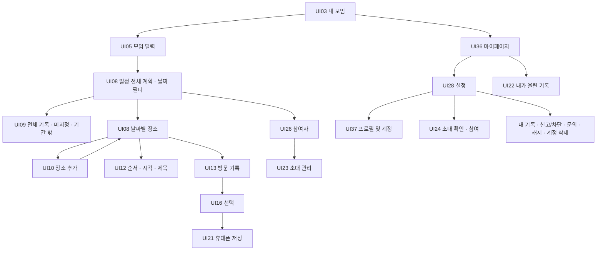

# 2026-10-30 UI 통합 설계

기준: 기능명세 v2.2 / 설계 v0.3.2 / UI `feature/ui-prototype@c19f34c`.

최신 캡처는 **디자인 참고용 데모 실행 화면**이다. 아래 제품 적용 기준과 화면별 계약을 함께 사용한다. 별도 정책 승인이 필요한 버튼은 제품 구현에서 보류한다. API·DB 스키마는 이번 화면 정리로 확장하지 않는다. 판단 배경과 미결 사항은 [10월 30일 회의 안건](../../회의록/10월%2030일%20회의%20안건.md)에 있다.

## 화면별 적용

| 설계 ID / UI 원본 | 반영할 구성과 동작 | 제품 적용 기준 / 안건 |
| --- | --- | --- |
| UI08 / S01·S02 | 전폭 16:9 배너, 일정명·기간·참여자 묶음, 날짜 카드, 날짜 탭·장소 타임라인·빈 상태 | 날짜 카드는 필터 진입. 전체 계획 기본·UI09 전체 기록·미지정·기간 밖 경로 유지. 날짜 탭은 최대4개 가로 스크롤, 하루면 생략. A01·A02 |
| UI06 / 날짜 선택 시트 | 달력 입력 형태 참고 | ‘새 일정 만들기’와 ‘기간 변경’ 구분. 다중 비연속 날짜 생성은 보류. 방장만, 연속 기간 최대366일·월요일 시작·영향 확인·버전 검사. A01 |
| UI25 / 배경 변경 시트 | 사진 선택·미리보기·기본 복원 | 모임 대표 사진에만 적용, 방장만 변경. 일정에서 열면 모든 일정의 모임 배너가 바뀜을 확인. A04 |
| UI10·11 / S03 | 검색·분류·지도·결과·선택 상세, 직접 등록 | 현재 선택 날짜·일정/모임 ID 유지. 추가 성공 후 같은 날짜로 복귀·신규 항목 강조. 예정 시각5분/미정, 하루15개. 카카오 실연동·무료 한도 차단은 별도 검수 |
| UI12 / S05·방문 시간 시트 | 날짜 제목, 순서 이동, 시각 편집, 빈 날짜 제목 편집 | 메모 없음. 저장·버리기·계속 편집, 실패/버전 충돌 시 입력 보존. 시각순 정렬은 명시적 실행 때만. 5분 단위. A06 |
| UI09·13 / S04 | 파일별·사람별 보기 아이콘, 격자, 선택 체크, 선택 수·하단 저장 버튼, 사람별 더보기 | 접근성 이름 ‘시간순/사람별 묶음’. 파일 시각·정렬·보기 기억은 F16 유지. 사람별 더보기는 해당 작성자의 조회된 파일을 선택할 수 있는 화면으로 연결. 영상 포함, 최대120개. A03·A09 |
| UI14·16 / 업로드 시트 | 추가 타일→촬영/앨범 선택→선택 확인 | 기존 통합 선택 화면 사용, 파일별 정보·상태 유지. 데모10개를 적용하지 않고 P11 누적 한도와 120개 선택 상한을 구분. A10 |
| UI18 / 뷰어 | 확대·영상 재생·닫기 | 권한 있는 열람본, 닫을 때 영상 정지·목록 위치 복원. 저장·신고·본인 수정/삭제 연결 유지 |
| UI26 / 함께하는 친구 | 일정에서 참여자 묶음 탭→명단·초대 버튼 | 일정의 상위 모임 참여자. 방장 표시·본인 표시·방장 이전/퇴장·신고/차단·나가기 기존 경로 유지. 일반 참여자도 초대 가능. A07·A11 |
| UI23 / 초대 관리 | UI26의 초대·복사 버튼 연결 | 모든 현재 참여자, 모임 단위 링크·코드·7일·50회·개별 취소. 공유 취소와 초대 취소 구별. 공유/복사 직전 현재 참여·초대 상태 확인 |
| UI36 / 마이페이지(신규 화면 ID) | 기본 프로필·표시명, 모임 수, 닉네임 변경, 설정 톱니바퀴, 고객센터 | 사진 변경 보류, ‘현재 참여 중인 모임’ 서버 총계 사용. 미조회/실패는 0으로 표시하지 않음. 내 기록 바로가기 유지. 공지는 실제 게시 경로 확정 전 숨김. A05·A08·A12 |
| UI37 / 프로필 및 계정(신규 화면 ID) | 표시명 수정, 로그인 방식 조회, 기본 아이콘 | 기존 F02·F01로 연결. 데모 닉네임12자가 아닌 사용자 인식 문자20자·NFC·검사 적용. 사진 변경/복원 보류. 로그인 공급자 예시값 대신 본인의 실제 연결 목록. A05 |
| UI28 / 설정 | 계정·초대코드·위치 설정·문서·로그아웃·탈퇴 구역 | UI22/29/30/31/32/33·문의·동의 내역 유지. 코드 입력→UI24 초대 확인→명시적 참여. ‘준비 중’을 성공으로 표시하지 않음. 약관 항목은 승인된 게시 문서와 대응. A12·A13 |

## 제품 화면 전환

S01만을 의무 첫 화면으로 사용하는 변경은 A02 합의 전 보류한다. 요약 배너·날짜 카드는 UI08에 반영하면서 전체 보기 접근을 유지한다. `roomId`는 이 UI의 일정(`scheduleId`)에 대응하고, 참여·초대는 상위 `groupId`, 방문 기록은 `scheduleId + visitDate + visitId`로 범위를 확인한다. 임의 날짜 ID를 별도 여행방으로 저장하지 않는다.

모든 화면은 서버 응답 후 완료 처리한다. 진행·빈 결과·조회 실패를 구분하고, 복귀 시 날짜·필터·스크롤을 유지한다. 전체 선택은 불러온 선택 가능 파일 중 최대120개이고, 권한 상실·삭제·만료 시 선택/집계를 갱신한다. 사진·영상 파일 외부 공유는 제공하지 않는다.

## 추가 검수 시나리오

| ID | 확인 항목 | 기대 결과 |
| --- | --- | --- |
| U30-01 | 일반 참여자가 일정의 참여자 목록에서 초대 관리 진입 | 발급·조회·복사·공유·다른 참여자의 초대 취소 가능, 역할 변경은 불가 |
| U30-02 | 초대 화면을 연 뒤 퇴장·이용 제한 | 새 조회/쓰기·이전 요청 재시도 거부, 캐시 링크를 새로 공유하는 동작 차단 |
| U30-03 | 날짜에 방문은 없고 미지정 기록만 있음 | 기록 수 유지, 전체/미지정 경로로 열람 가능 |
| U30-04 | 기간 축소로 기존 기록일이 기간 밖이 됨 | 전체/기간 밖에서 조회, 날짜 필터 범위 이탈 안내, 기록 삭제 없음 |
| U30-05 | 기록 보기 전환·상세 복귀·앱 재실행 | F16 정렬키·파일 집합·집계 일치, 보기 방식 기억, 영상 소리 정지 |
| U30-06 | 길게 선택·버튼 선택·사람별 메뉴·121개 전체 선택 | 모두 같은 선택 흐름, 120개 상한·사진/영상 수·파일별 결과·실패 재시도 |
| U30-07 | 사진4개 완료+1개 예약 후 같은 방문에 추가 | 남은 사진0개, 영상은 별도 계산; 예시10개 한도 미사용 |
| U30-08 | 마이페이지·계정 닉네임 수정 성공/실패 | F02 검사·20자 규칙, 동일 소유ID 유지, 서버 성공 전 완료 표시 없음 |
| U30-09 | 설정 초대코드→가입→복귀 | 초대 확인 후 명시적 참여, 실제 상태/정원/기한 재검증 |
| U30-10 | 모임에서 나간 사용자의 설정·내 기록 | 공동 조회 불가, 본인 열람/삭제는 유지, 새 저장 불가 |
| U30-11 | 프로필·모임 수·문의·약관 조회 실패 | 예시 프로필/0개/저장 성공 토스트로 대체하지 않고 오류·재시도 표시 |
| U30-12 | 방장 기간 수정과 일반 참여자의 직접 요청 | 연속366일·5분·버전·고정 기한 유지, 비방장 거부 |

상태: 문서 검증 대상. 위 항목의 실제 앱·API·실기기 검수는 **미실행**이다. 출시 관련 A13 결정 전에는 UI02·UI30의 종전 계약만으로 일반 사용자 출시를 승인하지 않는다.
