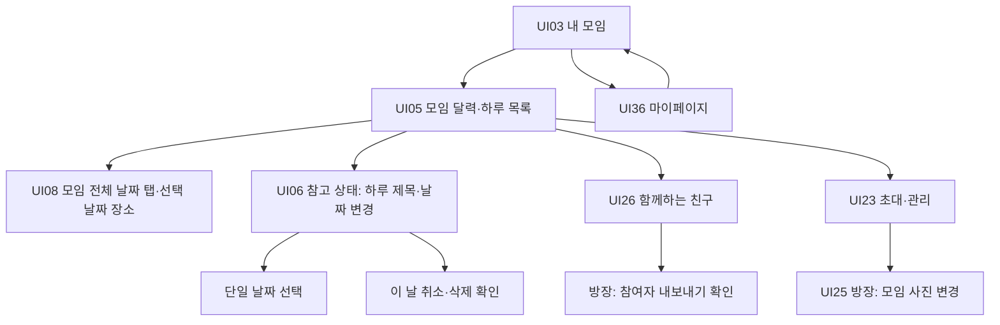

# 2026-11-01 UI 변경 반영

> **2026-11-03 통합 메모:** 이 문서는 `docs` 브랜치에서 작성한 캡처 관찰 기록이다. 이후 [UI 전체 화면 정리 반영](2026-11-01_UI_전체화면정리_반영.md)이 PPTX를 최우선 기준으로 정했으므로 아래 N01~N05와 "제품 계약 유지" 판단은 그 문서의 P1(N01)·P2(N02)·P11(N03)·P9(N04)·P10(N05)으로 대체한다. 회의 안건의 N01~N12(미설계 앱 화면)와는 다른 번호다. 여기서 만든 `870be87` 실행 캡처는 설계서에 그대로 쓴다.

최신 화면 기준은 `feature/ui-prototype@870be871c97e8687a2ae7592fcbc48f59875e148`이다. UI 변경은 `55e2b06`, 담당자의 전체 화면 설명 PPT 추가는 `870be87`에 들어 있다. `feature/ui-prototype_es`는 `a67ee60`에 머물러 있어 최신 기준으로 사용하지 않았다.

이 문서는 [10월 30일 통합 설계](2026-10-30_UI_통합_설계.md)의 **화면 관찰·전환 설명을 보완**한다. 제품 정책은 커밋된 `docs`의 기능명세 v2.2·시스템/API/DB 설계 v0.3.2를 유지한다. 작업 중인 다른 브랜치의 미커밋 v2.3 변경은 포함하지 않았다. 아래 미결 사항을 확정한 것으로 간주해 API나 DB를 변경하지 않는다.

## 확인한 원본

- [최신 UI 브랜치](https://github.com/eunssong2/reelspot/tree/870be871c97e8687a2ae7592fcbc48f59875e148)
- [전체 화면 정리 PPT, 22장](https://github.com/eunssong2/reelspot/blob/870be871c97e8687a2ae7592fcbc48f59875e148/docs/AT_THAT_PLACE_전체화면정리.pptx): 로그인부터 설정까지, 하루 일정 정책과 미연결 기능을 확인했다.
- `src/prototype/screens/`, `state/GroupsProvider.tsx`, `state/PrototypeProvider.tsx`, `utils/dayEntries.ts`, 관련 라우트: PPT와 실제 동작을 대조했다.
- [캡처 출처](프로토타입/출처.json): 원본 커밋, 파일 SHA256, 화면 실행 경로·문구·캡처 SHA256. 모든 캡처는 같은 커밋에서 다시 생성했다.

## 화면별 수정

| 설계 화면 | 최신 UI에서 확인한 변경 | 설계서 반영 및 제품 적용 조건 |
| --- | --- | --- |
| UI01·02 시작/가입 | 카카오·Google 예시 로그인, 가입 동의·표시명 | UI 담당 원본 화면을 추가. 실제 OAuth와 게시 약관 검수 아님. F01의 카카오 우선·Google 후속 및 A13 가입 정합성 검토 유지 |
| UI03 내 모임 | 하단 마이페이지 탭 연결, 모임 대표 사진 카드 | 카드·하단 탐색 캡처 갱신. 내 기록은 실제 제품 경로 유지 |
| UI04 모임 생성 | 모임명·첫 일정·연속 기간 시트 | 새 캡처 추가. 원자 생성·요청키 재사용·결과 불명 복구는 서버 계약 유지 |
| UI05 모임 달력 | 여러 날 일정을 날짜별 한 줄로 분해, 날짜 제목 또는 ‘N일차 · 일정 이름’; 목록도 하루 단위 | 달력·목록·⋯ 메뉴 캡처 추가. 하루 하나 제한은 N01, 실제 표시와 조회의 ID 범위는 N03 참조 |
| UI06 일정 추가/변경 | 생성은 시작~종료 기간, 달력 ⋯의 변경은 하루 제목100자·날짜 하나·취소·삭제 | `SCHEDULE-EDIT`는 기존 기간 편집 참고 화면으로 보존. `DAY-EDIT`·`DAY-DATE`·`DAY-CANCEL`을 별도 상태로 제공. 제품 일정 전체 변경을 하루 편집으로 자동 대체하지 않음(N02) |
| UI08 날짜별 장소 | 달력 카드→요약 생략→그날 장소. 모임 이름과 모든 활성 일정의 날짜 탭, 취소 날짜 제외, 웹 드래그 지원 | `GROUP-DAYS` 추가. `groupId + itineraryId + dayId` 조합 유지. 기존 일정 단위 전체 계획·전체 기록·미지정·기간 밖 조회 경로 유지(N03) |
| UI23·25 초대/모임 사진 | 초대 화면 위에 방장 전용 모임 사진 변경, 4:3 사진 선택, 내 모임 카드와 상태 공유 | 초대 캡처·화면 전환에 UI25 진입점 명시. 모임 대표 사진의 제품 16:9·검사·서버 반영 조건과 구분(N04) |
| UI26 참여자 | 달력 상단 인원→명단, 방장/나 표시, 방장만 다른 참여자 ⋯→내보내기 확인 | 방장·일반 참여자·확인·로컬 결과 캡처 추가. 사진 내보내기가 아닌 **모임 참여자 강제 퇴장**. 실제 회원 ID·권한·재참여 차단은 F22 유지(N05) |
| UI36 마이페이지 | 참여한 모임 카드→내 모임, 모임 수에 `groups.length` 사용 | 복귀 전환 추가. 0개일 때 예시 모임 수로 대체하는 동작은 제품에서 제외. 현재 참여 총계·조회 실패·0개를 구분 |

## 최신 브랜치 화면 전환

이 그림은 최신 프로토타입 전환이다. 기존 제품 전환은 `제품 화면전환.json`에 유지하고 Excel에서 두 범위를 구분한다. 일정 요약의 S01→S02 경로도 데모에 남아 있다. 참여자 화면의 카카오톡 초대/링크 복사 버튼은 여전히 안내만 보여 주므로 실제 예시 공유는 UI23을 이용한다.

## 제품 정책과 추가 결정 사항

| ID | 원본에서 관찰한 동작 | 유지할 계약 / 결정에 필요한 내용 |
| --- | --- | --- |
| N01 날짜 중복 | 생성·기간 변경·하루 이동에서 같은 모임 날짜 중복 거부 (`DATE_TAKEN`). 담당 PPT도 ‘하루에 일정 하나’로 설명 | F07은 겹침 안내 후 허용, UI05는 같은 날 3개+N. 중복 금지 채택 여부와 기존 겹친 일정 처리 결정 전 기존 계약 유지 |
| N02 하루 변경·취소·삭제 | `dayId` 제목100자/날짜 변경, 하루 취소, 장소 없는 날 삭제. 날짜 이동 후 일차와 부모 기간 재계산 | F08/F11의 일정 전체 단위와 F10 날짜 제목30자에 충돌. 기록의 원래 날짜·기간 밖 조회·보관 기한·마지막 날짜 삭제·진행 업로드·버전 검사를 함께 결정. 기존 API를 새 하루 작업에 임의 매핑하지 않음 |
| N03 모임 전체 날짜 탐색 | 달력에서 S01 생략, 모임의 활성 일정 날짜를 합쳐 탭 표시. 취소 날짜 제외 | 제품은 전체 계획 기본 및 전체/미지정/기간 밖 기록 접근 유지. 다른 일정으로 탭 이동할 때 방문·기록·권한 범위도 변경. 취소된 카드가 다른 활성 날짜로 대체되지 않도록 별도 조회 경로 필요 |
| N04 모임 대표 사진 | 초대 화면의 방장 버튼, 4:3 선택·로컬 URI 저장, 새로고침 시 예시 모임 사진으로 복귀 | UI25는 모임 단위 16:9·긴 변1600px/5MB·위치 태그 제거·검사 후 반영. 비율 확정 전 제품 16:9 유지. 실패/취소 시 이전 사진 유지, 서버 완료 후 성공 처리. 프로필 사진은 A05 유지 |
| N05 내보내기·재참여 | 이름으로 대상을 구분해 로컬 명단/차단 배열 변경, ‘같은 초대로 다시 참여 불가’ 안내 | F22는 회원 식별자와 모임 단위 차단. 다른 초대 코드로도 재참여 제한. 이름 중복·권한 상실·서버 실패·기존 기록의 권리를 함께 검증. 초대 공유 권한은 모든 현재 참여자로 유지 |

신규 하루 편집 라우트는 `groupId`와 `scheduleId` 소속 일치 검사, mock 변경 함수의 현재 방장 권한/버전 재검증을 제품 구현에서 보완해야 한다. 제목만 바꿀 때와 날짜 이동 때의 미디어 귀속·기간 갱신도 같은 변경으로 취급하지 않는다. 프로토타입에서 버튼이 보이거나 로컬 성공 안내가 뜬 것은 서버 계약 검증 근거가 아니다.

## 추가 제품 검수 계획

| ID | 확인 항목 | 기대 결과 |
| --- | --- | --- |
| U31-01 | 3일 일정의 달력·목록·날짜 제목 | 각 날짜 한 줄, 제목 없으면 일차 기본값, 취소 표시. 중복 날짜 정책은 N01 결정값으로 일치 |
| U31-02 | 하루 편집 진입·취소·재진입·미저장 뒤로가기 | 선택한 일정/날짜 유지, 취소 미반영·입력 보존·이탈 확인 |
| U31-03 | 다른 모임 일정 ID·비방장 직접 진입/변경 | 소속과 현재 역할을 서버에서 확인해 조회/변경 거부 |
| U31-04 | 하루 날짜 이동·취소·삭제 및 마지막 날 삭제 | N02 결정 전 제품 노출 보류. 결정 후 기록 귀속·보관 기한·기간 밖 접근·진행 작업·버전 검증 |
| U31-05 | 모임의 다른 일정 날짜 탭 선택→장소/기록 진입 | 선택한 일정 ID와 날짜·방문 ID 전달. 취소/미지정/기간 밖 기록의 기존 조회 경로 유지 |
| U31-06 | 일반 참여자/방장·같은 이름의 서로 다른 참여자 내보내기 | 방장만 회원ID로 요청, 확인 취소는 무변경, 다른 초대에서도 모임 단위 재참여 차단 |
| U31-07 | 모임 사진 선택 취소·실패·성공·앱 재실행 | 취소/실패는 이전 사진, 검사·서버 성공 후 카드/배너 갱신, 재실행에도 유지 |
| U31-08 | 마이페이지 총계0개·목록 일부 조회·실패→내 모임 | 서버 총계와 상태 구분, 예시 숫자 대체 금지, 카드에서 실제 내 모임으로 복귀 |
| U31-09 | 로그인 복원·가입·보류 초대·동의 문서 열람 | 인증만으로 참여 완료 금지. 확정 게시 문서·권한·정원·초대 기한은 서버 계약 검증 |
| U31-10 | 하루 편집 제목100자와 기존 날짜 제목30자 | N02에서 길이와 저장 필드를 확정하기 전 같은 필드로 임의 통합하지 않음 |

상태: 위 표는 실제 제품·API·실기기 검수 **미실행**이다. 웹 프로토타입의 화면 캡처와 명시된 예시 전환만 확인했다. 다운로드·업로드·OAuth·모임 사진 서버 저장·외부 공유 완료를 검증한 것은 아니다.

## 산출물 검증 결과

2026-11-01 검증: 동일 UI 커밋의 캡처47개를 제품 화면19개와 관련 상태28개에 대응했다. 제품 화면 총35개 중 나머지16개는 기존 명세 도형이다. PDF64쪽, PPTX67장, Excel 화면 명세, HTML 갤러리, SVG/PNG 및 전체 미리보기를 재생성했다.

- `render_artifacts.py --ui`: 화면 미리보기35개, SVG 화면 밖 텍스트0건.
- `verify_standalone.py`: 원본 브랜치·상위 문서 없는 복사본 재생성 등5개 검사 통과.
- `validate_artifacts.py`:45개 검사 통과. 캡처 해시, PPTX 전체 캡처 포함·도형 경계, PDF 페이지 수·순서, Excel 열기, HTML 링크/이미지 확인.
- PDF의 적용 기준·하루 편집 페이지와 실제 모임 날짜 탭·내보내기 확인 캡처를 시각 확인했다. 웹 원본의 모바일 화면을 보존했다.

증거는 `UI/화면 반영.json`, `부록/독립 패키지 검증.json`, `부록/산출물 검증.json`, `부록/파일 목록 SHA256.json`에 있다. 기존 API/DB 파일과 실제 앱 코드는 이번 커밋에서 변경하지 않았다.
