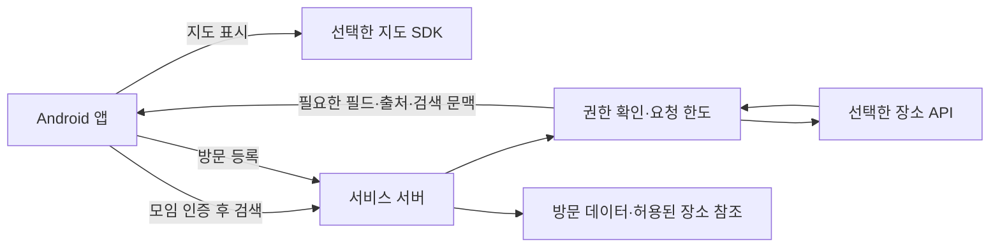

# 지도 API 연동 설계안

2026-10-30 · 검토안 v0.1 · 기준: 기능명세 v2.1 / 설계 v0.3.1 · 실제 구현·API 호출 미실행

[공급자 비교와 요금 근거](../../기능%20명세서/참고%20자료/지도_API_조사와_선택안.md)를 바탕으로 만든 적용안이다. 현재 제품 계약은 카카오맵이다. 이 문서는 Google 전환 또는 무료 한도 운영을 선택했을 때 변경할 위치와 조건을 제시하며, 기존 OpenAPI·DDL을 이미 변경했다는 뜻이 아니다.

## 1. 요청 흐름



지도 SDK의 타일·기기 관련 통신은 앱에서 공급자로 직접 발생할 수 있다. 모든 정보가 개인 PC만 거친다고 안내하지 않는다. 서버는 회원·모임 접근 권한, 검색어·좌표 범위·요청 크기를 검증하고 필요한 검색어·영역만 외부로 전달한다. 계정 식별자·모임명·사진·초대 토큰을 지도 API에 보내지 않는다.

## 2. 기존 계약에서 확인한 변경 지점

| 원천 | 현재 내용 | 공급자 선택 후 적용 |
| --- | --- | --- |
| 기능명세 F09 | 국내 카카오맵, 지도 영역 재검색·분류·정렬·직접 등록 | 선택 공급자와 검색 의미, 한도 소진 시 직접 등록 경로 확정 |
| `도구/api_contract.py` | `placesSearch`의 provider가 kakao로 고정, 응답에 이름·주소·좌표 | Google이면 enum 변경, 누락 필드 처리·출처·페이지·상태·보관 가능성 계약 추가 |
| `도구/physical_model.py` | places.provider가 kakao/manual, 이름 필수·좌표 컬럼 보관 | 공급자 참조와 표시용 일시 데이터 분리, 캐시 만료와 재조회 모델 설계 |
| `도구/data_model.py` | 모임별 장소 원장·공급자 ID·수기 fingerprint | Google ID 및 사용자 직접 입력의 출처 구분, 중복 키에 공급자 포함 |
| `도구/design_model.py` | `GET /places`, query 필수, UI10 카카오 설명 | 카테고리만 검색할 때 query 필요 여부·오류·검수 시나리오 확정 |
| `도구/document_content.py`·`build_design.py` | 시스템·연동 준비 항목에 카카오 명시 | 확정 공급자·계정·키·요금·표시·보관 조건 동기화 |
| `기준/기능명세서.md`·`기준/기준선.json` | 원본 사본과 해시 | 기능명세 변경 시 사본·해시·추적 갱신 후 생성·검증 |

기존 장소 ID를 Google ID로 간주하거나 이름만으로 서로 다른 공급자의 장소를 자동 병합하지 않는다. 기존 장소가 있다면 원래 공급자 참조를 보존하고 새 선택·전환 절차를 마련한다. 지도 표시 정책이 허용하지 않는 공급자 혼합은 자동 장애 대체로 사용하지 않는다.

## 3. 카카오 유지안 — 월 0원 운영 기준

사용자가 월 0원 우선과 무료 한도 소진 시 검색 중단을 선택했다. 아래는 그 결정을 반영한 구현 기준이며 콘솔 설정·앱 구현 완료는 아니다.

| 상황 | 처리 |
| --- | --- |
| 무료 쿼터 적용 앱·유료 추가 사용 OFF 확인 | 해당 앱의 무료 범위에서 검색 제공 |
| 무료 쿼터 자격 미확인 또는 없음 | 운영 연동 시작 보류. 비용 방침을 임의로 바꾸거나 두 번째 앱의 유료 사용을 켜지 않음 |
| 일간/월간 잔여량 임계치·429 | 외부 검색 중단, 재시도 폭주 방지, 공급자의 실제 한도 초기화 확인 후 재개 |
| 외부 검색·지도 중단 | 좌표 없는 이름·주소 직접 등록 유지. 기존 자체 방문 데이터는 열람 가능 |
| Google 등 대체 공급자 | 유료 API로 자동 전환하지 않음. 다른 지도에 기존 공급자 결과를 무단 혼합하지 않음 |

카카오 콘솔의 무료 쿼터 배지·유료 설정·다른 API의 월간 소모량을 증거로 확인한다. 서버측 검색 집계만으로 SDK·다른 API를 포함한 전체 사용량을 안다고 가정하지 않는다. 일/월 제한은 실제 무료 쿼터와 여유분을 반영하고 공급자 초기화 시각을 확인해 설정한다. 무료 한도 초과를 우회하려고 계정·앱을 순환하지 않는다.

- 무료 쿼터 적용 앱을 확인한 뒤 플랫폼 키와 서버용 REST 키를 구분한다. 유료 추가 사용은 비용 방침을 정한 후 설정한다.
- 키워드 검색에 query, 지도 중심 x/y, rect, 관련도/거리 정렬을 연결한다. 카테고리는 관광지 AT4, 음식점 FD6, 카페 CE7, 숙박 AD5에 대응하는 안을 실제 결과로 검증한다. ‘맛집’은 평점 보증이 아니다.
- 검색 당시 지도 중심을 저장한 응답 문맥으로 반환하고, 변경된 검색보다 늦게 도착한 응답을 버린다. 외부 키와 공급자 응답 전문은 로그에 남기지 않는다.
- 무료 쿼터 소진·공급자 장애 때 빈 검색 결과로 위장하지 않는다. 검색 재시도 가능 여부를 알리고 좌표 없는 직접 등록을 제공한다. 지도 자체도 한도·장애 영향을 받을 수 있으므로 핀 지정만 대안으로 제시하지 않는다.
- 장소 저장은 현행 보관 조건을 확인한 필드만 사용한다. 확인 없이 영구 캐시를 구현하지 않는다.

근거: [카카오맵 설정·쿼터](https://developers.kakao.com/docs/ko/kakaomap/common), [장소 검색 파라미터·분류](https://developers.kakao.com/docs/ko/local/dev-guide).

## 4. Google 전환안

### 준비와 최소 요청

Google Cloud 프로젝트에 결제와 필요한 Maps SDK for Android·Places API (New)를 설정한다. 앱용 키는 Android 패키지·서명 인증서와 허용 API로 제한하고 서버용 키와 분리한다. 서버 키를 앱·웹 번들·Git에 포함하지 않는다. 개인 서버의 외부 IP 변경도 키 제한과 연결 운영에서 검토한다. [SDK 준비](https://developers.google.com/maps/documentation/android-sdk/usage-and-billing), [키 보안](https://developers.google.com/maps/api-security-best-practices)

서버에서 `POST https://places.googleapis.com/v1/places:searchText`를 사용한다. 다음은 실행하지 않은 요청 형태 예시다.

```json
{
  "textQuery": "서울시청 근처 카페",
  "languageCode": "ko",
  "regionCode": "KR",
  "pageSize": 10,
  "locationRestriction": {
    "rectangle": {
      "low": {"latitude": 37.55, "longitude": 126.96},
      "high": {"latitude": 37.58, "longitude": 127.00}
    }
  }
}
```

필드 마스크 후보는 `places.id,places.displayName,places.formattedAddress,places.location,places.types,places.attributions,nextPageToken`이다. 필요한 이름·주소·좌표 때문에 Text Search Pro 수준의 과금이 발생한다. wildcard는 사용하지 않는다. 검색 필드와 문맥은 [Text Search 공식 문서](https://developers.google.com/maps/documentation/places/web-service/text-search)에 따라 확정한다.

`regionCode`는 대한민국 검색 결과만 보장하는 필터로 취급하지 않는다. 영역 제한과 편향을 구분하고 주소 질의·분류 질의에서 영역/정렬 파라미터의 적용 여부를 검증한다. 거리 표시는 검색 당시 지도 중심 기준 직선거리로 정의하고, 공급자가 반환한 제한된 후보의 거리순이 전체 장소의 완전한 거리순이라고 안내하지 않는다.

### 결과·저장 모델

- 검색 응답에는 공급자와 ID, 표시 가능한 필드, 출처, 현재 검색 문맥을 포함한다. 페이징을 도입하면 페이지 토큰을 원래 질의·영역·사용자 권한과 연결한다.
- 이름·주소·좌표 누락을 기존 필수 스키마에 빈 문자열/0 좌표로 끼워 넣지 않는다. 선택 불가 또는 좌표 없는 상태를 계약으로 정의한다.
- 장기 보관은 허용된 공급자 ID와 사용자가 만든 방문일·예정 시각 등 자체 데이터 중심으로 나눈다. 공급자 표시 정보는 필요 시 조회하고, 허용한 임시 캐시만 별도 저장소에서 만료·파기한다. 백업·로그에도 같은 제한을 적용한다.
- 현재 `places.name NOT NULL` 등 구조는 ID만 남는 상태를 표현하지 못하므로 단순 provider enum 추가로 전환 완료 처리하지 않는다. 조회 실패 시 ‘장소 정보를 불러올 수 없음’ 상태로 자체 방문 데이터는 유지한다.
- Google 위·경도의 캐시 최대 30일 조건을 사진 보관 3개월과 혼합하지 않는다. 이름·주소 등에도 같은 30일을 임의 적용하지 않는다. 표시 필드별 허용 범위를 확인해야 한다.
- 공급자 결과를 사용자가 선택하거나 이름을 조금 수정했다는 이유만으로 모두 ‘직접 입력’으로 바꾸지 않는다. 독립 입력과 공급자 유래 필드의 출처를 보존한다.
- place ID의 변경·폐업·재조회 실패를 처리하고 공식 권장 갱신 방식으로 관리한다. 공급자 정보가 사라졌다는 이유로 이용자의 방문 기록·사진을 연쇄 삭제하지 않는다.

근거: [Places 보관·표시 정책](https://developers.google.com/maps/documentation/places/web-service/policies), [서비스별 약관 제14항](https://cloud.google.com/maps-platform/terms/maps-service-terms), [Place ID 관리](https://developers.google.com/maps/documentation/places/web-service/place-id).

### 비용 제어

서버가 호출 전에 사용자별·전체 요청 한도를 검사하고 동시 요청도 원자적으로 집계한다. 비용 집계는 SDK 지도 표시와 Places 검색·상세 등 SKU를 나눈다. 페이지 조회·재시도도 한도를 소비하며 타임아웃 뒤 무한 재시도하지 않는다. 공급자 쿼터·서버 한도·예산 경보를 함께 두고 중단 시 직접 등록으로 이어진다. 현재 월 0원 방침에서는 이 Google 전환안을 활성화하지 않는다. 향후 변경 시에도 예상 사용량·일/월 한도 숫자는 실제 계정과 SKU 확인 후 정한다. 예산 알림만으로 지출이 차단되지는 않는다. [비용 관리](https://developers.google.com/maps/billing-and-pricing/manage-costs)

## 5. 개인정보와 약관 연결

현재 위치는 명세대로 버튼 선택 때만 요청한다. 검색어·지도 영역·IP·SDK 식별 정보 등 실제 전송 항목과 수신자·국가·기간을 네트워크와 공급자 문서로 확인한다. Google을 선택하면 공개 약관·처리방침의 공급자 요구도 반영하고, 국외 처리의 법적 근거·필요 절차는 [약관 06번](../../약관/06_국외이전_동의문과_위탁_공개표.md)에 연결한다. 서버에 위치를 저장하지 않는다는 이유로 위치정보 검토를 생략하지 않는다.

OpenFreeMap도 앱이 외부 타일 서버와 통신하므로 무료·무키라는 이유로 외부 전송이 없다고 처리하지 않는다.

## 6. 선택 후 검수

- [ ] 동일 국내 장소·주소·카테고리 사례의 검색 품질과 지도 마커 일치 확인.
- [ ] 관련도/거리, 지도 영역 재검색, 늦은 응답 폐기, 한글·좌표 순서 확인.
- [ ] 현재 위치 거부·실패에도 검색·좌표 없는 직접 등록 가능.
- [ ] 모임 밖 검색 요청·잘못된 좌표·과도한 길이·동시 호출 제한.
- [ ] 한도 소진/429·인증 오류·타임아웃·빈 결과를 구분하고 재시도 폭주 방지.
- [ ] 공급자 ID 기반 중복 방지와 동일 일정·방문일의 기존 중복 규칙 유지.
- [ ] Google 선택 시 출처 표시, 지도 조합, 필드별 저장·만료·백업·조회 실패 검증.
- [ ] 실제 공급자 콘솔의 호출량과 서버 측 집계 대조. 카카오 무료 쿼터 배지·유료 추가 사용 OFF 확인.
- [ ] 일간/월간 한도 중단과 초기화 후 재개, 지도까지 실패했을 때 좌표 없는 직접 등록을 검증.
- [ ] 기능명세·API·DB 원천과 생성 산출물 동기화. `도구/사용법.txt`의 관련 검증 실행.

이번 작업에서는 위 검수를 수행하지 않았다. 현재 결과물은 공급자 결정을 위한 구체적인 설계안이다.
