# At that place 앱 사용 설명서

작성·검증: 2026-10-30 · Android 15(API 35) · 1차 개발 앱

Android 15 에뮬레이터에서 실제 앱을 조작해 작성한 사용 설명서입니다. 화면의 이름·모임·초대·문의는 모두 테스트 데이터이며, 촬영물은 가상 카메라의 시험 화면입니다.

> 현재 공개 서버의 앱 경로는 503 준비 중입니다. 아래 성공 화면은 별도 HTTPS 테스트 서버와 개발용 계정으로 확인했습니다. 실제 카카오 로그인 완료·앱 복귀는 아직 검증하지 않았고 Google 로그인은 보류 중입니다. 개발용 로그인·예시 약관·localhost 초대 주소는 일반 사용자용으로 사용하면 안 됩니다.

[PDF 설명서](앱_사용설명서.pdf) · [스크린샷 포함 HTML 열기](앱_사용설명서.html) · [검증 범위와 결과](검증결과.md)

## 빠르게 따라 하기

로그인 → 가입 동의 → 모임과 첫 일정 만들기 → 친구 초대 → 날짜별 장소 계획 → 사진·영상 올리기 → 기록 확인·휴대폰 저장

## 1. 처음 시작하기

1. 앱을 열고 ‘카카오로 시작하기’를 누릅니다. 카카오 인증을 마치면 앱으로 돌아옵니다.
2. 처음 가입한다면 표시명을 입력하고 서비스 이용약관을 열어 확인한 뒤 동의 스위치를 켭니다.
3. 개인정보 처리방침은 열람하는 안내 항목입니다. 별도 동의 체크는 없습니다. ‘동의하고 시작하기’를 눌러 완료합니다.

> 카카오 인증 완료와 앱 복귀는 아직 검증하지 못했습니다. 아래 가입 화면은 개발용 테스트 로그인으로 진입했습니다. Google 로그인은 보류 중입니다.

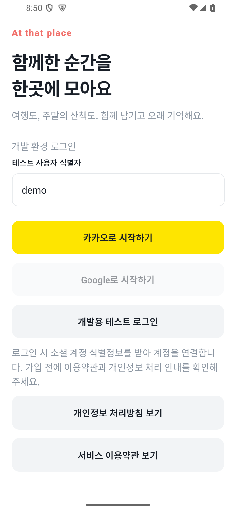

테스트 로그인 화면. 일반 이용자는 개발용 로그인 항목을 사용하지 않습니다.

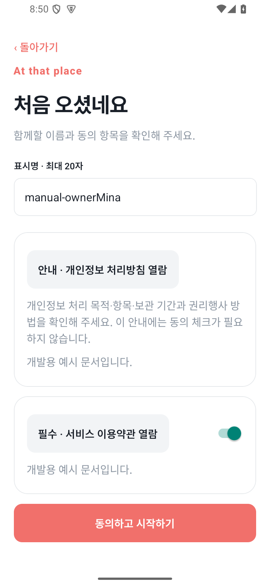

이용약관 동의 1개와 개인정보 처리방침 안내를 확인합니다.

## 2. 모임과 첫 일정 만들기

1. 홈에서 ‘새 모임 만들기’를 누릅니다.
2. 모임 이름, 첫 일정 제목, 시작 날짜와 종료 날짜를 입력합니다. 날짜 형식은 YYYY-MM-DD입니다.
3. ‘모임과 첫 일정 만들기’를 누르면 모임 달력이 열립니다. 날짜를 누르거나 ‘목록’으로 전환해 일정을 엽니다.

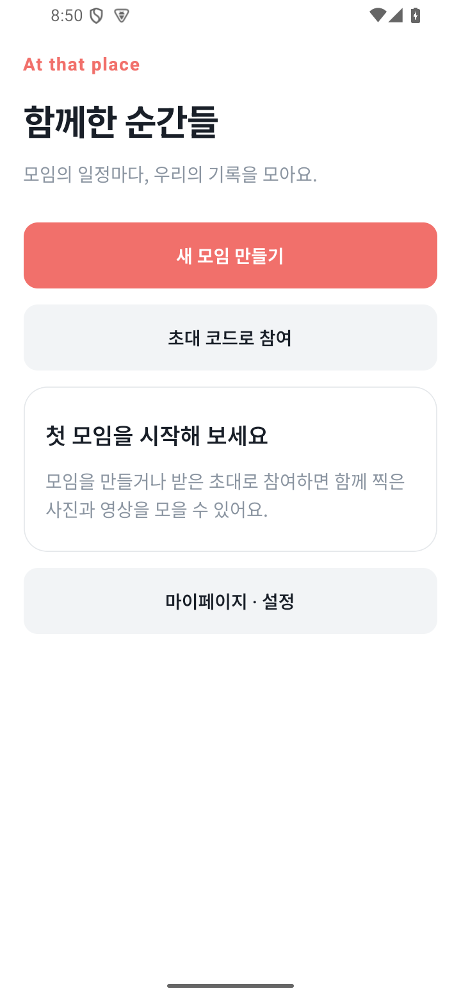

아직 참여한 모임이 없는 홈

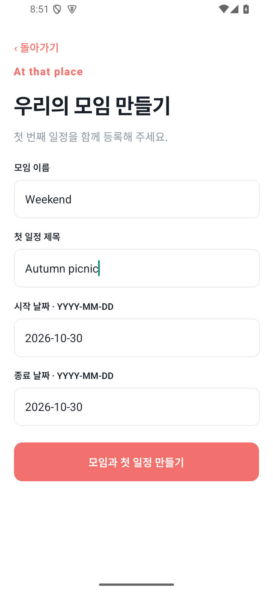

모임과 첫 일정을 함께 입력

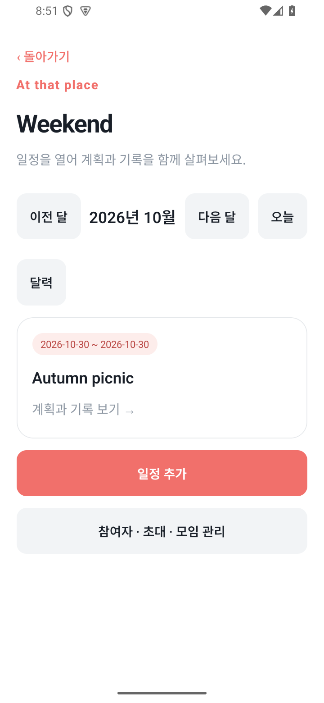

달력 대신 목록으로 일정 열기

## 3. 친구 초대와 참여

1. 모임에서 ‘참여자 · 초대 · 모임 관리’를 누릅니다.
2. ‘새 초대 발급’을 누른 뒤 ‘초대 링크·코드 복사’ 또는 ‘초대 공유’를 선택합니다.
3. 초대받은 사람은 홈의 ‘초대 코드로 참여’에서 코드를 입력하고 ‘초대 확인’ → ‘참여하기’를 누릅니다.

> 초대 관리는 방장뿐 아니라 모든 참여자가 할 수 있습니다. 모임 정원은 10명이며, 초대는 발급 후 7일·확인 50회까지 유효합니다. 새 초대를 발급해도 이전 초대는 유지됩니다. 공유 화면을 연 뒤 전송은 취소해 외부 사람에게 보내지 않았습니다.

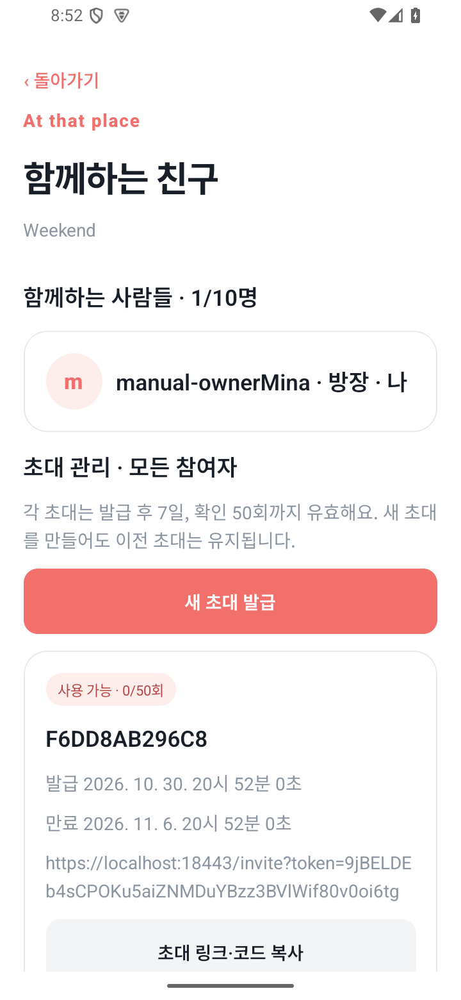

모임의 초대 발급 메뉴

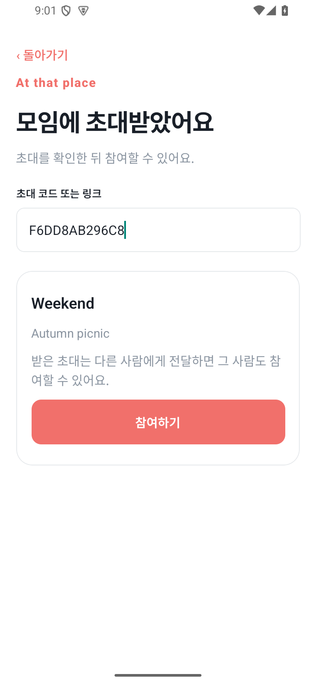

받은 코드를 확인한 뒤 참여

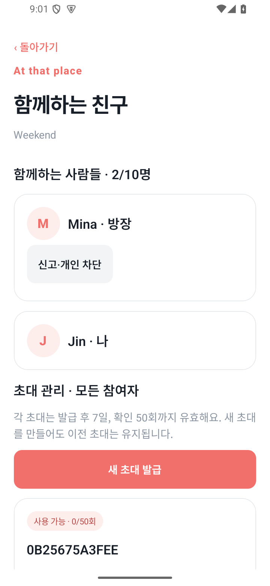

방장이 아닌 Jin도 새 초대를 발급했습니다.

## 4. 날짜별 장소 계획 만들기

1. 일정을 열어 ‘장소 계획’에서 원하는 날짜를 선택합니다.
2. 날짜별 계획을 편집하거나 장소 추가를 누릅니다.
3. ‘직접 등록’에서 장소 이름과 방문 날짜를 입력합니다. 주소·좌표·예정 시각은 선택 항목입니다.
4. 시각을 입력한다면 10:05처럼 5분 단위로 작성한 뒤 ‘이 날짜에 장소 추가’를 누릅니다.

> 카카오 지도 표시와 장소 직접 등록을 확인했습니다. 이번 검증에서는 장소 검색 결과 선택, 현재 위치 권한과 정확도를 따로 확인하지 않았습니다.

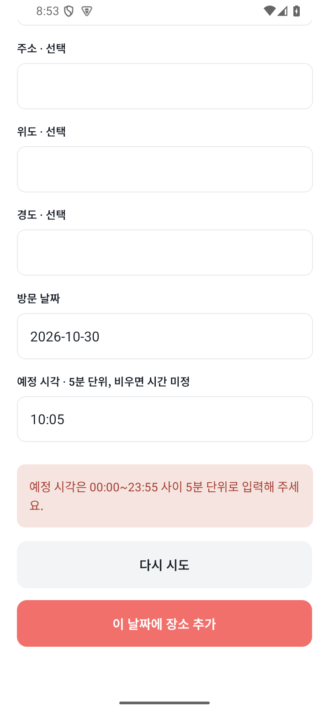

직접 등록: 장소 이름·날짜·예정 시각 확인

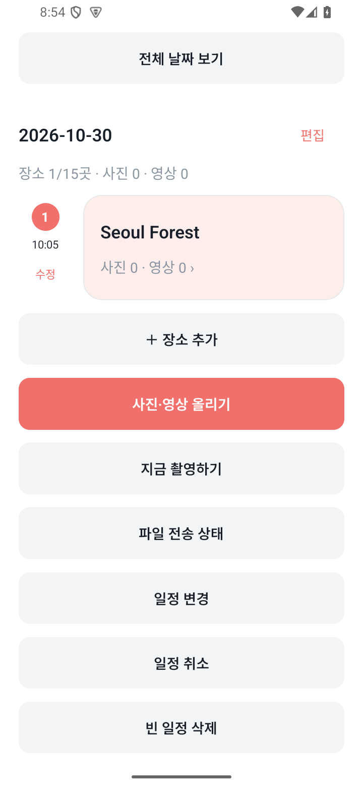

10:05 방문 장소가 계획에 추가됐습니다.

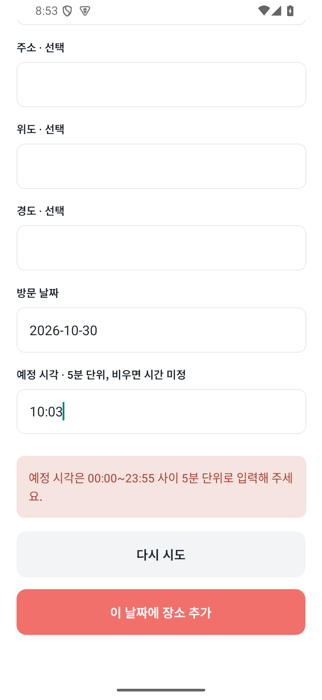

5분 단위가 아닌 시각은 저장 전에 안내합니다.

## 5. 사진·영상 올리기

1. 일정에서 ‘사진·영상 올리기’ → ‘휴대폰에서 파일 선택’을 누르거나 ‘지금 촬영하기’로 촬영합니다.
2. 촬영 결과에서 ‘이 파일 사용’을 누르면 업로드 후보로 추가됩니다. 이 단계만으로 서버에 게시되지 않습니다.
3. 후보 파일의 기록일·장소·설명을 확인하고 화면 아래의 ‘확인하고 전송 시작’을 누릅니다.
4. ‘파일 전송 상태’에서 완료·실패·검토 상태를 확인합니다.

> 한 번에 최대 120개를 선택할 수 있지만 작성자별 장소당 누적 사진 5개·영상 2개 제한이 따로 적용됩니다. 장소 미지정 파일은 같은 일정·기록일 기준입니다. 테스트 환경의 자동 처리 통과는 실제 운영 심사를 검증한 결과가 아닙니다.

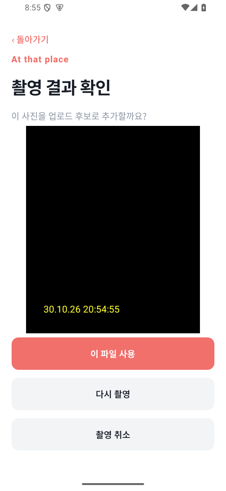

촬영 후 이 파일 사용 또는 다시 촬영

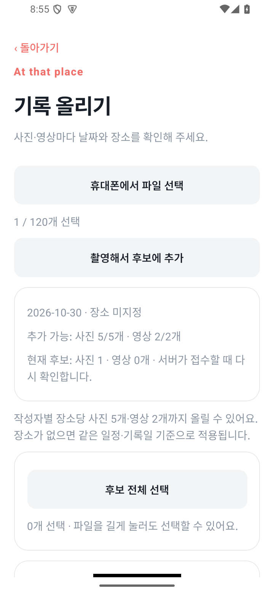

전송 전 기록일·장소·남은 개수 확인

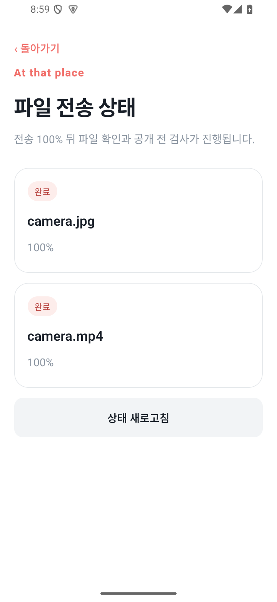

사진과 영상 모두 완료 상태 확인

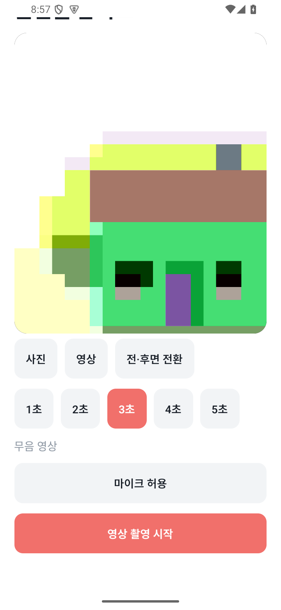

영상은 길이를 선택해 촬영합니다. 이 검증은 3초 무음입니다.

## 6. 기록 보기와 휴대폰 저장

1. 일정에서 ‘전체·장소별 기록’을 엽니다. 시간순·사람별 묶음과 오래된 순·최신순을 바꿀 수 있습니다.
2. 날짜·장소 미지정·기간 밖 기록 필터를 사용하거나 ‘전체 기록 보기’로 돌아옵니다.
3. 사진이나 영상을 눌러 상세 화면을 열고 ‘휴대폰에 저장’ → ‘선택 기록 저장’을 누릅니다.
4. 사진은 Pictures/At that place, 영상은 Movies/At that place에서 확인합니다.

> 촬영 날짜가 유지되어 앨범 맨 위에 보이지 않을 수 있습니다. 중요한 기록은 화면에 표시된 보관 기한 전에 저장해 두세요. 본인 기록은 ‘본인 기록 수정·삭제’에서 관리합니다.

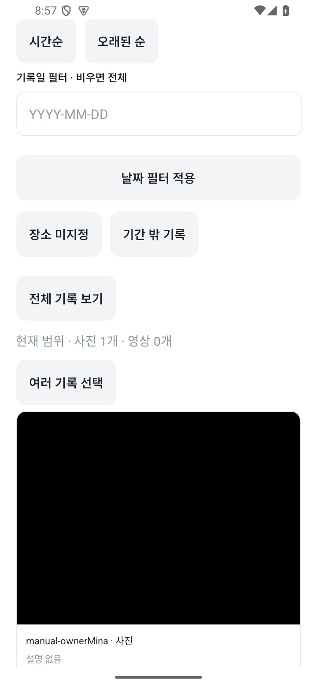

전체·장소별 기록의 필터와 정렬

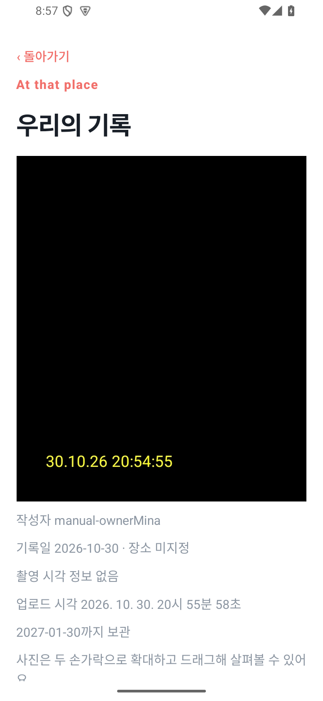

사진 상세 화면. 에뮬레이터 가상 촬영물입니다.

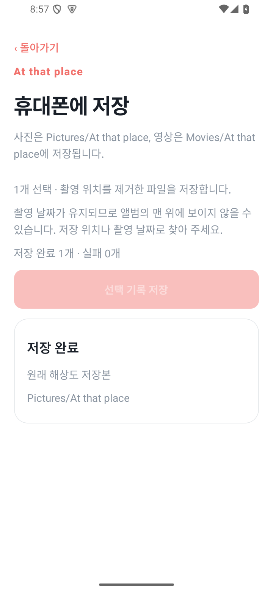

사진의 앨범 저장 완료

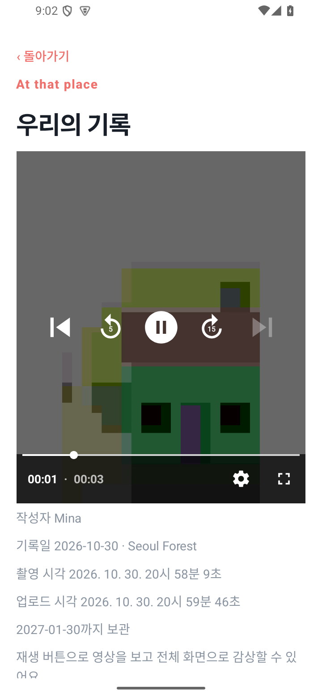

다른 참여자가 올린 영상 재생 중

영상도 휴대폰 앨범에 저장

## 7. 내 계정과 고객센터

1. 홈의 ‘마이페이지 · 설정’에서 참여 모임 수와 내가 올린 기록을 확인합니다.
2. ‘닉네임 변경 · 계정’에서 이름을 변경하고 저장합니다.
3. 설정에서 약관·개인정보·동의 내역, 저장 공간, 미완료 업로드, 개인 차단을 확인합니다.
4. ‘문의하기’에서 유형과 내용을 입력해 접수합니다. 결과는 ‘알림 · 신고·문의 결과’에서 확인합니다.

> 계정 삭제·모임 종료·퇴장은 되돌리기 어려운 작업입니다. 해당 화면에서 영향을 확인한 뒤 실행하세요. 실제 계정 삭제와 카카오 연결 해제는 이번 설명서 촬영 과정에서 실행하지 않았습니다.

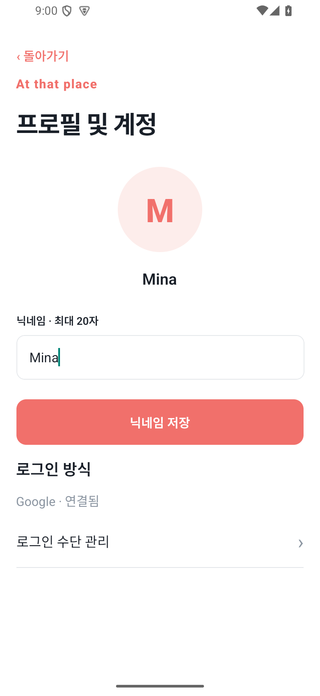

최대 20자의 닉네임 변경

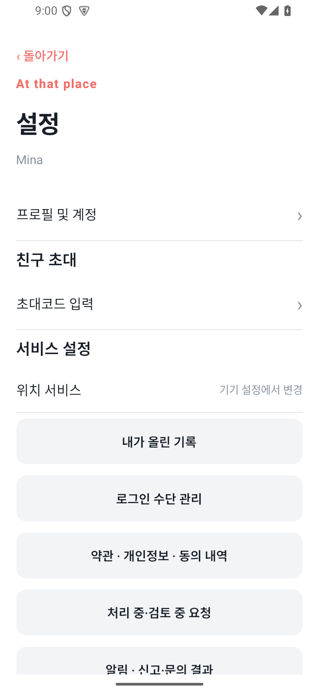

약관, 요청 상태, 알림 등 설정 메뉴

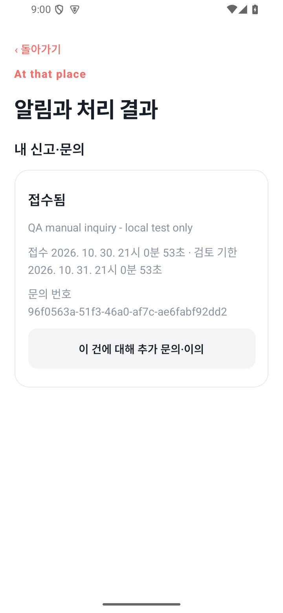

테스트 문의가 접수된 결과 화면

## 문제가 생겼을 때

| 화면·상황 | 확인할 것 |
| --- | --- |
| 서비스 연결 준비 안내 / 503 | 운영 API 연결을 기다리는 상태입니다. 앱을 재설치하거나 카카오 키를 바꿔 해결하는 문제가 아닙니다. |
| 날짜·시간 입력 오류 | 날짜는 YYYY-MM-DD, 예정 시각은 5분 단위 HH:mm으로 입력합니다. 시각을 비우면 시간 미정입니다. |
| 전송 100%인데 아직 미완료 | 서버 파일 확인과 공개 전 검사가 남을 수 있습니다. 파일 전송 상태 또는 처리 중·검토 중 요청에서 결과를 확인합니다. |
| 앨범 맨 위에 저장한 파일이 없음 | Pictures/At that place 또는 Movies/At that place와 촬영 날짜를 확인합니다. |
| 계정 삭제·모임 종료 | 설정 및 모임 관리에서 영향 범위를 확인합니다. 이번 테스트에서 삭제·탈퇴·방장 이전을 실행한 것은 아닙니다. |

설명서의 성공 화면은 출시 준비 완료나 실제 카카오 인증 성공을 뜻하지 않습니다. 상세 검증 범위는 [검증결과](검증결과.md)를 확인하세요.
