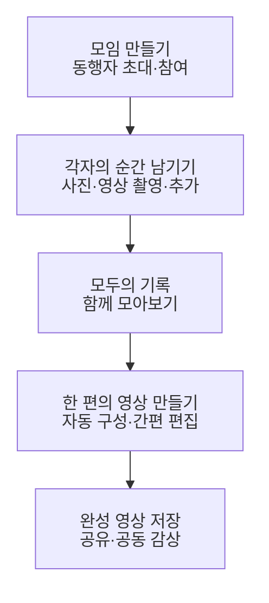

# AT_THAT_PLACE_FEATURE_OVERVIEW

# At that place 모임 기록 앱 기능 개요

이 앱은 함께한 순간을 남기고 싶은 사람들이, 모임마다 각자 찍은 사진·영상이 흩어지고 이를 모아 편집하기 번거로운 문제를 해결해서, 모두의 기록을 한곳에 모으고 한 편의 추억 영상으로 간직하도록 한다.

이 문서는 **새 앱을 처음부터 개발하기 위한 첫 버전의 기능 범위 초안**이다. 모임 생성부터 공동 기록, 영상 초안 구성, 편집, 실제 영상 파일 저장과 공동 감상까지 구현한다. 기능 명세에서는 아래 기능의 정상 흐름·예외·수용 기준을 확정하고, 설계서에서는 화면·데이터·서버·미디어 처리 구조를 정한다.

# 전체 이용 흐름

모임은 기록을 모으는 기본 단위다. 여행·데이트·친구 모임 등 함께한 활동을 담고, 한 편의 추억 영상으로 남긴다. 기본 구조는 **모임방 하나 = 한 번의 일정**, **모임방 → 날짜 → 방문 장소 → 게시물 → 사진·영상 파일**이다. 같은 장소도 방문 날짜가 다르면 기록을 분리한다.

현재 기준에서는 방문 장소를 선택해 기록을 남긴다. **장소 없이 바로 기록하기, 하나의 모임방에서 반복 모임을 계속 기록하기는 추가 결정이 필요하다.** 두 방식의 필요 여부와 동작은 ‘설계 전에 확정할 항목’에서 고객에게 묻는다.

# 첫 버전 기능 개요

| 영역 | 처음부터 구현할 기능 | 사용자가 얻는 결과 |
| --- | --- | --- |
| 계정과 권한 | 사용자 식별, 로그인·로그아웃, 세션 유지, 모임 참여 여부와 역할에 따른 접근 제어 | 자신의 계정으로 허용된 모임 이용 |
| 모임과 참여 | 모임 생성·수정, 시작일·종료일, 초대·참여, 참여자 목록, 나가기·참여 관리, 대표 사진 | 함께 기록할 공간과 구성원 |
| 사진과 영상 기록 | 촬영·가져오기, 방문에 연결, 파일별 설명, 한 번에 최대 10개 선택, 전송·재시도, 기록 수정·삭제 | 각자가 남긴 원본 기록 |
| 공동 기록 감상 | 날짜별 장소 계획, 지도·목록 검색, 방문별 파일 카드, 업로드 완료 시각 정렬, 사진 확대·영상 재생 | 방문별로 분리된 모두의 기록 |
| 영상 초안 구성 | 사용할 기간과 기록 선택, 사진·영상 자동 구성, 제목·날짜·장소 표시. 순차 연결·분할 화면 중 제공할 방식은 설계 전에 결정 | 한 편으로 구성된 영상 초안 |
| 간편 편집 | 장면 제외·재배치, 영상 자르기, 사진 표시 시간, 제목·원음 조절, 자동 저장·미리보기 | 원하는 흐름으로 다듬은 영상 |
| 영상 완성과 공유 | 실제 영상 파일 생성, 진행·취소·재시도, 기기 저장, 외부 공유, 모임에서 공동 감상 | 다시 보고 나눌 수 있는 완성 영상 |
| 저장과 복구 | 원본·편집 내용·완성 영상 구분, 초안 복원, 캐시·사용 용량 관리. 공유 파일의 보관 기간·조회 가능 조건은 고객과 정하고, 전달 방식은 설계에서 결정 | 종료·실패 후에도 이어 쓸 수 있는 기록 |

아래 기능은 모두 신규 구현 대상으로 관리한다. 현재 정해진 정책은 ‘현재 적용할 기준’에 모았고 관련 기능에도 반영했다. 추가 결정이 필요한 내용은 ‘설계 전에 확정할 항목’에서 질문으로 구분한다. 기능 범위의 나머지 부분은 기능 명세 단계에서 확정할 초안이다.

# 필수 기능과 완료 조건

기능 번호는 설계·구현·검수에서 같은 기능을 식별하기 위한 번호다.

## 계정과 모임

| 기능 번호 | 구현할 기능 | 완료 조건 |
| --- | --- | --- |
| F01 | 계정 진입과 사용자 식별 | 로그인·로그아웃과 재로그인이 가능하고, 기록의 작성자를 일관되게 식별한다. 로그인 방식은 설계 전에 정한다. |
| F02 | 모임 생성과 관리 | 이름·시작일·종료일·참여자를 가진 방을 만들고 목록에서 다시 연다. 기본은 한 방에 한 일정이며 시작일부터 종료일까지 날짜를 구성한다. 반복 모임·기간 없는 모임의 지원 여부와 기간 변경 시 기존 기록의 처리 방식은 설계 전에 정한다. |
| F03 | 동행자 초대와 참여 | 초대 링크 또는 코드로 모임을 확인하고 참여한다. 같은 계정의 중복 참여를 막고, 만료·취소·잘못된 초대에 결과를 안내한다. |
| F04 | 참여자와 권한 관리 | 참여자는 장소 추가, 방문 순서·시간·날짜 제목 편집, 대표 사진 변경을 할 수 있다. 비참여자는 데이터를 조회할 수 없으며 권한은 서버에서 검증한다. 누가 초대·참여자 제외·타인 기록 삭제·영상 관리를 할 수 있는지는 설계 전에 정한다. |
| F05 | 계정과 모임의 종료 처리 | 계정·모임 삭제 요청을 처리하고, 관련 기록·영상의 보관·삭제와 참여자 접근을 확정된 정책에 맞게 반영한다. |

## 사진과 영상 기록

| 기능 번호 | 구현할 기능 | 완료 조건 |
| --- | --- | --- |
| F06 | 사진과 짧은 영상 촬영 | 사진·영상 모드 전환, 촬영 시작·종료, 결과 확인·재촬영이 가능하다. 권한 거부·촬영 중단·저장 실패를 안내한다. |
| F07 | 기기에서 사진·영상 가져오기 | 사진·영상을 합쳐 한 번에 최대 10개 선택하고 개별 선택 해제·추가를 한다. 1개 이상일 때만 제출한다. 파일 형식·용량, 긴 영상의 사용 구간을 고르는 방식, 개인별 누적 한도는 설계 전에 정한다. |
| F08 | 모임에 기록 남기기 | 현재 방·날짜·방문에 게시물을 연결하고 파일별 설명을 입력한다. 같은 지도 장소라도 다른 날짜·방의 기록이 섞이지 않는다. 방문 장소 없이 기록하는 기능의 추가 여부는 설계 전에 정한다. |
| F09 | 전송과 재시도 | 대기·전송 중·완료·실패 상태를 구분하고 취소·재시도를 제공한다. 저장된 파일이 조회 가능한 시점에 완료로 처리한다. 일부만 성공하면 성공한 파일과 집계만 갱신하고 실패 파일은 유지한다. 원본 제공자의 기기 상태와 관계없이 조회할 수 있어야 하는지, 얼마나 보관할지는 설계 전에 정한다. |
| F10 | 모두의 기록 감상 | 선택 방문의 파일 하나를 카드 하나로 표시하고 작성자·업로드 시각·설명을 보여 준다. 기본 최신순, 선택 시 오래된순이며 같은 게시물의 파일 순서는 유지한다. 사진 확대·영상 재생 후 원래 목록 위치로 돌아오고 닫은 영상은 정지한다. |
| F11 | 기록 수정과 삭제 | 허용된 사용자가 설명·날짜·장소를 수정하거나 기록을 삭제한다. 해당 기록을 사용한 영상 프로젝트에 변경 사실을 반영한다. |
| F12 | 날짜별 장소 검색과 추가 | 장소명·주소 또는 분류로 검색하고 지도 마커와 목록 선택을 연동한다. 선택 날짜의 마지막 순서에 추가하고 해당 날짜 목록으로 복귀한다. 같은 방·날짜·장소의 중복은 막되 다른 날짜 방문은 허용한다. 위치 권한을 거절해도 일반 검색은 가능하다. |

## 영상 초안과 편집

| 기능 번호 | 구현할 기능 | 완료 조건 |
| --- | --- | --- |
| F13 | 영상에 사용할 범위 선택 | 모임의 하루 또는 전체 기록 중 사용할 범위를 정하고, 포함·제외할 사진·영상을 선택한다. 사용할 기록이 없으면 생성을 안내와 함께 제한한다. |
| F14 | 영상 초안 자동 구성 | 설계 전에 선택한 순차 연결·분할 화면 방식과 장면 정렬·길이 규칙에 따라 사진·영상을 구성한다. 사진은 지정 시간 동안 표시하고 영상은 선택 구간을 사용한다. 모든 장면을 직접 배치하지 않아도 초안이 만들어진다. |
| F15 | 장면 순서와 길이 수정 | 장면 제외·순서 변경, 영상 시작·끝 자르기, 사진 표시 시간 조절이 가능하고 전체 길이에 반영한다. |
| F16 | 제목과 기록 정보 표시 | 영상 제목·날짜·장소 표시를 설정하고 미리보기와 출력 파일에 같은 내용·위치로 반영한다. 장소 없는 기록에도 적용 가능한 표시 규칙을 둔다. |
| F17 | 원음 조절 | 영상의 원음 음량·음소거를 설정하고, 사진 장면이나 원음 없는 영상도 정상적으로 처리한다. |
| F18 | 편집 프로젝트 저장과 복원 | 선택한 기록·순서·구간·표시·음량 설정을 자동 저장하고 앱을 다시 열어 이어 편집한다. 원본을 덮어쓰지 않는다. |
| F19 | 전체 영상 미리보기 | 사진과 영상이 연결된 전체 흐름을 재생·이동하며 확인한다. 장면 순서·길이·제목·소리가 완성 파일과 일치한다. |
| F20 | 원본 기록 변경 반영 | 새 기록이나 사용 중인 기록의 삭제·접근 제한을 알린다. 사용자의 편집을 임의로 덮어쓰지 않고, 갱신·제외·재생성을 선택하게 한다. |

## 영상 완성과 보관

| 기능 번호 | 구현할 기능 | 완료 조건 |
| --- | --- | --- |
| F21 | 실제 영상 파일 생성 | 선택한 사진·영상·편집 설정을 하나의 영상 파일로 만든다. 지원 플랫폼의 기본 재생 앱에서 정상적으로 재생된다. |
| F22 | 생성 진행과 실패 복구 | 생성 상태·진행·취소·실패 이유·재시도를 제공한다. 실패하거나 취소한 미완성 파일은 완성 결과로 표시하지 않는다. |
| F23 | 기기 저장과 외부 공유 | 완성 파일을 기기에 저장하고 시스템 공유 기능으로 전달한다. 저장 실패·권한 거부 시 결과와 다음 행동을 안내한다. |
| F24 | 모임에서 완성 영상 감상 | 완성 영상을 모임에 보관해 참여자들이 다시 찾아 재생한다. 작성자·생성 시각과 어떤 프로젝트의 결과인지 구분한다. |
| F25 | 완성 영상 관리 | 허용된 사용자가 완성 영상을 삭제하거나 편집 후 새 결과를 생성한다. 이미 외부로 저장·공유한 파일과 앱 내부 결과를 구분한다. |
| F26 | 저장 공간과 초안 관리 | 원본·편집 프로젝트·완성 영상·캐시를 구분한다. 사용 용량을 확인하고 캐시를 지워도 필요한 원본과 프로젝트를 보존한다. |

## 장소 계획과 모임 대표 정보

| 기능 번호 | 구현할 기능 | 완료 조건 |
| --- | --- | --- |
| F27 | 모임 대표 사진 변경 | 참여자가 앨범 사진을 선택해 대표 배너에 반영하고 기본 이미지로 복원한다. 대표 사진만 긴 변 1600px 이하·5MB 한도를 적용하고 배너는 16:9로 표시한다. 이 수치를 일반 기록 사진이나 완성 영상의 한도로 적용하지 않는다. |
| F28 | 방문 순서·시간·날짜 제목 편집 | 참여자가 방문 순서를 바꾸고 시간을 5분 단위 또는 미정으로 설정하며 날짜 제목을 최대 30자로 편집한다. 시간으로 자동 재정렬하지 않는다. 순서·시간·제목을 함께 저장하고 충돌 시 입력을 보존한다. 날짜 공통 메모와 장소 삭제는 포함하지 않는다. |

# 영상 완성 규칙

| 항목 | 구현할 동작 |
| --- | --- |
| 입력 | 같은 모임에서 사용자가 선택한 사진·영상으로 구성한다. |
| 범위 | 하루 또는 모임 전체 기간을 선택한다. 기본 선택값은 기능 명세에서 정한다. |
| 순서와 구성 | 영상의 순차 연결·분할 화면 구성과 최초 정렬 기준은 설계 전에 정한다. 기록 목록의 업로드 최신순을 영상 구성 순서로 자동 적용하지 않는다. 이후에는 사용자가 편집한 순서를 유지한다. |
| 길이 | 사진 표시 시간·클립 사용 구간·최종 길이 상한을 적용한다. 상한을 넘을 때의 처리 방식은 기능 명세에서 정한다. |
| 표시 | 제목·날짜·장소의 표시 여부와 위치를 적용한다. 없는 정보는 생략하거나 정해진 대체 문구를 쓴다. |
| 소리 | 장면별 원음 설정을 적용한다. 배경음악의 첫 버전 포함 여부는 고객과 확정한다. |
| 원본 보존 | 편집과 영상 생성이 원본 파일을 변경하지 않는다. |
| 생성 중 변경 | 생성을 시작한 시점의 편집 구성을 기준으로 결과를 만든다. 이후 변경은 다음 생성에 반영한다. |
| 결과 갱신 | 새 결과를 만들 때 기존 결과의 유지·교체 정책을 적용한다. 외부로 저장한 파일은 별도 사본으로 취급한다. |

# 함께 구현할 서비스 기반

| 기반 | 필요한 구현 |
| --- | --- |
| 앱 실행과 화면 이동 | 초기 진입, 로그인 상태 복원, 참여 모임 목록, 기록·편집·결과 화면 이동, 빈 상태·로딩·오류 안내 |
| 사용자와 모임 데이터 | 사용자·모임·참여자·초대·역할의 저장과 조회·변경 처리 |
| 원본 파일 저장과 전송 | 기록 정보와 파일 연결, 접근 권한 확인, 전송·재시도·중복 방지. 원본 제공자의 기기가 꺼져 있을 때도 조회해야 하는지와 보관 기간을 먼저 정한 뒤 서버 보관·기기 간 직접 전송·혼합 방식을 설계 |
| 공동 기록 동기화 | 장소 추가·편집·전송 완료 후 관련 목록·집계를 재조회하고 선택 날짜·목록 위치를 유지. 장소 계획의 동시 수정은 버전 충돌로 처리하며 실시간 공동 편집은 필수로 두지 않음 |
| 편집 프로젝트 보관 | 사용한 원본의 참조, 장면 순서·구간·표시·소리 설정 저장, 기기 내 복원과 서버 보관 범위 |
| 영상 생성과 결과 보관 | 생성 작업 실행·상태 관리·취소·재시도, 결과 파일 저장·재생, 실패한 임시 파일 정리 |
| 기기 기능 연결 | 카메라·마이크·사진 보관함 권한, 파일 가져오기·저장, 시스템 공유 |
| 오류 확인과 운영 | 사용자에게 보이는 실패 안내, 원인을 추적할 수 있는 오류 기록, 보관 용량·전송·영상 생성 비용 확인 |

각 기반의 데이터 모델·API·인증 방식·파일 저장 위치·영상 생성 실행 위치는 설계서에서 구체화한다.

# 구현 순서와 단계별 완료 기준

| 순서 | 구현 묶음 | 완료 기준 |
| --- | --- | --- |
| 1 | 앱 실행·계정·데이터 저장·권한 기반 | 로그인 상태가 복원되고 허용되지 않은 데이터 접근이 차단된다. |
| 2 | 모임 생성·초대·참여·참여자 관리 | 서로 다른 두 계정이 같은 모임을 열고, 참여 변경에 맞게 접근 권한이 바뀐다. |
| 3 | 촬영·가져오기·업로드·공동 기록 감상 | 한 사람이 올린 사진과 영상을 다른 사람이 보고, 전송 실패 후에도 중복 없이 이어서 등록한다. |
| 4 | 날짜·장소 계획과 기록 관리 | 같은 장소의 다른 날짜 기록이 분리되고, 방문 순서·시간·날짜 제목·대표 사진의 변경이 반영된다. 방문 장소 없는 기록은 고객이 필요하다고 결정하면 추가한다. |
| 5 | 영상 초안·간편 편집·프로젝트 복원 | 여러 사람의 사진·영상으로 초안을 만들고 앱 재실행 후 편집을 이어간다. |
| 6 | 영상 파일 생성·저장·공유·공동 감상 | 실제 파일을 외부 재생 앱에서 열고, 모임 참여자도 완성 영상을 다시 본다. |
| 7 | 오류·복구·접근성·성능 검증 | 권한 거부, 연결 끊김, 앱 종료, 저장 공간 부족, 생성 취소·실패 조건을 처리한다. |

앞 단계부터 동작 가능한 흐름을 쌓고, 영상 생성에 필요한 형식·화질·소리·기기 호환성은 설계 단계부터 작은 입력으로 기술 검증한다.

# 비기능 요구사항 초안

| 품질 | 지켜야 할 기준 | 검증 방법 |
| --- | --- | --- |
| 접근 제어 | 화면과 서버 모두에서 참여 여부를 검증하고, 명시된 장소 편집 권한과 추가 확정할 기록·영상 관리 권한을 적용한다. | 비참여 계정·권한 없는 역할·탈퇴한 계정의 직접 요청 확인 |
| 기록 보존 | 저장 완료한 원본·편집 내용은 재진입 후 복원되고 생성 실패가 원본을 훼손하지 않는다. | 저장 직후 강제 종료와 생성 실패 후 재실행 |
| 연결 복구 | 전송 실패 후 초안을 유지하고 재시도가 중복 기록·결과를 만들지 않는다. | 업로드 중 연결 해제·복구와 반복 재시도 |
| 출력 일치 | 결과의 장면 순서·방향·표시·소리가 프로젝트 설정과 일치한다. | 사진·세로·가로·무음 영상을 섞어 미리보기와 파일 비교 |
| 호환성 | 지원 기기·운영체제·입력 형식·출력 품질 범위를 명시하고 정상 처리한다. | 확정한 기기·형식 조합별 촬영·재생·내보내기 |
| 접근성 | 주요 버튼·상태를 화면 읽기 기능으로 이해하고 핵심 흐름을 완료한다. | 화면 읽기 기능으로 모임 참여부터 영상 저장까지 수행 |
| 성능 | 화면 응답·미디어 표시·영상 생성 시간의 목표를 입력 크기와 기준 환경별로 정한다. | 기준 기기·네트워크·기록 수·영상 길이를 고정해 반복 측정 |

성능의 수치와 측정 구간, 지원 범위, 허용 오차는 기능 명세와 설계서에서 확정한다.

# 현재 적용할 기준

아래 정책은 기능 명세와 설계의 기준으로 적용한다. 추가 결정이 필요한 항목은 다음 절에 따로 정리한다.

| 항목 | 적용할 기준 |
| --- | --- |
| 제품의 목적 | 여행에만 한정하지 않고 함께한 활동을 기록한다. 모두의 기록을 모아 한 편의 추억 영상으로 남기는 것이 핵심이며, 외부 숏폼 게시는 공유 방법 중 하나로 둔다. |
| 기본 공간 구조 | 한 방에 한 일정이며 모임방 → 날짜 → 방문 장소 → 게시물 → 파일로 관리한다. 같은 장소도 다른 날짜·방이면 별도 방문이다. 반복 모임을 한 방에서 계속 관리할지는 추가로 정한다. |
| 기간과 날짜 | 시작일·종료일을 모두 포함한다. 하루 일정은 날짜 하나, 여러 날 일정은 날짜별 전환을 제공한다. 이전 화면으로 돌아오면 선택 날짜와 목록 위치를 유지한다. |
| 장소 추가 | 선택한 날짜의 마지막 순서에 추가하고 방문 시간은 미정으로 둔다. 저장 성공 후 해당 날짜 목록으로 돌아온다. 같은 방·날짜·장소의 중복은 막고 다른 날짜 방문은 허용한다. |
| 지도와 검색 | 이름·주소 검색, 분류 선택, 지도 영역 재검색, 마커·목록 선택 연동, 관련도·거리순을 제공한다. 거리는 검색을 요청한 시점의 지도 중심을 기준으로 표시한다. 위치 권한을 거절해도 일반 검색을 제공한다. 지도 공급자와 검색 지역은 설계에서 정한다. |
| 장소 계획 편집 권한 | 모든 참여자가 장소 추가, 순서·시간·날짜 제목 수정, 대표 사진 변경을 할 수 있다. 비참여자는 조회할 수 없으며 서버에서 권한을 검증한다. 기록 삭제·영상 관리 권한은 별도로 정한다. |
| 방문 순서와 시간 | 저장한 방문 순서로 표시하며 시간순으로 자동 재정렬하지 않는다. 시간은 24시간제로 표시하고 5분 단위로 입력한다. 시간 미정도 허용한다. |
| 날짜 제목과 설명 | 날짜 제목은 최대 30자이며 비우면 날짜 기반 기본 제목을 쓴다. 날짜 전체에 붙이는 공통 메모는 제공하지 않는다. 사진·영상 파일별 설명은 입력할 수 있다. |
| 장소 삭제 | 별도 합의 전에는 구현하지 않는다. 기록·모임 삭제 여부와 그에 따른 보관 정책은 별도로 정한다. |
| 기록 조회와 정렬 | 특정 방·날짜·방문의 파일만 조회한다. 기본은 업로드 완료 시각 최신순이며 오래된순으로 바꿀 수 있다. 같은 게시물 안의 파일 순서는 유지한다. 이 정렬을 영상 생성 순서에 자동 적용하지 않는다. |
| 파일 표시와 집계 | 사진 한 장·영상 하나당 카드 하나로 표시한다. 저장 완료된 파일만 사진·영상으로 나눠 집계한다. 조회 실패는 0개나 빈 목록으로 표시하지 않는다. |
| 한 번에 선택하는 파일 수 | 사진·영상을 합쳐 최대 10개를 선택한다. 개인별·하루별·모임별 누적 한도는 별도로 정한다. |
| 대표 사진 제한 | 모임 대표 사진만 긴 변 1600px 이하·파일 크기 5MB 한도로 처리하고 배너는 16:9로 표시한다. 기본 이미지로 복원할 수 있다. 일반 기록 사진과 영상의 제한은 별도로 정한다. |
| 저장과 동시 수정 | 장소 순서·시간·날짜 제목을 함께 저장한다. 같은 날짜를 다른 참여자가 먼저 수정했다면 충돌을 안내한다. 저장 실패·충돌 시 입력을 유지하고, 미저장 상태에서 나가려면 확인한다. |
| 전송 완료·일부 성공 | 저장된 파일을 다른 참여자가 조회할 수 있는 시점에 완료로 처리한다. 일부만 성공하면 성공한 파일과 관련 집계만 갱신하고 실패한 파일은 재시도할 수 있게 유지한다. 취소 시 기존 화면 상태를 유지한다. |
| 동기화와 미디어 표시 | 관련 내용이 바뀌거나 화면에 다시 들어오면 필요한 목록·집계를 재조회한다. 장소 계획을 여러 사람이 실시간으로 함께 편집하는 기능은 필수로 두지 않는다. 목록에는 작은 미리보기 이미지를 사용하고 상세 화면에서 원본을 불러온다. 영상의 공동 편집 방식은 별도로 정한다. |
| 접근성과 화면 | 아이콘 버튼에 읽을 수 있는 이름을 붙이고 큰 글씨·긴 장소명에서도 내용이 겹치지 않게 한다. 터치 영역은 최소 44, 주요 버튼은 56을 기준으로 하되 플랫폼별 단위와 검증 방법은 설계에서 구체화한다. |

**아직 정해지지 않은 숫자와 방식:** 영상 길이 5초, 촬영 시간 1·2·3·5초 선택, 사람별 누적 개수 제한, 구독, 기기 간 직접 전송은 검토 중인 제안이다. 5명을 모임의 최대 인원으로 정하거나 확인용 파일의 길이·해상도를 서비스 제한으로 적용하지 않는다.

# 설계 전에 확정할 항목

## 고객에게 추가로 물어볼 질문

각 질문에는 현재 정해진 범위와 결정이 필요한 이유를 함께 적었다. 답변을 받으면 선택한 정책·적용 범위·결정일을 기록하고, 관련 기능과 ‘현재 적용할 기준’에 반영한다.

## 개발팀이 설계에서 결정할 항목

| 번호 | 결정할 항목 | 고객에게 물어볼 질문 | 현재 정해진 범위와 남은 결정 | 혜원 | 은송 | 성필 |
| --- | --- | --- | --- | --- | --- | --- |
| 1 | 장소 없는 기록 | 방문 장소를 먼저 정하지 않고 모임에 바로 사진·영상을 남길 수 있어야 하나요? 허용한다면 ‘장소 없는 기록’으로 둘까요, 나중에 방문 장소로 옮길 수 있게 할까요? | 현재 기준은 방문 장소에 기록을 연결하는 방식이다. 장소 없는 기록은 추가 여부와 정리 방법을 정해야 한다. | 장소로 관리하는 것이 편집이나 운영에 있어 편리할 것 같지만 장소없는 기록으로 두어도 괜찮을 것 같아요 ( 기타로 둘지 고민 ... ) | 일단은 사진·영상을 업로드를 가능하게 하고 나중에 방문 장소를 연결하면 좋을 것 같아요 |  |
| 2 | 반복 모임과 기간 | ‘방 하나 = 한 번의 일정’을 모든 모임에 적용할까요? 같은 친구 모임이 여러 번 만날 때마다 새 방을 만들까요, 하나의 방에 여러 일정을 둘까요? 기간 없는 모임도 필요한가요? | 현재 기준은 시작일·종료일이 있는 한 번의 일정마다 방 하나다. 반복·상시 모임은 정해지지 않았다. | 동호회 처럼 주기적 모임이 있는 대상도 고려한다면 방하나에 여러 일정을 넣는 것이 이득일 것 같아요 | 하나의 방은 한 번의 여행 일정으로 구성했으면 합니다. 같은 친구들과 다시 여행할 경우 새로운 방을 생성하는 것이 원칙으로 두는 것을 추천합니다 |  |
| 3 | 출시 플랫폼 | 첫 출시를 Android·iOS 동시로 할까요, 한쪽부터 할까요? 실제 사용자들이 사용하는 기기는 무엇인가요? | 두 플랫폼을 고려하고 있으나 출시 순서와 최소 지원 버전은 정해지지 않았다. |  | 서로 다른 기기를 사용하는 경우가 많아 동시 출시가 좋을 것 같아요 일부 친구만 가능하면 안쓸 것 같아서요 |  |
| 4 | 로그인 방식 | 카카오·Apple·Google 등 소셜 로그인과 다른 방식 중 어떤 것을 제공할까요? 초대받은 사람이 로그인하기 전 볼 수 있는 정보가 있어야 하나요? | 기록의 작성자 식별과 접근 제어는 필요하다. 로그인 방법과 로그인 전 공개 범위는 정해지지 않았다. |  | 카카오·Apple·Google 소셜 로그인을 우선 제공했으면 합니다. 초대 링크를 통해 접속한 사용자는 로그인 전 모임명, 여행 기간 등 기본 정보만 확인까지만 가능하면 좋을 것 같습니다 |  |
| 5 | 초대와 참여 | 링크·코드 중 무엇으로 초대할까요? 초대 만료·재발급·취소, 참여 승인, 초대할 수 있는 사람의 범위는 어떻게 할까요? | 동행자가 같은 방에 참여하는 기능은 필요하다. 초대 방식과 참여 절차는 정해지지 않았다. |  | 초대 링크와 초대코드를 모두 지원했으면 합니다 |  |
| 6 | 모임 인원 | 방장을 포함해 최대 몇 명까지 참여하나요? 방을 만든 뒤 정원을 바꿀 수 있나요? | 최대 참여 인원과 생성 후 정원 변경 허용 여부는 정해지지 않았다. | 초대 인원 수도 유료버전에 넣으면 어떨까요 (기본 5~8명?) | 장을 포함해 최대 10명까지 참여할 수 있도록 제안합니다. 일반적인 친구·가족 여행을 고려한 기준입니다 |  |
| 7 | 기록·모임 관리 권한 | 본인 파일의 수정·삭제만 허용할까요? 방장은 타인의 파일을 관리 삭제하거나 참여자를 제외할 수 있나요? 방장이 나가면 누가 관리하나요? | 모든 참여자는 장소 계획과 대표 사진을 편집할 수 있다. 본인 기록 삭제·타인 기록 관리·참여자 제외·관리자 이전 권한은 추가로 정해야 한다. | 파일 수정 삭제는 본인만 할 수 있는 것이 좋을 것 같습니다 
(이후에 버전에서는 방장이 파일까지 관리할 수 있는 버전도 추가하면 좋을 것 같아요(동호회,동아리)) | 모든 참여자는 방문 장소와 대표 사진을 편집할 수 있도록 합니다. 단, 개인이 업로드한 원본 사진·영상은 본인만 삭제가능하고요 방장은 참여자 관리 및 강제 퇴장 권한을 가지고  방장이 탈퇴할 경우 다른 참여자에게 방장 권한을 이전하도록 하는 것이 좋을 것 같습니다 |  |
| 8 | 기간 변경과 삭제 | 기간을 줄이면 범위 밖 방문·기록은 유지·보관·이동 중 어떻게 처리하나요? 참여자 탈퇴·제외, 계정·모임 삭제 시 공유 기록과 완성 영상은 어떻게 남길까요? | 장소 삭제는 별도 합의 전 제공하지 않는다. 기간 변경과 탈퇴·삭제에 따른 기록·영상의 처리 방식은 정해지지 않았다. | 탈퇴 시 탈퇴한 회원 사진 삭제 , 모임 삭제 시 방에 있는 사진 전부 삭제 ,
일정 변경 시 날짜 변경은 되지만 기간 변경은 불가 
따로 방을 파거나 일정을 추가하는 것이 어떨까요 | 여행 기간을 변경하더라도 기존에 업로드한 기록은 삭제되지 않도록 해야 하고 변경된 기간에서 벗어난 기록은 별도 보관하거나 날짜를 재지정하도록 하면 좋을 것 같아요 탈퇴시에 공유기록을 삭제하는 것을 선택하는 건 어떨까요 |  |
| 9 | 짧은 영상과 긴 영상 가져오기 | 촬영 시간을 1·2·3·5초 중 선택하게 할까요? 5초는 기본값인가요, 최대 길이인가요? 긴 영상을 가져오면 전송 전에 사용할 구간을 고르게 할까요? | 촬영 시간 선택과 긴 영상의 구간 선택을 검토 중이다. 5초는 확정된 기본값이나 최대 길이가 아니다. | 2초 5초 (최대 5초) 로 하는 것이 어떨지  
5초 이상의 영상을 가져오면 원하는 구간을 2초 or 5초로 선택할 수 있도록 하면 좋을 것 같습니다 | 촬영 길이는 1·2·3·5초 중 선택할 수 있도록 하면 좋을 것 같아요 짧은 장면을 여러 개 모아 여행 영상을 제작한다는 서비스 방향에 맞는 기능인 것 같아요 |  |
| 10 | 파일과 누적 제한 | 한 파일의 크기와 개인별·하루별·모임별 누적 개수를 제한할까요? 초과 시 차단·정리 안내·추가 이용 중 어떤 동작이 필요한가요? | 한 번의 선택은 사진·영상 합계 10개다. 일반 기록의 파일 크기·형식과 누적 한도는 정해지지 않았다. 대표 사진의 5MB 한도는 여기에 적용하지 않는다. | 기준은 장소별이 좋을 것 같습니다. 한 장소에 사람당 사진 2장, 동영상 1개 업로드 가능
장소 추가를 개수 제한을 두는 것이 어떨지 하루에 장소 10개까지 추가 가능 등  | 한 번에 사진·영상 합계 10개 선택 기준으로 두는 것이 좋을 것 가탕요 용량 제한은 잘 모르는 분야라 모르겠습니다 |  |
| 11 | 영상의 범위 | 기본 결과는 하루 한 편인가요, 모임 전체 한 편인가요? 둘 다 제공한다면 처음 선택되는 값은 무엇인가요? | 모두의 사진·영상을 한 편으로 만드는 것이 목표다. 생성 단위와 기본 선택값은 정해지지 않았다. | 일정 당 한편이 좋지 않을까요 영상을 만들 때 일정 안에서 하루에 해당 하는 사진/동영상만 선택한다면 하루 한편이 되는거죠  | 전체 여행 단위 영상을 모두 제작할 수 있도록 구성했으면 하고 기본 선택값은 전체 여행/원하는 날짜만 선택해 하루 영상을 제작하기도 가능했으면 해요 |  |
| 12 | 순차 연결과 화면 분할 | 장면을 차례로 잇는 영상, 여러 사람의 장면을 동시에 보여 주는 그리드 중 무엇을 첫 버전에 넣을까요? 분할 수·사람별 자리·빈 자리 처리·사진과 영상 혼합 규칙은 어떻게 할까요? | 장소를 표시하고 장면을 잇는 방식과 여러 화면을 나누어 보여 주는 방식을 검토 중이다. 분할 화면을 첫 버전에 넣을지와 구체적인 배치 규칙은 정해지지 않았다. | 장소별로 사진을 선택한 후 그리드로 할지 장면을 잇는 방식으로 할지 장소별로 설정할 수 있도록 하면 어떨까요 (동영상일 경우 길이가 다르면 그리드로 못한다는 메시지 출력) | 첫 버전에는 순차 연결과 화면 분할을 모두 제공하는 방향을 추천합니다 |  |
| 13 | 자동 선택과 길이 | 모든 기록을 넣을까요, 선택한 기록만 넣을까요? 촬영 시각·방문 순서·업로드 순서 중 무엇으로 구성할까요? 사진 표시 시간·영상 구간·완성 길이 상한과 초과 시 처리는 무엇인가요? | 기록 목록은 업로드 완료 시각 기준, 장소 목록은 사용자가 정한 방문 순서다. 완성 영상에 사용할 최초 정렬·장면 선택·길이 규칙은 별도로 정해야 한다. | 선택한 기록만 넣어야 할 것 같습니다. 일단 일정을 기준으로 그 다음 장소(시간)   | 기본적으로 방문 장소 순서에 따라 장면을 구성하고 촬영 시간 기준으로 정렬되는 기능도 넣으면 좋을 것 같아요 영상 길이 초과 시 임의 삭제보다는 장면 길이 조정이나 기록 선택을 안내메세지가 필요해보여요 |  |
| 14 | 출력 형태와 표시 | 세로·가로·정사각형 중 어떤 결과가 필요한가요? 제목·날짜·장소를 어디에 얼마나 표시하나요? 화면 잘림과 여백 중 무엇을 우선하나요? | 장소를 영상에 표시하는 방향은 있으나 최종 비율·해상도·표시 위치·화면 채우기 방식은 정해지지 않았다. | 세로/가로 선택하여 넣을 수 있도록 (제일 먼저 선택)
제목 날짜 장소는 여러 버전을 두고 선택할 수 있도록 하는게 좋을 것 같습니다 
보통 화면 잘림을 우선으로 하는 것 같습니다  | SNS 공유를 고려해 세로형 9:16을 기본으로 제공하는 것이 좋을 것 같아요 화면 잘림보다는 여백을 추천합니다 |  |
| 15 | 소리와 음악 | 원음은 기본으로 켤까요? 배경음악이 첫 버전에 꼭 필요한가요? 분할 영상에서 여러 사람의 소리는 함께 재생할까요, 하나만 선택할까요? | 원음 기본값, 배경음악 제공 여부, 분할 화면의 소리 재생 방식은 정해지지 않았다. | 원음으로 할지 무음으로 할지 선택가능하도록 분할 화면일 경우 원음으로 하면 그냥 소리가 겹치도록(셋로그도 그렇게 되어있음) 
출시 후 배경음악이 있다고 생각하면 그때 추가 | 배경음악 기능은 영상 제작의 완성도를 높이기 때문에 포함했으면 하지만 인스타 올릴때 따로 음악 지정을 할 수 이썽서 제외해도 될 것 같아요 영상의 소리를 끄거나 킬 수 있게 설정하는 것이 좋을 것 같아요 |  |
| 16 | 영상 편집과 공개 | 각자가 자기 프로젝트를 만들까요, 모임이 하나를 함께 편집할까요? 누가 완성본을 모임에 공개·수정·삭제하고, 새 결과를 만들면 이전 결과는 남길까요? | 장소 계획은 참여자가 함께 수정할 수 있다. 영상 프로젝트의 소유·공동 편집·공개·이전 결과 보관은 별도로 정해야 한다. | 각자 영상을 만들 수 있도록 (원하는 사진, 영상을 선택하여) 서버 저장 공간을 고려했을 때 각자 완성된 영상 모임방에 개재는 고민이 필요할 것 같습니다. 카톡으로 공유해도 충분할 것도 같아서요 | 사진·영상 기록은 모임에서 공동으로 관리하되 완성 영상 프로젝트는 사용자별로 생성가능하면 좋을 것 같아요 |  |
| 17 | 조회 가능성과 오프라인 | 사진을 올린 사람의 휴대폰이나 앱이 꺼져 있어도 다른 참여자가 항상 볼 수 있어야 하나요? 인터넷 없이 촬영·초안 편집·기존 기록 보기 중 어디까지 필요하나요? | 휴대폰끼리 직접 전달하는 방식을 검토했지만 기기가 꺼지면 다른 참여자가 못 볼 수 있다는 우려가 있다. 항상 조회할 수 있어야 하는지와 오프라인 사용 범위를 먼저 정해야 한다. | 저희 앱은 와이파이 데이터가 연결되어 있어야 접속이 가능해야 할 것 같고 올린사람의 휴대폰이나 앱이 꺼져 있어도 볼 수 있어야 할 것 같습니다  | 참여자의 휴대폰이나 앱이 꺼져 있어도 업로드된 기록을 다른 참여자가 볼 수 있어야 해요 오프라인에서는 따로 기능 제공을 안해도 될 것 같아요 |  |
| 18 | 보관 기간과 용량 | 원본·편집 내용·완성 영상을 각각 얼마나 오래 보관하나요? 기기에만 둘 수 있는 자료와 공동으로 보관할 자료는 무엇인가요? 용량이 차면 무엇을 정리하나요? | 기기와 공동 저장소의 용량을 관리할 필요가 있다. 보관 기간·공동 보관 범위·정리·자동 삭제 정책은 정해지지 않았다. | 보관 기간은 6개월 ~ 1년 정도 가 어떨까요 사진, 동영상을 올리고 저장공간을 확인해 봐야 할 것 같습니다  | 서버 저장 비용을 고려해 원본·압축본·완성 영상의 보관 정책을 구분해야 하며 사용자에게 미리 안내하고 삭제를  2주내에 했으면 해요  |  |
| 19 | 유료화 범위 | 첫 버전에 구독·결제를 넣나요? 넣는다면 길이·개수·보관 용량 중 무엇을 무료·유료로 나누나요? | 구독으로 더 긴 영상이나 추가 이용을 제공하는 아이디어가 있다. 결제의 첫 버전 포함 여부·요금·무료와 유료의 한도는 정해지지 않았다. | 유료범위는 의논이 필요할 것 같습니다.
타임로그 프리미엄 유료화 기능 범위 (참고 사례)

1. 영상 편집 기능

- 1분 이상 브이로그 제작
- 외부 영상 불러오기
- 영상 시간 변경
- 인트로 만들기
- 클립 전환 효과(클릭음)
- 모자이크 편집
- 일괄 편집

2. 자막 및 텍스트 기능

- 프리미엄 폰트
- 자막 3~5줄 지원
- 글자색 커스터마이징
- 텍스트 장식
- TTF 폰트 가져오기

3. 촬영 및 레이아웃 기능

- 레이아웃 촬영
- 위치 커스터마이징
- 레터박스 색상 변경
- 박스·아웃라인 색상 변경
- 박스 여백 및 테두리 설정

4. 저장 및 기타 기능

- 클립별 앨범 저장
- 워터마크 제거
- 광고 제거

5. 유료 가격

- 프리미엄 가격: 6,600원
- 결제 주기: 화면상 확인 불가
- 세금: 국가 및 스토어 정책에 따라 자동 반영

총 20개 유료 기능

저희앱 + 초대인원수, 사진업로드 수  등 추가 가능 | 첫 출시에서는 결제 기능보다 핵심 기능의 사용성과 이용자 확보에 집중하는 것이 좋아보이고 유료 이용자는 긴 영상 제작·추가 저장 공간·프리미엄 템플릿 등을 이용할 수 있도록 확장하는 방향으로 가면 될 것 같아요 |  |
| 20 | 촬영 소리 | 어떤 기기·촬영 상황의 소리가 불편한가요? 목표는 음량 감소인가요, 별도 촬영 안내음 조절인가요? | 촬영 소리를 줄여 달라는 요청이 있다. 원하는 동작과 기기별 지원 가능 범위는 확인이 필요하다. |  | 기기 및 국가별 카메라 셔터음 제한을 지키는 것이 좋을 것 같지만 일단 무음이 제일 좋아보여요 |  |
| 21 | 체감 품질 | 기록을 여는 시간·파일 전송·영상 완성에 각각 어느 정도 기다릴 수 있나요? 영상 생성이 오래 걸리면 화면을 떠났다가 돌아와 진행 상태·결과를 확인할 수 있어야 하나요? | 로딩·실패·완료를 구분하고 입력을 보존해야 한다. 동작별 대기 시간 목표와 긴 작업 중 화면 이탈 동작은 정해지지 않았다. | 영상 생성 화면을 떠났다가 돌아와도 진행 상태와 결과를 확인할 수 있으면 좋을것같어요 앱을 완전히 종료한 뒤에도 생성이 계속되는 기능은 구현 가능성을 검토한 후 결정하면 좋겠습니다. | 기록 목록과 썸네일은 가능한 빠르게 표시하  업로드 및 영상 생성 시 진행률을 확인할 수 있으면 좋을 것 같아요 영상 제작 중 다른 화면으로 가도 작업은 유지되어야 할 것 같아요 |  |
| 22 | 편집 | 사진 올릴 때 자막을 달지, 장소 등록할 때 설명으로 자막을 달지, 편집할 때 자막을 넣을지 에 따라 입력값이 필요할 것 같습니다 |  |  |  |  |
|  |  |  |  |  |  |  |

고객과 사용 경험·정책을 정한 뒤, 다음 기술 선택을 그 요구를 만족하는 방식으로 설계한다.

| 항목 | 결정할 내용 | 지켜야 할 기준 | 혜원 | 은송 |
| --- | --- | --- | --- | --- |
| 파일 전달·공동 보관 구조 | 원본 제공자의 기기가 꺼진 상태에서도 조회할 수 있어야 하는지, 얼마나 보관할지와 비용을 기준으로 서버 저장·직접 전송·혼합 구조를 비교하고 영상 생성 실행 위치를 정한다. | 기기 간 직접 전송은 후보이며 채택된 구조가 아니다. 참여자가 조회할 수 있는 조건과 전송 완료의 의미를 일치시킨다. | 서버 저장 방식이 좋을 것 같습니다 
용량은 예상 이용량 비용을 확인한 뒤 정해야 할 것 같아요  | 참여자의 휴대폰이나 앱이 꺼져 있어도 다른 참여자가 업로드된 사진·영상을 조회할 수 있어야 해요 최대 2주 보관 이후는 유료화했으면 해요 서버 비용이 부담.. |
| 지도 공급자와 범위 | 공급자·검색 지역·초기 지도 위치·정렬 기능·분류 매핑·장소 사진 제공 방식을 정한다. | 마커·목록 연동, 현재 지도 영역 재검색, 지도 중심 기준 거리 표시, 위치 권한 거절 후 일반 검색을 제공한다. 지도 공급자와 로그인 공급자는 각각 정한다. | 일단 카카오톡 지도 api 를 받아서 지도 확인을 하였습니다 
위치권한이 없으면 서울시청을 기본 / 관련도순 지도 중심 거리순을 제공 분류는 관광지/맛집/카페/숙소로 일단 했는데 어떨까요 | 국내 여행을 우선 고려해 카카오맵 또는 네이버지도를 검토했으면 합니다. 장소 검색 시 현재 지도 영역을 기준으로 결과를 표시하고 현재 위치나 주변 장소를 검색할 수 있게 하면 좋을 것 같아요 혹시라도 안뜨는 경우 장소와 이름을 직접 작성할 수 있으면 좋을 것 같아요 |
| 날짜와 시각 | 서비스 시간대, 촬영·업로드·방문 시각의 구분, 날짜 변경과 해외 이동 처리를 정한다. | 날짜는 YYYY-MM-DD, 방문 시간은 HH:mm 형식으로 구분한다. 기록 목록 정렬은 업로드 완료 시각을 사용한다. 서비스 시간대는 추가 결정이 필요하다. | 한국 시간 기준으로 표시하되, 업로드 시각은 시간대 정보와 함께 저장 | 사진·영상의 촬영 시각, 업로드 시각, 장소 방문 예정 시각은 각각 구분하여 관리. 영상 제작 시에는 실제 촬영 시각이나 장소 방문 순서를 활용할 수 있도록 하는 걸 추천합니다 |
| 저장·조회 계약 | 식별자·파일별 상태·작은 미리보기 이미지·부분 성공·목록 추가 조회·버전 충돌·완료 통지의 처리 방식을 정한다. | 방·날짜·방문별 기록 분리, 조회 가능한 시점의 전송 완료, 날짜별 저장 충돌 감지, 관련 목록·집계 재조회를 보장한다. |  | 사진·영상 업로드 시 진행 중·완료·실패 상태를 명확히 구분하고, 일부 파일만 업로드에 실패한 경우 해당 파일만 재시도 하면 좋을 것 같아요. 근데 카카오도 묶음은 전체 실패여서 .. 오류가 많지만 않으면 전체 실패도 괜찮아보입니다 목록에는 원본 파일 대신 썸네일을 우선 표시하는 건 어떨까요 |
| 미디어 호환성과 성능 | 지원 파일 형식·영상 부호화 방식·해상도·파일 크기·처리 시간·기준 기기·허용 오차·접근성 단위를 구체화하고 측정한다. | 대표 사진 제한을 일반 기록 제한으로 적용하지 않는다. 제품 지원 범위를 명시하고 확정한 기기·입력 조합으로 검증한다. |  | SNS 공유에 적합한 세로형 9:16, 파일 업로드와 영상 생성에는 진행 상태를 표시하고, 처리 실패 시 재시도할 수 있어야 하며 오류코드와 오류메세지를 명확하게 표현해 고객문의까지 가능하도록 |

# 첫 버전 이후 확장 후보

| 기능 | 추가로 얻는 가치 |
| --- | --- |
| 배경음악·분위기 테마 | 적은 조작으로 영상 분위기 바꾸기. 음악을 첫 버전에 포함하면 필수 기능으로 이동한다. |
| 자동 하이라이트·자막 | 긴 기록을 더 쉽게 감상하기 |
| 지도에서 기록 탐색 | 모임의 기록을 지리적 위치로 찾아보기 |
| 월간·연간 모음 | 여러 모임과 날짜의 기록을 이어서 회고하기 |

# 첫 버전 완료를 확인하는 장면

세 사람이 각자의 계정으로 같은 방에 참여한다. 날짜별 방문 장소를 추가하고, 같은 장소를 다른 날짜에도 담아 방문을 분리한다. 각 방문에 사진·영상을 남기고 파일별 카드와 사진·영상 집계, 업로드 완료 시각 정렬을 확인한다. 모두의 기록으로 영상 초안을 만들고 장면 하나를 제외한 뒤 순서·길이·제목·원음을 조절한다. 영상의 순차 연결·분할 화면은 고객과 선택한 구성 방식에 따른다. 장소 없는 기록을 허용하기로 결정하면 해당 등록·조회 흐름도 별도로 검수한다.

앱을 종료했다 열어도 편집이 복원된다. 한 편의 영상 파일을 생성해 기기에 저장하고 다른 재생 앱에서 연다. 모임의 다른 참여자도 완성 영상을 찾아 재생한다. 이 과정에서 연결 끊김·권한 거부·저장 실패가 발생하면 원본과 초안을 유지하고 다음 행동을 안내한다.