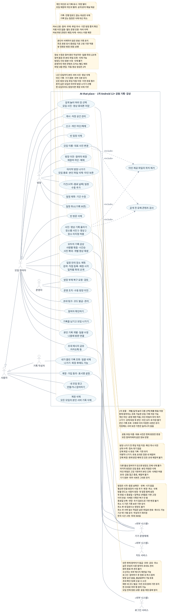
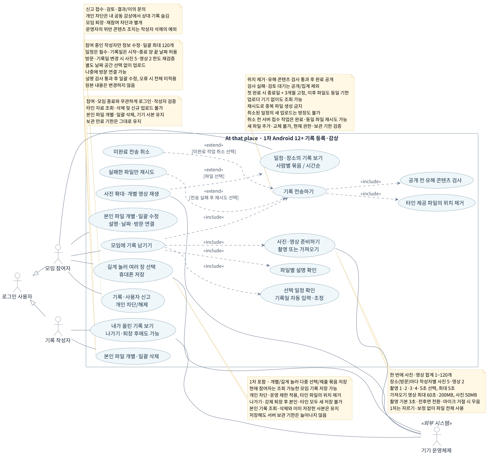
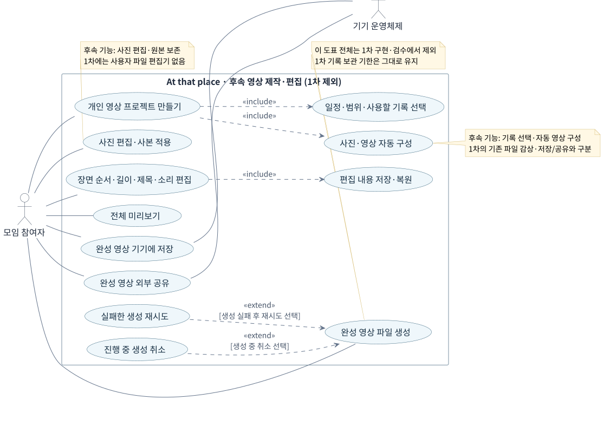

> **이전 문서 · 보관본:** 현재 기능 명세는 [기능명세서.md](../기능명세서.md)를 따른다. 이 파일은 더 이상 수정·동기화하지 않는다.

# At that place 기능 명세서

작성 기준일: 2026-10-17. 혜원·은송의 의견과 개발 차수·참여 인원·기록 유지·촬영 시간·보관 기간·캘린더 방식 일정 관리에 대한 의뢰인의 결정을 반영했다.

At that place는 함께한 활동을 남기고 싶은 사람들이 각자 찍은 사진·영상을 모임에 모으고 함께 감상하는 앱이다. 장기적으로는 모인 기록을 한 편의 추억 영상으로 간직하게 한다.

**1차 개발은 모임·일정 생성과 관리·초대·장소 계획·사진 및 영상 촬영과 업로드·공동 감상·사진/영상의 휴대폰 저장·외부 앱 공유·본인 기록 관리까지다. 자동 영상 생성과 사진·영상 편집은 모두 2차 개발이다.** 1차의 완료 기준에 편집기, 영상 초안, 완성 영상 파일 생성·저장·공유를 넣지 않는다. 사진 확대·영상 재생은 감상 기능으로 1차에 포함한다.

이 문서는 새 앱의 기능·화면·데이터·처리 계약을 설계하기 위한 기준이다. 이 문서의 ‘의견 반영 기준’은 고객 의견을 반영해 정리한 작업 기준이며 고객 전체의 최종 승인을 뜻하지 않는다. 의견이 충돌하거나 답변이 부족한 정책은 ‘설계 전에 확정할 항목’으로 남겼다. 미정인 숫자나 삭제 정책을 구현자가 임의로 정하지 않는다.

**결정 상태의 의미:** 개발 차수와 아래 ‘이번에 확정한 1차 정책’은 의뢰인이 확정했다. ‘의견 반영’은 혜원·은송의 공통 의견 또는 기존 기준을 업무 규칙으로 정리한 것이고, ‘설계 제안’은 빈 부분을 채우기 위한 검토안이다. ‘미정’은 상충하거나 답이 없는 항목이다. 카카오톡 공식 기준을 확인해 이 문서에 적용한 항목도 의뢰인의 준용 지시에 따른 확정 정책이다. 기존 의견 반영·설계 제안 중 공식 기준으로 해소되지 않은 제품 정책만 추가 질문하며, 기술·UI 구현값은 설계서에서 결정한다.

## 빠른 이동

- [이번에 확정한 1차 정책](#이번에-확정한-1차-정책)
- [카카오톡 팀채팅 기준 적용](#카카오톡-팀채팅-기준-적용)
- [모임방과 일정의 구조](#모임방과-일정의-구조)
- [개발 차수와 범위](#개발-차수와-범위)
- [혜원·은송 의견의 반영 결과](#혜원은송-의견의-반영-결과)
- [유스케이스 다이어그램](#유스케이스-다이어그램)
- [1차 역할과 권한](#1차-역할과-권한)
- [1차 화면과 이동 계약](#1차-화면과-이동-계약)
- [기간·맞춤 반복·일정 변경 상세](#일정-생성기간-선택맞춤-반복)
- [1차 기능 상세](#1차-기능-상세)
- [UI·코드 설계에 넘길 논리 데이터](#ui코드-설계에-넘길-논리-데이터)
- [UI·서비스 간 처리 계약](#ui서비스-간-처리-계약)
- [2차 기능 명세와 남은 결정](#2차-기능-명세와-남은-결정)
- [비기능 요구사항과 검증 기준](#비기능-요구사항과-검증-기준)
- [설계 전에 확정할 항목](#설계-전에-확정할-항목)
- [구현 순서와 완료 검수](#구현-순서와-완료-검수)

# 이번에 확정한 1차 정책

2026-10-16~17 의뢰인의 결정이다. 과거 의견과 달라진 부분은 이 표와 기능 상세를 우선 적용한다.

| 항목 | 확정 정책 | 적용 경계 |
| --- | --- | --- |
| 참여 인원 | 방장 포함 활성 참여자 최대 10명 | 모임방 단위. 일정이 늘어도 정원은 모임방 단위로 적용. 유료 확대는 미정 |
| 모임 구조 | 같은 모임방 안에서 기간 또는 맞춤 반복이 있는 일정을 만들고 기록을 모음 | 화면에서는 일정을 선택하면 바로 계획·기록이 열림. 날짜는 일정의 속성·필터이며 별도 생성·진입 단계가 아님 |
| 모임 생성·방장 | 방을 만드는 사람이 방장, 방 생성 과정에서 첫 일정 설정 | 2026-10-17 확정. 모임 정보와 첫 일정 설정을 모두 마쳐야 생성 완료 |
| 초대 권한·공유 | 방장만 앱에서 링크·코드 발급/조회·재발급·취소, 카카오톡 등으로 초대 메시지 공유 | 받은 메시지는 다른 동행자에게 재전달 가능. 전달받아도 초대 관리 권한은 생기지 않음. 유효한 초대·로그인·정원 확인 후 방장 승인 없이 참여. 링크·코드는 발급 시점부터 7일간 유효 |
| 초대 유효 기간 | 링크와 코드 모두 서버 발급 시점부터 7일(168시간) | 만료 순간부터 새 참여 불가. 재공유·재전달·조회로 기한 연장 안 됨. 기존 참여자는 유지 |
| 초대 사용 인원 | 같은 링크·코드로 여러 명 참여 가능. 한 명 참여 후 소모하지 않음 | 유효 기간 안에서 모임의 활성 참여자 최대 10명 기준. 초대별 별도 1회/누적 사용 한도 없음. 동일 계정 활성 참여는 하나 |
| 초대 추가 발급 | 방장이 ‘초대 코드 받기’를 누를 때마다 새 링크·코드를 발급. 이전 초대도 각자 원래 만료일까지 유지 | 새 초대는 새 발급 시점부터 7일, 이전 초대 만료일은 변경 없음. 방장이 따로 저장·재사용할 필요 없음 |
| 방장 나가기·후임 지정 | 다른 참여자가 남으면 후임 직접 지정·확인 즉시 이전 후 나가기. 마지막 방장은 모임과 서버 기록 삭제 후 나가기 | 상대 수락 대기 없음. 다른 참여자가 있으면 미이전 상태 나가기 불가. 마지막 1인은 삭제 확인 필수 |
| 모임 전체 삭제 권한 | 다른 활성 참여자가 있으면 방장도 모임 전체 삭제 불가 | 마지막 참여자인 방장이 나가기를 확인할 때만 모임·서버 기록 삭제. 본인 파일 개별 삭제·보관 만료는 별개 |
| 마지막 방장 나가기 | 현재 참여자가 방장 한 명이면 모임과 해당 모임의 서버 사진·영상·파생 파일 삭제 | 남은 3개월 기한보다 우선. 휴대폰에 이미 저장한 원본·내려받은 사본·외부 공유본은 삭제하지 않음. 삭제 모임 재참여 불가 |
| 나가기·강제 퇴장 후 재참여 | 유효한 기존/새 초대·로그인·정원 조건을 만족하면 다시 참여 가능 | 스스로 나가기·강제 퇴장 모두 승인·차단 해제 불필요. 종료 즉시 공동 접근 차단, 다시 참여하기로 일반 참여 복구 |
| 모임 참여 방식 | 유효한 초대를 받은 사용자가 로그인 후 참여하기를 선택하면 즉시 참여 | 방장 승인·참여 신청 대기 단계 없음. 참여 확정 순간 정원 10명·초대 유효성·중복 참여를 재검증 |
| 일정 관리 권한 | 방장만 일정 생성·제목/기간/시간/반복 수정·취소·반복 중단 | 단일·기간·맞춤 반복 모두 동일. 이 일정만/이후/전체 적용 범위 모두 현재 방장만 가능 |
| 일정 설정 | 하루·여러 날 기간, 종일·시각 지정, 일/주/월/년 맞춤 반복, 간격·복수 요일·종료 조건, 기간 변경 | 월요일은 예시. 반복 안 함/기한 없음/특정 날짜까지/지정 횟수와 변경 적용 범위를 선택 |
| 참여 종료 후 본인 기록 관리 | 로그인한 사용자는 모임 참여 여부와 관계없이 ‘내가 올린 기록’에서 본인 완료 파일 조회·삭제 가능 | 나가기·강제 퇴장 후에도 재참여·초대·빈자리 불필요. 본인 파일도 휴대폰에 새로 저장 불가. 타인 자료 조회·새 업로드·일정/설명/날짜/장소 수정은 허용하지 않음. 기존 보관 기한 유지 |
| 계정 삭제 시 본인 기록 | 계정을 완전히 삭제하면 모든 모임에서 본인이 올린 서버 사진·영상도 삭제 | 이미 나갔거나 강제 퇴장된 모임의 본인 파일도 포함. 휴대폰 원본·내려받은 사본·외부 공유본은 유지. 모든 방장 모임의 역할 정리를 완료한 뒤 계정 삭제 |
| 계정 삭제 전 방장 역할 정리 | 다른 활성 참여자가 있는 모든 방장 모임에서 후임을 직접 지정해 이전 완료 후 계정 삭제 | 한 모임이라도 미이전이면 계정 삭제 불가. 자동 후임 지정 없음. 혼자 남은 모임은 마지막 방장 나가기·서버 기록 삭제 확인을 먼저 완료 |
| 일반 나가기·강제 퇴장 시 기록 | 모임이 유지되는 동안 본인이 삭제하지 않은 완료 기록 유지 | 원래 3개월 기한 유지. 마지막 방장의 모임 삭제는 서버 기록 전체 삭제가 우선. 계정 삭제는 모든 모임의 본인 서버 사진·영상 삭제 |
| 앱 내 영상 촬영 시간 | 1·2·3·4·5초 중 정수 선택 | 선택 시간에 녹화 자동 종료, 최대 5초. 최초 기본값·조기 종료 허용 여부는 미정. 가져온 영상의 길이 제한은 별도 |
| 일정 취소 시 기존 기록 보관 | 취소 직전에 확정된 종료일 기준의 보관 기한 유지 | 취소일을 새 기산일로 사용하지 않음. 취소·반복 중단만으로 기존 기록 삭제/즉시 만료/기한 연장 안 함. 기한 내 감상 가능. 취소 후 새 업로드는 모든 역할에서 차단. 취소 전 서버 접수된 미완료 파일은 같은 작업으로 완료 허용 |
| 카카오톡 기준 적용 | 공식 팀채팅 정책의 명확한 항목은 추가 질문 없이 적용 | 이미 직접 확정한 개별 정책·1/2차 범위를 우선. 일반채팅·오픈채팅·톡클라우드·PC 공통 기능은 구분해 적용. 미공개 내부 동작을 카카오톡 정책으로 단정하지 않음 |
| 모임 이름·대표 사진 | 현재 방장만 공동 모임 이름·대표 사진 변경/기본 이미지 복원 | 현재 참여자 전원에게 같은 공동 정보 반영. 장소 계획의 공동 수정과 분리. 일반 참여자의 직접 변경 요청 거부 |
| 기존 사진·영상 외부 공유 | 1차에 카카오톡 등 외부 앱으로 기존 사진·영상 직접 공유 | 현재 참여자만 본인/타인 유효한 파일 공유. 나가기·강제 퇴장 후 본인 파일도 새 공유 불가. 수신자에게 모임 접근 권한은 부여하지 않음 |
| 묶음 저장·파일 선택 상한 | 개별·여러 파일 선택·같은 제출 묶음의 전체 완료 파일 저장 제공. 업로드 선택은 사진·영상 합계 최대 120개 | 공식 멀티미디어 사용 방식을 본 앱의 기록 목록에 적용. 모임 정원 10명과 구별. 서버 전송 병렬 수·외부 앱의 수신 한도와도 별개 |
| 사진·영상 휴대폰 저장 | 1차에 사용자가 선택한 기록 파일을 휴대폰에 저장하는 기능 포함 | 새 영상 생성·편집 없이 기존 사진/영상 저장. 현재 참여자는 해당 모임의 본인/다른 참여자 기록 모두 저장 가능. 나가기·강제 퇴장 후 본인/타인 파일 모두 새로 저장 불가. 저장 파일 규격은 추가 확정. 저장해도 서버 보관 기한은 늘어나지 않음 |
| 취소 전 접수된 업로드 | 취소 전에 서버가 접수한 파일별 업로드 작업은 취소 후에도 이어서 완료 가능 | 같은 작업·같은 파일의 재시도만 허용. 현재 참여·로그인·기한·파일 검증은 유지. 취소 이후 신규 파일·작업 접수 불가 |
| 취소 일정의 새 업로드 | 취소된 일정에는 새 사진·영상 업로드 불가 | 방장도 동일. 기존 기록의 감상·본인 파일 삭제와 보관 기한 유지. 취소 전 서버 접수된 파일만 기존 작업으로 완료·재시도 허용. 새 파일 추가·교체는 불가 |
| 기간 단축 시 즉시 만료 | 새 보관 기한이 이미 지난 기록이 있으면 만료 대상·기한 안내 후 방장이 확인한 경우에만 변경 허용 | 다른 작성자의 해당 기록도 만료. 공동·본인 열람 즉시 차단 후 서버 정리, 기기 원본·외부 사본 유지. 확인 취소 시 변경·만료 실행 안 함 |
| 기록 보관 | 기록이 연결된 해당 일정 종료일부터 3개월 | 반복도 각각 실제로 진행되는 일정의 종료일 기준. 반복 전체의 최종 종료일·모임 생성일로 계산하지 않음 |
| 일정 종료일 변경과 보관 | 아직 만료되지 않은 기록은 변경된 실제 일정 종료일부터 달력상 3개월로 보관 기한 재계산 | 변경된 일정만 적용. 이미 만료·삭제된 기록은 복구하지 않음. 기간 단축으로 새 기한이 이미 지났으면 경고·방장 명시적 확인 후 변경과 동시에 만료. 일정 취소만으로는 기존 보관 기한을 바꾸지 않음 |

기록을 남겨 둔다는 것은 보관 만료까지 유지한다는 뜻이다. 만료일은 달력상 3개월을 기준으로 계산하며 90일로 바꾸지 않는다. 마지막 방장 나가기의 모임 삭제는 남은 기한보다 우선한다. 종료일 변경 시 아직 만료 전인 기록은 새 종료일 기준으로 재계산하고 이미 만료·삭제된 기록은 복구하지 않는다. 정확한 만료 시각·말일 보정·사전 안내·물리 삭제 시점은 ‘설계 전에 확정할 항목’에서 정한다. 아직 확정하지 않은 계산 규칙을 이유로 보관 기간 자체를 다시 미정으로 표시하지 않는다.

# 카카오톡 팀채팅 기준 적용

2026-10-17 의뢰인이 카카오톡을 기본 사용 기준으로 지정했다. 같은 내용을 선택지로 다시 묻지 않고 공식 도움말에서 확인한 내용을 명세에 적용한다. **앞서 직접 결정한 정원 10명·일정 종료 후 3개월·방장 전용 일정/초대 관리·승인 없는 참여·수락 대기 없는 방장 이전·퇴장 후 재참여·마지막 방장 나가기·계정 삭제·참여 종료 후 본인 조회/삭제는 앱 고유 확정 정책으로 유지한다.** 카카오톡의 일반채팅·오픈채팅·톡클라우드 정책을 팀채팅 정책으로 섞거나, 카카오톡에 있는 모든 기능을 1차 범위에 추가하지 않는다.

| 공식 안내에서 확인한 내용 | At that place에 적용할 동작 | 적용 경계 |
| --- | --- | --- |
| 팀채팅은 관리자가 멤버와 팀 정보를 관리한다. 방장·부방장이 팀 이름/이미지를 변경하면 공동 정보에 반영된다. [공식 팀 정보 도움말](https://cs.kakao.com/helps_html/1073209689) | 공동 모임 이름·대표 사진은 방장만 변경하고 현재 참여자 전원에게 반영한다. 미정이던 모임 이름 권한을 확정하고 기존 의견 기반의 전원 대표 사진 변경을 방장 관리로 변경한다. | 이미 정한 단일 방장 권한 체계에 맞춰 적용한다. 부방장·개인별 별칭/대표 사진을 자동으로 추가하지 않는다. |
| 방장이 초대 권한과 캘린더 작성 권한을 관리할 수 있다. [공식 초대 권한](https://cs.kakao.com/helps_html/1073209692), [공식 캘린더 권한](https://cs.kakao.com/helps_html/1073209703) | 방장이 참여자·초대·일정을 관리하는 구조를 따른다. | 본 앱은 이미 정한 ‘방장만’으로 고정한다. 모든 멤버에게 권한을 여는 설정이나 부방장 역할을 새로 추가하지 않는다. |
| PC 공통 멀티미디어 도움말은 사진/영상 개별 저장과 여러 파일 선택 저장을 안내하며 묶음사진 전체 저장도 공식 공지에 있다. [공식 저장 도움말](https://cs.kakao.com/helps_html/1073209396), [공식 묶음 저장 공지](https://pc.kakao.com/talk/notices/ko/2455) | 개별 저장·목록의 여러 파일 선택 저장·같은 제출 묶음의 완료 파일 전체 저장을 1차에 제공한다. | 공식 동작을 본 앱의 모바일 목록/상세에 옮겨 적용한다. 팀채팅 전용 제한이나 모바일 버튼 위치까지 공식 확인된 것으로 표기하지 않는다. 일정 전체 무제한 자동 다운로드를 뜻하지 않는다. |
| 공식 안내상 사진·영상은 한 번에 최대 120개 선택 전송할 수 있다. [공식 선택 개수 도움말](https://cs.kakao.com/helps_html/1073210382) | 업로드 선택 상한을 합계 120개로 적용한다. 클라이언트/서버 검증과 선택 수 표시를 맞춘다. | 카카오톡 말풍선의 내부 묶음 분할은 본 앱에 옮기지 않는다. 모임 정원·일별 누적 용량·전송 병렬 수는 다른 정책이다. |
| 공식 Android 도움말은 저장한 사진/영상의 앨범 위치와 촬영 날짜에 따른 정렬을 안내한다. [공식 저장 위치 도움말](https://cs.kakao.com/helps_html/1073209397) | 플랫폼이 지원하면 ‘At that place’ 앨범을 사용하고 저장 성공 후 확인 위치를 안내한다. 촬영 날짜 때문에 최신 위치에 안 보이는 경우를 안내한다. | 실제 파일명·지원 형식·OS별 저장 절차는 기술 설계로 확정한다. 카카오톡의 앨범 이름을 그대로 사용하지 않는다. |

카카오톡과 다른 앱 고유 정책도 구현자가 혼동하지 않도록 다음과 같이 명시한다. 카카오톡 팀채팅의 방장 변경은 상대 수락과 요청 기한이 있지만 본 앱은 직접 지정·확인 즉시 이전한다. 카카오톡의 방장 나가기는 팀채팅 삭제로 이어질 수 있지만 본 앱은 다른 참여자가 있으면 먼저 이전해야 한다. [공식 방장 변경](https://cs.kakao.com/helps_html/1073209691), [공식 방장 나가기](https://cs.kakao.com/helps_html/1073209694) 카카오톡 공식 공지의 링크 참여 승인과도 달리 본 앱의 유효한 초대는 로그인·정원 확인 후 승인 없이 참여한다. [공식 링크 참여 안내](https://pc.kakao.com/talk/notices/ko/2874?agent=win32) 카카오톡 팀 데이터의 유료 구독·무기한 미디어 보관·초대 거부 상태는 본 앱의 확정된 보관/재참여 정책을 바꾸지 않는다. [공식 팀채팅 안내](https://cs.kakao.com/helps_html/1073209686), [공식 초대 제한](https://cs.kakao.com/helps_html/1073209697)

외부 사진·영상 공유는 이번 의뢰인의 명시적 결정으로 1차에 포함한다. 이 기능의 권한·서버 접근·기기 공유 동작은 아래에 풀어 쓰며, 카카오톡의 미공개 내부 처리라고 주장하지 않는다. 공개 안내로 정해지지 않는 캘린더 기간 변경·3개월 만료 경계·장소별 누적 제한 등 앱 고유 정책만 고객 질문으로 유지한다. OS 권한·저장 위치·전송/렌더링 방식 등 구현 세부는 기술·UI 설계에서 결정한다.

# 개발 차수와 범위

| 구분 | 1차 개발 | 2차 개발 |
| --- | --- | --- |
| 계정·모임·일정 | 로그인·모임·최대 10명·초대·참여 관리, 달력/일정 목록, 기간·시간·맞춤 반복·일정 변경 | 일정 알림·외부 캘린더 동기화 등은 별도 범위 합의 |
| 장소 계획 | 날짜별 장소 검색·추가, 직접 등록, 방문 순서·예정 시각·날짜 제목, 대표 사진 | 영상 구성과 장소 정보의 연결 |
| 기록 등록 | 사진·영상 촬영, 기기에서 가져오기, 장소 없이 업로드, 나중에 장소 연결, 파일별 설명 | 업로드 전 사진 보정·자르기, 긴 영상 구간 선택 등 원본 편집 |
| 공동 감상 | 썸네일 목록, 사진 확대, 업로드한 개별 영상 재생, 날짜·방문별 조회 | 새로 제작한 완성 영상 감상·보관 정책은 별도 확정 |
| 기록 관리 | 참여 중 본인 파일 설명·날짜·장소 수정, 참여 종료 후에도 본인 기록 조회·삭제, 업로드 재시도·캐시 정리 | 편집 프로젝트 저장·복원, 원본 변경과 프로젝트의 연동 |
| 영상 제작 | 제공하지 않음 | 기록 선택, 순차 연결·분할 화면, 자동 구성, 미리보기, 실제 영상 생성 |
| 편집 | 제공하지 않음 | 사진 편집, 장면 길이·순서·제목·표시 정보·원음 편집 |
| 외부 전달 | 초대 링크·코드를 카카오톡 등으로 공유, 기존 사진·영상의 휴대폰 저장. 현재 참여자는 모임의 모든 사진·영상 저장 가능. 참여 종료 후 본인/타인 파일 모두 저장 불가. 기존 파일 직접 외부 공유도 1차 포함. 파일 규격은 기술 설계에서 확정 | 제작한 완성 영상의 기기 저장·시스템 공유 |
| 결제 | 제외를 권고하는 설계 제안. 최종 범위 확인 필요 | 인원·용량·보관 연장·템플릿 등을 유료화할지 별도 결정 |

1차의 ‘설명 수정’과 ‘날짜·장소 변경’은 기록 정보 수정이다. 사진 픽셀이나 영상 길이·소리를 바꾸지 않는다. 썸네일 생성, 방향 보정 표시, 호환용 변환은 업로드·재생을 위한 시스템 처리이며 사용자가 조작하는 편집 기능이 아니다. 대표 사진의 16:9 표시는 화면 배치로 처리하고 자르기 편집기를 제공하지 않는다.

# 혜원·은송 의견의 반영 결과

| 주제 | 혜원 의견 | 은송 의견 | 이번 명세의 처리 |
| --- | --- | --- | --- |
| 장소 없는 기록 | 장소 중심이 편리하지만 장소 없이 두는 것도 가능. ‘기타’ 분류 고민 | 우선 업로드하고 나중에 장소 연결 | 장소 연결을 선택 입력으로 반영. 화면 명칭은 ‘장소 미지정’을 설계 제안으로 사용 |
| 모임의 단위 | 주기적 모임을 위해 한 방에 여러 일정 | 한 방에 한 여행, 재여행은 새 방 | 의뢰인 확정: 같은 방에서 단일·기간·맞춤 반복 일정을 같은 입력 방식으로 관리. 달력에서 선택한 일정에 기록 연결 |
| 플랫폼 | 추가 답변 없음 | Android·iOS 동시 출시 희망 | 두 플랫폼 동시 출시를 목표로 반영. 최소 버전·기준 기기는 미정 |
| 로그인·초대 | 추가 답변 없음 | 카카오·Apple·Google, 로그인 전 모임명·기간, 링크와 코드 모두 | 해당 흐름을 의견 반영 기준으로 명세. 플랫폼별 로그인 제공 조합과 초대 세부 정책은 확인 필요 |
| 인원 | 무료 5~8명과 유료 확대 검토 | 방장 포함 10명 제안 | 의뢰인 확정: 방장 포함 최대 10명. 인원 선택 충돌 해소, 유료 확대는 별도 |
| 원본 관리 | 본인만 수정·삭제. 방장의 원본 관리는 이후 검토 | 본인만 원본 삭제, 방장은 참여자 제외·권한 이전 | 1차 원본 수정·삭제는 작성자만. 방장도 타인 원본을 수정·삭제하지 않음 |
| 기간·탈퇴·삭제 | 기간 길이는 고정하고 날짜만 변경. 탈퇴 시 본인 사진 삭제, 방 삭제 시 전체 삭제 | 기간 변경에도 원본 유지, 범위 밖 기록 보관·재지정. 탈퇴 때 삭제 여부 선택 | 의뢰인 확정: 일정 기간 변경 허용, 모임에서 나가도 본인이 삭제하지 않은 기록 유지. 모임 전체 삭제는 마지막 방장 나가기에만 허용. 계정 삭제 시 모든 모임의 본인 서버 사진·영상 삭제. 계정 삭제 전 모든 방장 모임의 후임 직접 지정·이전 또는 마지막 1인 나가기 완료. 범위 밖 기록의 표시·재지정은 별도 확정 |
| 짧은 영상 | 2초·5초, 최대 5초, 긴 영상 구간 선택 | 1·2·3·5초 선택 | 의뢰인 확정: 앱 촬영은 1·2·3·4·5초 선택. 가져온 영상 길이 제한은 미정, 구간 자르기는 2차 |
| 누적 제한 | 장소마다 1인 사진 2장·영상 1개, 하루 장소 10개 제안 | 한 번에 합계 10개 선택 유지 | 카카오톡 준용으로 1회 사진·영상 합계 120개 선택. 장소·개인·하루별 누적 제한은 앱 고유 정책으로 별도 결정 |
| 생성 범위 | 일정 한 편, 선택한 하루만으로 제작 가능 | 전체 여행 기본, 원하는 날짜 선택 가능 | 2차는 선택 일정의 전체 기간 기본·원하는 날짜 필터. 반복 전체 합본은 별도 결정 |
| 영상 구성 | 장소마다 순차·분할 선택, 길이 다르면 분할 제한 제안 | 순차와 분할 모두 희망 | 모두 2차. 길이가 다른 영상을 분할하는 규칙과 장소별 설정은 미정 |
| 장면 선택·정렬 | 선택한 기록만, 일정 다음 장소 기준 | 방문 순서 기본, 촬영 시각 정렬도 희망. 초과 시 선택·길이 조정 안내 | 2차 선택 기록만 사용. 날짜·방문 순서를 기본안으로 두고 촬영 시각 정렬은 옵션 검토. 임의 누락 금지 |
| 출력 비율·여백 | 세로·가로 선택, 잘라 채우기 선호 | 9:16 기본, 여백 유지 선호 | 2차 정책 충돌로 남김. 비율 기본값·화면 채우기 방식 미정 |
| 소리·음악 | 원음·무음 선택, 분할 원음 중첩, 음악은 이후 검토 | 원음 켜기·끄기, 음악은 없어도 가능 | 원음 조절은 2차. 배경음악과 분할 믹싱은 별도 합의. 1차는 업로드한 영상 자체를 재생 |
| 프로젝트·완성본 | 개인 제작, 모임 게시보다 외부 공유로 충분할 수 있음 | 사용자별 프로젝트 희망 | 2차 개인 소유 프로젝트를 기준으로 정리. 완성본 모임 게시·보관은 확정하지 않음 |
| 온라인 이용 | 인터넷 필수, 업로더 기기가 꺼져도 조회 | 동일, 오프라인 기능 불필요 | 1차 온라인 이용, 서비스 측 공동 저장으로 반영. 휴대폰끼리의 직접 전송만으로 구성하지 않음 |
| 보관 기간 | 6개월~1년 제안, 비용 측정 필요 | 최대 2주 뒤 유료 연장 제안. 사전 안내 희망 | 의뢰인 확정: 각 일정 종료일부터 3개월. 종료일 변경 시 미만료 기록 재계산, 만료·삭제 기록 복구 없음. 기간 단축으로 기한이 지났으면 경고·방장 확인 후 즉시 만료. 정확한 만료 시각·안내·물리 삭제·유료 연장은 별도 |
| 유료화 | 인원·업로드 수 포함 검토, 타 앱 기능·가격 사례 제시 | 첫 출시 핵심 기능 우선, 이후 긴 영상·용량·템플릿 | 타 앱 가격·20개 유료 기능은 이 앱의 요구사항으로 전환하지 않음. 1차 결제 제외를 제안 |
| 촬영 소리 | 추가 답변 없음 | 무음 선호, 기기·지역 제약 준수 희망 | 앱 자체 효과음과 기기 셔터음 구분. 무음 보장 요구로 확정하지 않음 |
| 작업 진행·이동 | 영상 생성 중 화면 이동·복귀 희망. 완전 종료 후 지속은 검토 | 업로드·생성 진행률, 화면 이동 후 작업 유지 | 1차 업로드 상태·화면 이동 복구, 2차 생성 작업 상태에 반영. 프로세스 종료 후 지속 실행은 보장 범위를 별도 설계 |
| 지도·직접 등록 | 카카오 지도 검토, 위치 거부 시 서울시청, 관광지·맛집·카페·숙소 | 국내 우선, 카카오·네이버 검토, 지도 영역 검색·현재 위치·수기 등록 | 지도 공급자는 미정. 수기 등록 포함. 서울시청·네 분류는 설계 제안. 분류 매핑을 고정된 공급자 코드와 분리 |
| 시각·오류 | 한국 시각 표시, 업로드 시각 시간대 저장 | 촬영·업로드·방문 시각 분리, 썸네일 우선, 일부 실패 재시도, 문의 가능한 오류 | 한국 시각 표시 기준, 시각 분리, 파일별 실패·재시도, 사용자 설명과 문의용 식별값으로 구체화 |
| 설명·자막 입력 시점 | 고객 답변 없음 | 고객 답변 없음 | 1차 파일별 설명은 기록 목록용. 영상에 자막으로 자동 삽입하지 않음. 2차 자막 입력 시점·재사용 여부는 질문으로 유지 |

# 1차 전체 이용 흐름과 주요 용어

1. 로그인하고 최대 10명이 참여하는 모임을 만들거나 초대로 참여한다.
2. 모임의 달력·일정 목록에서 일정을 만들거나 선택한다. 만들 때 제목·시작과 종료·종일 여부·반복·종료 조건을 한 폼에서 설정한다.
3. 선택한 일정에서 바로 장소를 계획하거나 사진·영상을 올린다. 장소를 정하기 전에도 올릴 수 있고 기록일은 자동 입력한 뒤 필요하면 바꾼다.
4. 같은 일정의 기록을 함께 감상한다. 여러 날 일정은 전체 기록을 기본으로 보며 날짜별로 좁혀 볼 수 있다.
5. 참여 중에는 모임의 사진·영상을 개별/선택/제출 묶음 단위로 휴대폰에 저장하거나 외부 앱으로 공유한다. 본인 기록의 설명·기록일·장소를 수정하거나 삭제한다.

| 용어 | 정의와 경계 |
| --- | --- |
| 사용자·모임 참여자 | 계정으로 식별되는 사람과 특정 모임에 참여 중인 역할. 두 상태는 별도로 검증한다. |
| 모임방 | 최대 10명의 참여 관계·방장·대표 사진을 가진 공동 공간. 일정을 여러 개 담을 수 있다. |
| 일정 | 시작과 종료를 가진 한 번의 활동. 하루·여러 날·시간 지정 모두 같은 일정 폼을 사용한다. 달력에서 선택한 일정이 계획·기록의 대상이다. |
| 기간 | 한 번의 일정이 진행되는 시작~종료 범위. 반복을 얼마나 오래 할지와 별개다. |
| 반복 설정 | 일정이 다시 나타나는 주기·간격·요일/날짜·종료 조건. 반복되는 각 날짜의 일정도 화면에서는 모두 ‘일정’이다. |
| 반복 종료 조건 | 반복이 계속될 범위. 기한 없음·특정 날짜까지·정해진 횟수 중 하나를 고른다. |
| 기록일·날짜 필터 | 일정 안에서 사진·영상·방문을 정리할 날짜 속성. 날짜 공간을 별도로 만들지 않고 일정 상세 안에서 필터로 사용한다. |
| 방장 | 모임 생성자에게 부여되는 참여 관리 역할. 이전 가능하며 현재 방장은 한 명이다. |
| 장소 정보·방문 | 지도 또는 직접 등록한 장소와 그 장소를 선택 일정에서 방문할 계획. 여러 날 일정에서는 방문일도 지정한다. |
| 게시물·파일 | 한 번의 제출 묶음과 사진 한 장/영상 하나. 파일별 상태·설명·기록일·방문을 관리한다. |
| 장소 미지정 기록 | 선택 일정에는 속하지만 방문 연결은 없는 파일. 기록일은 날짜 속성으로 저장한다. |
| 파일 설명 | 카드·상세에서 표시하는 글. 2차 영상 자막과 별개다. |
| 업로드 완료 | 서비스 측 저장과 다른 참여자의 권한 있는 조회가 가능한 상태. 업로더 기기가 켜져 있을 필요가 없다. |
| 2차 프로젝트·완성 영상 | 편집 설정과 출력한 영상 파일. 1차 화면이나 완료 검수의 필수 항목이 아니다. |

# 모임방과 일정의 구조

사용자가 보는 구조는 **모임방 → 일정 → 계획·기록**이다. 달력에서 날짜 또는 기간을 고르면 해당 날짜에 걸친 일정들이 표시되고, 일정 하나를 누르면 장소 계획과 사진·영상이 바로 열린다. 일정 선택 뒤 날짜를 다시 고르는 필수 단계를 두지 않는다.

| 사용자 입력 예 | 저장할 일정 설정 | 화면에서의 사용 |
| --- | --- | --- |
| 10월 19~21일 여행 | 종일, 시작 19일·종료 21일, 반복 안 함 | 여행 일정 하나를 열어 사흘 전체 기록 보기. 필요할 때 19/20/21일로 필터 |
| 매주 화·목 저녁 운동 | 첫 시작·종료 시각, 1주마다, 화·목, 12월 31일까지 | 달력의 실제 날짜에 나타난 운동 일정을 눌러 그날 기록 열기 |
| 격주 토요일 모임 | 2주마다, 토요일, 총 8회 | 2주 간격의 일정 표시, 그중 하나만 날짜·시간 변경 가능 |
| 매월 둘째 금요일 모임 | 1개월마다, 둘째 금요일, 기한 없음 | 해당 월에 계산된 일정 표시. 모임방은 그대로 사용 |

참여자·초대·최대 10명·대표 사진은 모임방에 속한다. 기간·반복 설정·방문·기록·보관 예정일은 선택 일정의 정보다. 여러 날 일정의 날짜는 기록을 좁혀 보는 속성이며 독립적인 사용자 공간이 아니다.

기술 설계에서는 반복 설정과 특정 날짜에 나타난 일정을 식별하는 정보를 구분한다. 그래야 ‘이번 일정만 날짜 변경’, 그날 기록의 유지, 일정별 3개월 보관을 처리할 수 있다. 이는 내부 식별 관계이며 화면에 별도의 관리 단계를 추가하는 요구가 아니다. 반복을 중단해도 이미 남긴 기록을 삭제하지 않는다.

# 유스케이스 다이어그램

사각형은 At that place의 서비스 범위, 타원은 기능, 밖의 주체는 사용자 또는 협력하는 외부 시스템이다. 실선은 기능에 참여하는 관계이며 실행 순서가 아니다. ‘모임 참여자 → 사용자’, ‘방장 → 모임 참여자’, ‘기록 작성자 → 사용자’의 빈 삼각형은 기본 역할의 기능을 함께 이용한다는 뜻이다. 기록 작성자는 모임을 나간 뒤에도 유지되는 역할이며 한 사람은 참여자·방장·작성자 역할을 함께 가질 수 있다.

`include` 점선 화살표는 반드시 포함하는 동작을 가리킨다. `extend`는 대괄호 조건에 따른 추가 동작에서 기본 기능을 가리킨다. 회색 ‘정책미정’은 실행 권한·적용 범위 등 추가 합의가 필요하다는 뜻이다. 기간 선택·맞춤 반복·세 변경 범위는 1차 명세에 포함하며 일정 생성·수정·취소·반복 중단은 현재 방장만 가능하다. 종료일 변경 시 미만료 기록의 보관 기한 재계산은 확정이며, 일정 취소 시 기존 보관 기한 유지도 확정이다. 취소 후 새 업로드는 차단한다. 취소 전 서버가 접수한 미완료 업로드는 같은 작업으로 완료할 수 있다. 기간 밖 기록·반복 예외의 세부 정책은 별도로 확정한다. 지도·로그인 서비스의 공급자 표기는 특정 업체 채택을 뜻하지 않는다. 그림을 누르면 원본 크기로 볼 수 있다.

## 1차 전체 기능

## 1차 기록 등록·감상 상세

## 2차 영상 제작·편집 범위

# 1차 역할과 권한

서버는 요청별로 로그인·대상·모임 삭제 상태·필요 권한을 검증한다. 모임 공동 조회·등록·수정에는 현재 참여가 필요하다. ‘내가 올린 기록’의 본인 파일 조회·삭제는 로그인·작성자 일치·모임 삭제/파일 보관 상태를 검증하며 현재 참여를 요구하지 않는다. 화면에서 버튼을 숨기는 것만으로 권한 검사를 대신하지 않는다. 작성자 식별은 모임에서 나가도 바뀌지 않는다.

| 동작 | 로그인 전 | 일반 참여자 | 해당 기록 작성자(참여 종료 포함) | 방장 |
| --- | --- | --- | --- | --- |
| 유효한 초대의 모임명·기간 보기 | 초대 자격을 확인한 경우에만 가능 | 가능 | 가능 | 가능 |
| 모임의 전체 기록·참여자·장소 조회 | 불가 | 가능 | 현재 참여 중일 때만 가능 | 가능 |
| 장소 추가·직접 등록·순서·시각·날짜 제목 | 불가 | 가능 | 현재 참여 중일 때만 가능 | 가능 |
| 사진·영상 등록 | 불가 | 취소되지 않은 일정에 가능 | 현재 참여 중이며 취소되지 않은 일정에 가능 | 취소되지 않은 일정에 가능. 취소 시 방장도 신규 업로드 불가 |
| 파일 설명·기록 날짜·연결 방문 수정 | 불가 | 불가 | 현재 참여 중인 본인 파일만 가능 | 본인 파일만 가능 |
| 사진·영상 휴대폰 저장 | 불가 | 현재 참여 중인 모임의 본인·다른 참여자 파일 모두 가능 | 현재 참여 중이면 모임의 모든 파일 가능. 참여 종료 후 본인 파일도 저장 불가 | 현재 참여 중인 모임의 모든 파일 가능. 일반 참여자와 동일 |
| 기존 사진·영상 외부 공유 | 불가 | 현재 참여 중인 모임의 본인·타인 유효한 파일 가능 | 현재 참여 중일 때만 가능. 참여 종료 후 본인 파일도 불가 | 일반 참여자와 동일 |
| 내가 올린 기록 조회·본인 파일 삭제 | 불가 | 본인 파일만 가능 | 참여 종료 후에도 본인 파일만 가능 | 본인 파일만 가능 |
| 앱의 초대 발급·관리 화면·재발급·취소 | 불가 | 불가 | 작성자 역할만으로는 불가 | 가능. 현재 방장인지 서버에서 검증 |
| 일정 생성 | 불가 | 불가 | 작성자 역할만으로는 불가 | 가능. 단일·기간·맞춤 반복 모두 동일 |
| 일정 제목·기간·시간·반복 규칙 수정 | 불가 | 불가 | 작성자 역할만으로는 불가 | 가능. 현재 방장 권한을 서버에서 재검증 |
| 일정 취소·반복 중단 | 불가 | 불가 | 작성자 역할만으로는 불가 | 가능. 모든 적용 범위에 현재 방장 검증 |
| 모임 이름·대표 사진 변경/기본 이미지 복원 | 불가 | 불가 | 작성자 역할만으로는 불가 | 현재 방장만 가능. 공동 정보는 모든 참여자에게 반영 |
| 참여자 강제 퇴장·방장 이전 | 불가 | 불가 | 작성자 역할로는 불가 | 가능. 퇴장은 접근 종료이며 기존 완료 기록·보관 기한 유지 |
| 모임 나가기 | 해당 없음 | 본인이 지우지 않은 기록을 남기고 나가기 | 동일 | 다른 참여자가 남으면 이전 완료 후 가능. 마지막 1인은 모임·서버 기록 삭제 확인 후 나가기 |
| 계정 삭제 | 해당 없음 | 본인 계정·모든 모임의 본인 서버 사진·영상 삭제 | 동일. 참여 종료 모임의 본인 기록 포함 | 모든 방장 모임에서 후임 직접 지정·이전 완료 또는 마지막 1인 나가기 완료 후 가능 |
| 모임 삭제 | 불가 | 불가 | 불가 | 마지막 1인 방장 나가기와 연계해 실행. 다른 활성 참여자가 있으면 방장도 전체 삭제 불가 |

외부 메신저에서 받은 초대 메시지를 재전달하는 것은 방장 전용인 앱의 발급·관리 기능과 구분한다. 일반 참여자·미참여자도 전달받은 유효한 초대를 열 수 있으나 초대 관리 정보 조회·변경은 할 수 없다.

방장과 원본 소유자는 별개다. 방장 이전은 파일 작성자를 바꾸지 않는다. 자발적으로 모임에서 나가도 본인이 삭제하지 않은 완료 기록은 일정 종료일 기준 3개월 기한까지 남는다. 강제 퇴장도 동일하게 완료 기록을 유지한다. 계정 자체 삭제 시에는 모든 모임의 본인 서버 사진·영상도 삭제한다. 계정 삭제 전 모든 방장 모임의 후임 직접 지정·이전 또는 마지막 1인 나가기를 완료해야 한다. 장소 삭제·날짜 공통 메모는 1차에 포함하지 않는다.

# 1차 화면과 이동 계약

화면 이름은 UI 설계를 위한 논리적 단위다. 달력과 목록은 같은 일정 데이터를 보여 주는 보기 방식이며 별도의 생성 흐름이 아니다. 일정 내부의 기록일·방문일 필터는 보조 조작이다.

| 화면 | 진입·핵심 표시 | 사용자 동작·다음 화면 | 반드시 구분할 상태 |
| --- | --- | --- | --- |
| 앱 시작·온라인 안내 | 로그인 복원·보류 초대·업로드 | 로그인 또는 원래 요청 화면 | 확인 중 / 오프라인 / 인증 만료 / 오류 |
| 로그인 | 제공 가능한 소셜 로그인·동의 | 로그인 성공 후 복귀 | 대기 / 처리 중 / 취소 / 오류 |
| 초대 미리보기·코드 | 유효한 초대의 모임명·일정 요약 | 로그인·참여 확인·모임 열기 | 유효 / 만료 / 취소 / 정원 초과 / 이미 참여 |
| 내 모임 목록 | 이름·대표 사진·인원/10·다가오는 일정 요약 | 만들기·코드 입력·모임 선택 | 로딩 / 비어 있음 / 목록 / 실패 |
| 모임 만들기·첫 일정 설정 | 모임 이름·정원 10명 안내, 첫 일정 제목·기간·종일/시간·반복 설정 | 모임 정보 → 첫 일정 설정 → 확인 → 함께 생성 완료 후 달력 | 작성 중 / 입력 오류 / 생성 중 / 결과 불명 / 성공 |
| 모임 달력·일정 목록 | 월 단위 달력·날짜별 일정 목록, 제목·기간/시각·반복 표시 | 날짜·기간 보기·일정 선택·이전/다음·오늘, 방장만 추가 | 로딩 / 일정 없음 / 여러 일정 / 실패 |
| 일정 만들기·수정 | 제목·종일·시작/종료·반복 요약·보관 안내 | 방장만 기간 선택·맞춤 반복·저장, 반복 수정 시 적용 범위 선택·변경 전후 보관 기한 확인 | 입력 / 유효성 오류 / 변경 미리보기 / 저장 중 / 충돌 |
| 맞춤 반복 설정 | 간격·일/주/월/년·요일/월 규칙·종료 조건·미리보기 | 설정 적용 또는 취소 후 일정 폼 복귀 | 입력 / 불가능한 조합 / 경계 날짜 / 적용 |
| 일정 상세 | 제목·기간·시각·반복 요약·보관 기한, 장소 계획·전체 기록 | 취소되지 않은 일정에 기록 추가, 기존 기록 감상·장소 추가, 날짜 필터, 방장만 일정 수정·취소 | 로딩 / 기록 없음 / 수정 충돌 / 취소 / 만료 |
| 장소 검색·직접 등록 | 검색·지도·선택 일정·방문일 | 장소 선택/직접 입력·추가 후 일정 상세 | 위치 거부 / 결과 없음 / 검색·저장 실패 |
| 계획 정보 수정 | 일정 내 방문 순서·방문일·시각, 선택 일자의 제목 | 같은 일정 안에서 계획 저장·취소 | 변경 없음 / 미저장 / 저장 중 / 충돌 |
| 촬영·파일 선택 | 촬영 모드·1~5초·선택 수·권한 | 결과 확인·재촬영·파일 선택 후 업로드 확인 | 권한 거부 / 취소 / 파일 접근 상실 / 지원 불가 |
| 업로드 확인 | 일정 이름·기간, 파일별 미리보기·기록일·선택 방문·설명 | 기록일 기본값 확인·필요한 수정·업로드 | 입력 / 검증 오류 / 제출 중 / 미저장 이탈 / 만료 |
| 업로드 작업 목록 | 파일별 진행·완료·실패·취소 | 실패만 재시도·미완료 취소·다른 화면 이동 | 전송 중 / 서버 확인 중 / 일부 성공 / 완료 / 중단 |
| 사진·영상 상세 | 파일·작성자·업로드 시각·설명·기록일·방문 | 확대·재생·복귀·현재 참여자의 본인/타인 파일 저장·외부 공유, 본인 정보 수정·삭제 | 로딩 / 표시 / 재생 실패 / 저장 중·완료·실패 / 삭제 / 만료 / 권한 상실 |
| 본인 기록 정보 수정 | 설명·기록일·방문·현재 버전 | 저장·취소 | 변경 없음 / 저장 중 / 충돌 / 방문 불일치 |
| 모임 관리·방장 초대 화면 | 참여자·방장·후임 직접 선택/이전 확인, 방장에게만 활성 링크·코드·공유/복사·새 코드 받기/취소 | 방장이 발급·카카오톡 등 공유, 받은 메시지는 재전달. 참여자는 기록을 남기고 나가기 | 처리 중 / 권한 상실 / 충돌 / 차단 사유 |
| 내가 올린 기록 | 로그인 계정이 올린 파일·모임/일정 표시용 정보·참여 종료 표시·보관 기한 | 본인 사진 확대/영상 재생·삭제·필터·추가 조회 | 로딩 / 비어 있음 / 목록 / 조회 실패 / 삭제·만료 |
| 설정·저장 공간 | 내 계정·내가 올린 기록 진입·캐시·보류 작업 | 본인 기록 관리·캐시 정리·로그아웃·계정 삭제, 방장 모임 정리 화면 진입 | 계산 중 / 정리 중 / 업로드 진행 / 방장 이전 필요 / 계정 삭제 확인·처리 중 / 실패 |

일정 상세는 선택 즉시 전체 계획·기록을 보여 준다. 종일 하루 일정은 기록일을 자동 확정하며 날짜 선택 UI가 필요 없다. 여러 날 일정에서 날짜 필터·날짜별 계획을 제공해도 전체 기록을 보기 위해 다시 날짜를 고르게 하지 않는다.

# 1차 기능 상세

각 기능의 ‘입력·검증’, ‘정상 처리’, ‘상태·예외’, ‘완료 조건’은 UI 설계와 서비스 처리 계약에 함께 반영한다. 숫자가 ‘미정’인 항목은 반드시 결정표에서 확정한 뒤 검증값을 배포한다.

## 앱 시작·온라인 상태·로그인

**목적·주체:** 사용자가 본인 계정으로 온라인 서비스에 진입하고, 초대·업로드 중간 상황을 이어 확인한다.

- 입력·검증: 소셜 인증 결과를 서버에서 검증하고 내부 사용자 식별자로 연결한다. 카카오·Apple·Google 제공 희망을 반영하되 플랫폼별 노출 조합과 계정 연결 방식은 확정이 필요하다. 같은 이메일만으로 다른 공급자의 계정을 자동 병합하지 않는 것을 설계 제안으로 둔다.
- 정상 처리: 앱 시작 → 연결 확인 → 로그인 상태 복원 → 유효하면 참여 모임 목록으로 이동한다. 유효한 초대에서 시작했다면 로그인 후 해당 초대로 복귀한다. 인증 중 중복 클릭으로 계정을 중복 생성하지 않는다.
- 상태·예외: 연결 없음은 오프라인 안내와 재시도, 인증 만료는 재로그인, 공급자 창 닫기는 로그인 화면 복귀로 구분한다. 로그인 실패 시 보류 중인 초대 정보는 유지한다. 서버 장애를 로그아웃 성공으로 취급하지 않는다.
- 완료 조건: 앱 재실행 후 같은 작성자로 식별되고, 초대 링크에서 로그인한 뒤 다시 링크를 누르지 않아도 참여 절차를 이어간다. 오프라인에서는 새 조회·등록·편집을 실행하지 않고, 임시 파일이나 보류 업로드를 자동 삭제하지 않는다.

## 모임 목록·모임 생성

**목적·주체:** 로그인한 사용자가 최대 10명이 함께 기록할 공간을 만들고 일정별 활동을 모은다.

- 입력·검증: 모임 이름은 필수이며 공백만 입력할 수 없다. 이름 최대 길이·생성 가능한 방 수는 미정이다. 정원은 방장 포함 활성 참여자 최대 10명으로 고정하며 사용자가 11명 이상으로 늘리거나 일정마다 별도 정원을 갖게 하지 않는다.
- 정상 처리: 모임 이름 입력 → 같은 방 만들기 흐름에서 첫 일정 제목·기간·시간·반복 설정 → 전체 확인 → 모임·생성자의 방장 참여·첫 일정 설정을 함께 저장 → 모임 달력으로 이동한다. 여러 입력 화면으로 나누더라도 하나의 생성 절차이며 첫 일정 없이 모임 생성 완료로 처리하지 않는다. 작성 취소는 입력 취소이며 완료된 모임으로 표시·초대하지 않는다.
- 목록 표시: 이름·대표 사진·현재 인원/10, 다음 또는 최근 선택 일정 요약을 표시한다. 방 하나에 시작일·종료일 하나만 표시해 모든 활동의 기간으로 오인시키지 않는다. 정렬은 최근 활동순 제안이며 활동 정의·종료 일정 표시는 미정이다.
- 상태·예외: 모임 또는 첫 일정 검증·저장에 실패하면 입력을 보존하고 생성 완료·초대 가능 상태로 표시하지 않는다. 모임·방장·첫 일정의 원자적 저장 또는 동등한 실패 복구로 반쪽 생성 상태를 막는다. 중복 탭·응답 유실은 같은 요청으로 재확인한다. 목록 실패와 빈 결과를 구별하고 탈퇴·제외된 방은 열 수 없다.
- 완료 조건: 생성자 포함 10명까지 활성 참여가 가능하고 11번째 참여는 거부된다. 서로 다른 일정이 늘어도 동일 모임·참여 관계를 재사용하며 중복 생성 요청으로 방이 두 개 생기지 않는다.

## 일정 생성·기간 선택·맞춤 반복

**목적·주체:** 방장만 같은 모임 안에 하루 활동·기간 여행·정기 활동을 생성한다. 일반 참여자는 일정 생성 버튼을 표시하지 않고 서버도 생성 요청을 거부한다. 방장 이전 후 새 일정 생성은 새 방장만 가능하다. 일정 제목·기간·시간·반복 규칙 수정도 현재 방장만 가능하고 서버에서 재검증한다. 일반 참여자는 해당 수정 조작을 제공하지 않는다. 일정 취소·반복 중단도 현재 방장만 가능하며 모든 적용 범위에서 서버 권한을 검증한다. 이 절은 At that place 안의 일정 기능 명세다.

### 일정 폼의 입력과 검증

| 항목 | 입력·표시 | 검증·저장 규칙 |
| --- | --- | --- |
| 일정 제목 | 필수 텍스트 | 공백만 불가. 최대 길이는 입력 정책에서 확정 |
| 종일 | 켜기·끄기. 날짜만 아는 활동은 종일 | 종일이면 시간 입력 숨김, 시각 지정이면 시작/종료 시각을 함께 입력 |
| 시작·종료 날짜 | 달력에서 하루 또는 기간 선택, 양 끝 날짜 표시 | 종일은 시작일 ≤ 종료일. 19~21일은 21일도 포함한 일정 하나 |
| 시작·종료 시각 | 종일이 아닐 때 날짜와 함께 입력 | 종료 순간 > 시작 순간. 자정 넘김·여러 날도 허용, 같은 시각 종료 불가 |
| 시간대 | 한국 시간 기본, 일정 계산에 쓴 기준을 보존 | 1차 기본은 Asia/Seoul. 다른 시간대 선택 UI는 별도 합의. 종일 날짜를 UTC 변환으로 하루 이동시키지 않음 |
| 반복 | 반복 안 함 / 매일 / 매주 / 매월 / 매년 / 맞춤 | 간단 선택도 아래의 동일한 반복 규칙으로 저장. 월요일 하드코딩 금지 |
| 반복 요약 | ‘2주마다 화·목, 12월 31일까지’처럼 표시 | 설정을 바꾸면 즉시 갱신. 반복 안 함이면 종료 조건을 요구하지 않음 |
| 변경 적용 범위 | 반복 일정 수정 때 이 일정만 / 이 일정 및 이후 / 모든 일정 | 저장 전 명시 선택. 입력하지 않은 범위로 임의 전파하지 않음 |
| 보관 안내 | ‘각 일정 종료일부터 3개월’ | 반복 전체 종료 조건과 보관 기산점을 혼동하지 않도록 별도 표시 |

**기간과 반복의 구분:** 19~21일 여행은 사흘 동안 진행되는 일정 하나다. ‘매주 화·목 19~21시, 12월 31일까지’에서 19~21시는 한 번의 활동 길이이고 12월 31일은 반복이 허용되는 마지막 시작 날짜다. 반복 종료일에 시작한 일정이 다음 날 끝나는 것은 가능하다.

### 맞춤 반복의 선택지

| 설정 | 제공할 선택 | 규칙·예시 |
| --- | --- | --- |
| 반복 간격 | 1 이상의 정수 + 일/주/월/년 | 매일, 3일마다, 2주마다, 2개월마다, 매년. 상한은 성능 기준으로 확정 |
| 주 단위 요일 | 월~일 중 하나 이상 복수 선택 | 매주 화·목, 격주 토·일, 평일은 월~금 선택으로 표현. 시작일의 요일을 초기 선택하고 직접 해제·추가 가능 |
| 월 단위 날짜 | 매월 같은 날짜 또는 몇 번째 요일 | 매월 15일, 매월 둘째 금요일, 매월 마지막 금요일. 기준 첫 일정에서 초기값을 제안하고 확인 |
| 년 단위 | 같은 월·일 + 년 간격 | 매년 10월 16일, 2년마다 같은 월·일. 추가적인 년 단위 복합 규칙은 별도 범위 |
| 반복 종료 | 기한 없음 / 날짜 지정 / 횟수 지정 중 하나 | ‘12월 31일까지’, ‘총 8회’. 날짜와 횟수를 동시에 강제하지 않음 |
| 종료 날짜 | 마지막 시작 날짜, 해당 날짜 포함 | 첫 시작 날짜보다 빠르면 거부. 일정의 한 번 종료일과 다른 필드로 저장 |
| 횟수 | 1 이상의 정수 | 첫 유효 일정 포함 총 횟수. 주 2회·총 8회라면 8일정이며 8주가 아님 |
| 결과 미리보기 | 자연어 요약 + 다음 일정들의 실제 날짜·시간 | 날짜·간격·요일·종료 조건 변경 때 갱신. 최초 표시 개수·조회 범위는 기술 설계에서 정함 |

**경계 날짜 처리의 설계 기준:** 31일이 없는 달의 ‘매월 31일’, 존재하지 않는 다섯째 요일, 평년의 2월 29일은 해당 기간을 건너뛰는 안을 적용한다. 다른 날짜로 몰래 이동시키지 않으며 미리보기에 건너뛰는 이유를 보여 준다. 월말로 당겨 진행하는 옵션까지 필요한지는 추가 결정 항목이다. 횟수는 실제로 성립한 일정만 센다.

주 간격의 기준 주는 첫 시작일이 속한 한국 시간 기준 월~일 주간이다. 첫 시작일의 요일이 선택 요일에서 빠지면 첫 시작일을 맞추도록 안내하고, 일치하지 않는 첫 일정을 임의 추가하지 않는다. 종료 조건 안에 실제 일정이 하나도 없으면 저장을 막는다. 여러 날 활동과 반복 간격이 겹칠 수 있으므로 겹침을 안내하되, 서로 다른 일정을 합치거나 같은 기록을 복제하지 않는다.

### 정상 생성·조회 흐름

1. 첫 일정은 방을 만드는 사람이 모임 생성 과정에서 입력한다. 생성자는 방장이 된다. 이후 새 일정은 현재 방장이 모임 달력에서 날짜를 누르거나 ‘일정 추가’로 만든다. 일반 참여자는 기존 일정 조회만 가능하다.
2. 같은 폼에서 제목·종일·시작/종료 날짜 및 시각을 입력한다. 하루·기간 중 별도 상품 유형을 고를 필요가 없다.
3. 반복이 필요하면 주기·간격·요일/월 규칙·종료 조건을 고르고 미리보기를 확인한다.
4. 저장하면 달력과 일정 목록에 실제 날짜의 일정이 표시된다. 여러 날 종일 일정은 같은 일정이 기간 전체에 걸쳐 표시된다.
5. 날짜에 일정이 여러 개면 제목·시간으로 구분해 선택한다. 선택하면 일정 상세에서 계획·기록이 바로 열린다.

기한 없는 반복은 끝없는 저장 행 생성이나 무기한 원본 보관을 뜻하지 않는다. 달력 조회 범위의 일정만 계산하고, 기록 연결·개별 변경·취소에 필요한 식별 정보는 안정적으로 보존한다. 중복 저장·재생성 요청이 같은 일정을 두 개 만들지 않아야 한다.

### 일정 변경·취소·반복 중단

| 적용 범위 | 기간·시간·제목 변경 | 취소·반복 중단 |
| --- | --- | --- |
| 이 일정만 | 선택한 날짜의 일정만 변경. 나머지 반복 규칙은 유지 | 선택 일정만 취소하고 같은 날짜가 다시 나타나지 않게 예외 저장 |
| 이 일정 및 이후 | 선택 일정과 그 이후의 규칙을 변경. 이전 일정·기록 보존 | 선택 지점부터 향후 진행을 중단. 이전 기록은 유지 |
| 모든 일정 | 반복 묶음의 공통 설정 변경. 개별 예외와 기록에 미치는 영향 미리보기 | 전체 진행 취소. 기존 기록이 있는 일정은 취소 상태로 남겨 기한 내 감상 |

- 일정 수정·취소는 원본 파일 개별 삭제와 별개다. ‘모든 일정’도 범위 밖이라는 이유만으로 기존 파일을 지우거나 다른 날짜의 반복 일정에 다시 연결하지 않는다. 종료일 변경에 따른 보관 기한 재계산과 만료는 아래 확정 정책을 따른다. 기록이 있는 일정은 기존 식별값을 유지하거나 명시적 연결을 보존해 기록이 사라지지 않게 한다.
- 개별 변경·취소한 날짜가 반복 규칙 갱신 후 다시 생성되지 않게 원래 반복 위치와 예외 정보를 보존한다. 모든 일정 변경 때 기존 예외를 유지·재적용할 범위와 기록이 있는 미래 일정의 처리는 영향 미리보기에 포함하고 추가 확정한다.
- 기간을 줄이거나 옮겨 기존 방문·기록일이 범위 밖이 되면 삭제하지 않고 해당 일정의 ‘기간 밖 기록’으로 확인·재지정하는 안을 제안한다. 과거 촬영 시각·업로드 시각은 바꾸지 않는다.
- 수정은 현재 버전과 적용 범위를 서버에서 검증한다. 동시 수정은 입력을 보존하며 충돌 안내, 일부 처리 결과 불명은 요청 식별값으로 재확인한다. 관련 일정 목록·기록·보관 안내를 함께 갱신한다.
- 일정 종료일 변경 시 해당 일정의 아직 만료되지 않은 기록은 새 실제 종료일부터 달력상 3개월로 보관 기한을 재계산한다. 이 일정만/이후/전체 중 실제 종료일이 바뀐 일정만 대상이며, 변경 대상이 아닌 과거 일정의 기한은 바꾸지 않는다. 반복 전체의 마지막 날짜나 반복 종료 조건만 바꾼 것을 새 보관 기산점으로 사용하지 않는다. 이미 만료·삭제된 기록은 복구하지 않는다. 기간 단축으로 새 만료 시점이 이미 지난 기록은 만료 대상·기한 경고 후 방장이 명시적으로 확인하면 변경과 동시에 만료 처리한다. 확인을 취소하면 변경하지 않는다. 일정 취소·반복 중단은 기존 기록의 보관 기한을 바꾸지 않는다. 취소일을 종료일로 덮어쓰지 않고 취소 직전 확정된 종료일 기준 기한을 유지한다. 취소 후 새 업로드는 차단한다. 취소 전에 서버가 접수한 파일별 미완료 작업은 기존 작업으로 완료·재시도할 수 있고 새 작업·파일 추가로 확장할 수 없다.

### 완료 조건

- 하루 종일, 여러 날 종일, 시간 지정·자정 넘김을 같은 일정 폼에서 만들고 날짜 목록에서 같은 일정이 중복 생성되지 않는다.
- 매주 월요일뿐 아니라 화·목, 평일, 격주, 매월 날짜·몇 번째/마지막 요일, 매년 반복을 설정·미리보기·저장한다.
- 기한 없음·종료일 포함·총 횟수를 구별하고 종료 후 새 일정이 나타나지 않는다. 31일·윤일·존재하지 않는 요일을 정한 규칙대로 처리한다.
- 하나만 옮기기·이후 변경·전체 변경·개별 취소에서 범위 밖 일정과 원본이 무단 변경되지 않고 예외가 다시 생성되지 않는다.
- 일정 선택 뒤 별도 날짜 선택 없이 계획·전체 기록을 연다. 날짜별 보기와 기록일 입력은 같은 일정 내부에서만 사용한다.

## 링크·코드 초대와 참여

**목적·주체:** 방장이 초대를 발급·관리하고, 직접 받은 사람 또는 메시지를 전달받은 동행자가 같은 모임에 참여한다. 방장이 모든 동행자의 연락처를 알고 있어야 한다는 전제를 두지 않는다.

- 입력·검증: 링크 또는 코드에서 초대 식별값을 받는다. 유효성·만료·취소·대상 모임과 방장 포함 최대 10명 정원을 서버에서 확인한다. 로그인 전에는 모임명과 초대에 연결된 일정의 기간 또는 기본 일정 요약만 공개하며 어떤 일정을 보여 줄지는 설계에서 확정한다. 사진·영상·참여자·위치 목록은 공개하지 않는다.
- 정상 처리: 방장 발급·공유 → 직접 수신 또는 다른 사람에게 재전달 → 링크 열기 또는 코드 입력 → 최소 정보 확인 → 로그인 → ‘참여하기’ 선택 → 서버에서 초대·정원·중복 재검증 → 참여 관계 즉시 생성 → 모임 열기. 방장 승인이나 참여 신청 대기 단계를 두지 않는다. 링크 미리보기·로그인만으로 참여를 생성하지 않고 사용자의 참여 의사를 확인한다.
- 기존 참여자·재참여: 활성 참여가 있는 계정은 중복 생성하지 않고 방을 연다. 스스로 나갔거나 강제 퇴장된 사람 모두 유효한 기존/새 초대·로그인·빈 정원이 있으면 ‘참여하기’로 일반 참여자가 된다. 방장 승인·새 초대 강제·영구 차단·차단 해제는 없다. 이전 방장이 재참여해도 현재 방장을 바꾸거나 과거 방장 권한을 자동 복구하지 않는다. 본인 파일 작성자와 원래 보관 기한은 유지하고 삭제·만료 파일은 복구하지 않는다.
- 발급·관리 권한: 현재 방장만 초대 링크·코드의 발급·관리 화면 조회·추가 발급·취소를 실행한다. 일반 참여자에게 해당 버튼을 표시하지 않고 직접 요청도 서버에서 거부한다. 방장 이전 후 새 방장이 관리한다.
- 매번 새 코드 받기: 방장이 ‘초대 코드 받기’를 선택하면 새 초대 식별값과 링크·코드를 발급해 바로 공유·복사할 수 있게 한다. 기존 코드를 따로 저장하거나 재사용하도록 요구하지 않는다. 새 초대 발급은 이전 초대의 자동 취소·대체·기한 연장이 아니다. 여러 초대가 각자 발급일부터 7일간 동시에 유효할 수 있다. 서버는 발급별 유효 상태를 저장한다. 한 번 누른 요청의 통신 재시도는 동일 발급 결과를 반환하고, 완료 후 사용자가 다시 누른 새 요청에는 새 초대를 발급한다.
- 카카오톡 등 공유: 방장이 초대 화면에서 ‘공유하기’를 눌러 카카오톡 등 원하는 전달 수단을 선택한다. 메시지에는 모임명·참여 링크·직접 입력용 코드·간단한 참여 안내를 넣는다. 기록·참여자 목록은 공유하지 않는다. 공유 화면의 구체적 연결 방식은 기술 설계에서 정하되 카카오톡으로 전달 가능한 경로를 제공한다.
- 동행자 재전달: 방장이 아는 사람에게 보낸 메시지를 그 사람이 다른 동행자에게 전달할 수 있다. 전달받은 유효 링크·코드도 같은 참여 절차를 사용하며 방장이 연락처를 미리 등록할 필요가 없다. 외부 재전달은 새 초대 발급이 아니며 받는 사람에게 앱의 발급·관리 권한을 부여하지 않는다.
- 공유 상태·대체 동작: 공유 창 취소는 초대 취소가 아니다. 카카오톡이 없거나 공유 실행이 실패하면 링크·코드 복사를 제공한다. 공유 버튼 재실행으로 초대를 자동 재발급하지 않는다. 공유 창을 열었거나 돌아온 사실만으로 수신·전달·모임 참여 완료라고 표시하지 않는다.
- 유효 기간: 링크·코드는 같은 초대의 서버 발급 시점부터 7일(168시간)까지 유효하다. 발급 시각 ≤ 현재 서버 시각 < 만료 시각일 때만 새 참여가 가능하다. 방장 초대 화면에 만료 예정일·시각을 표시하고 서버 저장 시각과 한국 시각 표시를 구분한다. 복사·재공유·재전달·미리보기·로그인으로 기간을 연장하지 않는다. 만료되면 방장에게 새 초대를 요청하도록 안내하며 이미 참여한 사람을 내보내지 않는다. 로그인 전 유효했어도 참여 확정 시 만료됐으면 새 참여를 거부한다.
- 이전 초대 유지: 새 초대를 발급해도 이미 카카오톡으로 보낸 이전 링크·코드는 원래 만료일까지 유효하다. 이전 초대 만료일을 새 발급일로 연장하지 않는다. 방장이 특정 초대를 명시적으로 취소했다면 그 초대만 취소 규칙을 따른다.
- 여러 명 참여: 하나의 초대 메시지를 단체 대화방에 공유해 여러 계정이 같은 링크·코드로 참여할 수 있다. 한 계정의 참여로 초대를 소모하거나 만료시키지 않는다. 초대별 별도 누적 사용 횟수 제한 없이 유효 기간·명시적 취소·모임 활성 정원 10명을 적용한다. 같은 계정의 반복 참여 요청은 기존 참여를 반환하며 인원을 중복 증가시키지 않는다.
- 코드 규격은 기술 설계에서 정한다. 자발적 나가기·강제 퇴장 후 모두 유효한 기존/새 초대로 재참여를 허용한다. 유효한 초대는 로그인 후 방장 승인 없이 참여한다. 재전달된 초대도 같은 유효성·정원 규칙을 적용하며 방장이 취소한 초대는 전달 사본으로 다시 사용할 수 없다.
- 상태·예외: 잘못된 초대·만료·취소·방 삭제·정원 초과를 안내한다. 활성 참여자 9명일 때 두 계정이 동시에 참여해도 한 계정만 참여 확정되어 최대 10명을 지킨다. 코드 반복 추측을 제한하고 유효하지 않은 코드로 모임 정보를 유추하지 못하게 한다.
- 완료 조건: 방장이 카카오톡 등으로 공유한 초대를 다른 동행자에게 재전달하고 그 사람이 로그인 후 참여 절차를 이어갈 수 있다. 방장 승인 없이 참여하기 직후 모임 기록을 조회·등록할 수 있고 승인 대기 화면은 없다. 방장 전용 발급·조회·재발급·취소 요청을 일반 참여자가 실행하지 못한다. 공유 취소·복사 대체·로그인 복귀·최대 10명·중복 참여·초대 취소를 검증한다. 코드 입력은 링크 진입 실패의 대체 경로다. 발급 후 168시간 직전/정각, 로그인 도중 만료, 만료 후 기존 참여 유지, 재전달 기한 불변을 검수한다. 서로 다른 시각에 새 초대를 두 번 발급해 둘 다 원래 만료일까지 사용할 수 있는지와 추가 발급이 통신 재시도와 구별되는지 확인한다.

## 모임 달력·일정 상세·기록 필터

**목적·주체:** 참여자가 달력이나 일정 목록에서 활동을 선택해 바로 기록을 남기고 감상한다.

- 모임 표시: 이름·대표 사진·인원/10·달력/일정 목록·참여자 진입을 둔다. 모임방 전체에 시작일·종료일 하나를 붙이지 않는다.
- 달력·목록: 월 이동·오늘로 이동·날짜 선택, 실제 날짜의 제목·종일 또는 시간·반복 표시를 제공한다. 여러 날 일정은 기간 전체를 표현하고 동일 일정 식별값을 공유한다. 같은 날짜의 여러 일정과 겹치는 일정은 구분해서 선택한다. 기본 보기·밀집 일정 표시 세부는 UI 설계에서 정한다.
- 일정 상세: 선택한 일정의 기간·반복 요약·보관 예정일과 전체 장소 계획·완료 기록을 즉시 표시한다. 날짜 필터는 여러 날 일정 안에서만 보조적으로 제공하고, 단일 날짜 일정은 불필요한 날짜 선택 단계를 숨긴다.
- 날짜별 계획: 여러 날 일정의 방문일·제목을 일정 상세 안의 구분선·필터로 보여 준다. 일자 제목은 최대 30자, 비우면 날짜 표시를 사용한다. 날짜 전체 공통 메모는 제공하지 않는다. 이는 독립 날짜 생성 기능이 아니다.
- 복귀: 모임의 달력 기준 월·선택 일정·기록 필터·정렬·스크롤을 복원한다. 필터된 날짜가 기간 변경으로 벗어나면 전체 기록으로 복귀하고 기간 밖 기존 기록의 안내를 제공한다.
- 완료 조건: 여행 일정을 누르면 전체 기간의 기록이 바로 보이고 필요한 경우에만 날짜로 좁힌다. 반복 운동 일정 하나를 열면 다른 날짜에 진행한 운동의 기록은 섞이지 않는다.

## 장소 검색·지도·직접 등록

**목적·주체:** 참여자가 선택 일정에 방문할 장소를 찾거나 직접 등록한다. 여러 날 일정일 때 방문일을 일정 안에서 지정한다.

- 입력·검증: 장소명·주소 검색어, 분류, 지도 영역, 관련도·거리 정렬을 받는다. 분류 ‘관광지·맛집·카페·숙소’는 설계 제안이다. 지도 공급자·국내 우선 범위·분류 매핑·검색어 길이·검색 지연 시간은 설계에서 확정한다.
- 지도 처리: 검색 요청 시점의 지도 중심·영역을 기준으로 검색하고 결과 목록과 마커의 선택을 연동한다. 지도 이동만으로 결과를 계속 바꾸지 않고 ‘이 영역에서 검색’으로 갱신한다. 표시 거리는 요청 당시 지도 중심 기준이며 사용자의 실제 위치와 구분한다.
- 현재 위치: 버튼을 선택할 때 권한을 요청한다. 거절·위치 획득 실패 시 검색을 막지 않는다. 기본 지도 위치 서울시청은 설계 제안이다. 위치를 계속 추적하거나 촬영 위치로 자동 기록하지 않는다.
- 직접 등록: 장소 이름은 필수, 주소·좌표는 선택으로 설계한다. 이름 최대 길이·주소 길이는 미정이다. 좌표가 없으면 위치가 없는 직접 등록 장소로 표시하며 지도 마커나 거리를 지어내지 않는다. 좌표가 있으면 유효한 위도·경도 범위를 검증한다. 직접 등록 정보는 해당 모임 범위에만 저장하고 외부 지도에 게시하지 않는다.
- 추가 처리: 선택 일정·장소·방문일을 확인 → 중복 검증 → 해당 방문일 마지막 순서에 추가 → 시각은 미정 → 같은 일정 상세로 복귀한다. 하루 일정의 방문일은 자동 지정한다. 같은 방·선택 일정·방문일의 동일 지도 장소 중복은 막고 다른 일정·방문일은 허용한다. 직접 등록 중복 규칙은 별도 확정하며 이름만으로 병합하지 않는다.
- 상태·예외: 검색 결과 없음·공급자 실패·네트워크 오류를 구분하고 직접 등록으로 갈 수 있다. 검색 도중 입력이 바뀌면 이전 검색 응답이 새 결과를 덮어쓰지 않는다. 저장 중 중복 요청·동시 추가로 같은 방문을 두 번 생성하지 않는다.
- 완료 조건: 위치 거부 상태에서도 검색·직접 등록이 가능하고 좌표 없는 장소가 기록 대상이 된다. 같은 장소의 다른 일정·날짜 방문은 분리된다. 추가 직후 순서·사진 및 영상 집계를 재조회한다.

## 방문 순서·예정 시각·날짜 제목 편집

**목적·주체:** 모든 참여자가 선택 일정의 계획을 조정한다. 여러 날 일정의 방문일별 순서·시각·일자 제목은 일정 안에서 편집한다.

- 입력·검증: 해당 날짜 방문의 순서 전체, 각 방문의 시각 또는 미정, 날짜 제목, 읽어 온 버전을 받는다. 시간은 24시간제 00:00~23:55의 5분 단위다. 방문 누락·중복·다른 일정·방문일에 속하는 항목의 혼입을 거부한다.
- 정상 처리: 일정에서 계획 수정 → 방문일별 순서·시각·일자 제목 변경 → 전체 변경 저장 → 순서·시각·제목·버전을 함께 갱신 → 같은 일정의 계획과 관련 집계 갱신. 예정 시각이 같거나 미정이어도 저장한 순서를 유지한다. 시간 입력만으로 자동 재정렬하지 않는다.
- 동시 수정: 다른 참여자가 먼저 저장하면 충돌로 처리한다. 내 입력을 보존한 채 최신 내용 확인·다시 적용·취소를 제공하고 뒤늦은 저장으로 덮어쓰지 않는다. ‘실시간 공동 편집’은 1차 필수가 아니다.
- 상태·예외: 저장 중 중복 요청을 막고 실패 시 순서·시간·제목 입력을 유지한다. 변경 후 나가려면 저장·버리기·계속 편집 중 선택하게 한다. 장소 삭제 버튼은 제공하지 않는다.
- 완료 조건: 순서를 바꾼 뒤 시각을 입력해도 순서가 유지된다. 두 참여자의 동시 저장에서 먼저 반영된 내용을 무단 덮어쓰지 않는다. 저장 중 실패해도 사용자의 입력을 다시 볼 수 있다.

## 모임 이름 변경

**목적·주체:** 현재 방장이 공동 모임 이름을 변경한다. 일반 참여자·작성자 역할만으로는 변경할 수 없다.

- 입력·검증: 모임 식별값·새 이름·현재 버전. 앞뒤 공백을 정리하고 공백만 있는 이름은 거부하며 최대 길이는 입력 규격에서 확정한다. 서버가 현재 방장·활성 모임·버전을 검증한다.
- 정상 처리: 모임 관리 → 이름 수정 → 확인 → 새 버전 저장 → 참여자들의 모임 목록·상세·이후 발급하는 초대 정보에 같은 이름 반영. 개인에게만 보이는 별칭 변경으로 처리하지 않는다. 이미 외부로 전송된 초대 메시지 문구가 수정된다고 보장하지 않는다.
- 실패·완료: 일반 참여자의 직접 요청·방장 권한 상실·충돌·삭제된 모임은 거부하고 기존 이름과 사용자 입력을 보존한다. 변경이 기록 소유권·일정·보관 기한을 바꾸지 않는다. 기본 모임 정보 변경은 재질문 없이 카카오톡 팀채팅 기준을 적용한 확정 기능이다.

## 대표 사진 변경

**목적·주체:** 현재 방장만 공동 모임의 대표 배너를 바꾸거나 기본 이미지로 복원한다. 일반 참여자는 조회만 가능하다.

- 입력·검증: 서버가 현재 방장·활성 모임·버전을 확인하고 일반 참여자의 직접 교체/복원 요청을 거부한다. 사진 한 장을 기기에서 선택한다. 대표 사진만 긴 변 1600px 이하·5MB 이하의 저장본으로 처리하고 배너는 16:9로 표시한다. 원본 선택 단계의 최대 허용 크기·지원 형식과 압축 품질은 설계에서 정한다. 변환 후에도 제한을 못 맞추면 실패를 안내한다.
- 정상 처리: 선택 → 표시 미리보기 → 변경 확인 → 새 저장본 준비 → 배너 참조 교체 → 관련 목록·상세 갱신. 기본 이미지 복원도 확인 후 반영한다. 화면의 비율 채우기는 원본 파일을 사용자가 편집하는 기능이 아니다.
- 상태·예외: 선택 취소는 기존 사진 유지, 전송·변환 실패는 기존 사진 유지다. 동시 변경은 버전 충돌을 표시하고 마지막 요청이 무조건 덮어쓰지 않도록 설계한다. 교체 실패한 임시 파일 정리와 더 이상 참조되지 않는 대표 사진 정리를 구분한다.
- 완료 조건: 방장만 변경/복원할 수 있고 모든 참여자의 화면에 새 배너가 반영되며 일반 기록 파일은 변경되지 않는다. 5MB·1600px 기준을 일반 기록 파일 제한으로 적용하지 않는다.

## 앱 내 사진·영상 촬영

**목적·주체:** 참여자가 현재 모임에 올릴 사진이나 개별 짧은 영상을 촬영한다.

- 입력·권한: 사진 모드에는 카메라, 소리 있는 영상 촬영에는 카메라·마이크 권한을 필요한 시점에 요청한다. 마이크 거부 시 영상 차단 또는 무음 촬영 허용 중 동작은 기기 검증 후 확정하며 소리 있는 영상으로 오인시키지 않는다.
- 정상 처리: 사진·영상 모드 선택 → 필요한 권한 확인 → 촬영 시작 → 사진 결과 또는 영상 녹화 시간·종료 상태 표시 → 결과 확인 → 재촬영·사용 선택 → 업로드 확인으로 이동. 기본 전·후면 전환을 제공하는 것을 설계 제안으로 둔다. 줌·노출·렌즈·필터 등 고급 조작은 1차 필수로 추가하지 않는다.
- 길이: 1·2·3·4·5초 중 정수 하나를 선택하고 선택한 시간에 녹화를 자동 종료한다. 앱 내 촬영 최대 길이는 5초다. 최초 선택 기본값·기록 중 조기 종료 허용·기기별 종료 오차는 별도 확정한다. 파일 메타데이터가 소수 초라고 해서 1·2·3·4·5초 선택 규칙 위반으로 단정하지 않으며 허용 오차는 기술 검증으로 정한다.
- 중단·취소: 전화·앱 전환·권한 회수·기기 저장 공간 부족 시 녹화 결과의 사용 가능 여부를 확인한다. 유효한 파일만 업로드 후보가 된다. 촬영 취소가 이미 업로드한 파일을 삭제하지 않는다. 재촬영 시 이전 임시 파일만 정리한다.
- 촬영 소리: 앱이 추가하는 안내음과 기기 카메라 소리를 분리한다. 지원 가능한 설정은 기기 검증 후 명시하며 무음을 보장하거나 기기 제약을 우회하는 요구를 넣지 않는다.
- 완료 조건: 사진 촬영·영상 시작/자동 종료·재촬영·선택 취소가 동작하고 4초를 포함한 다섯 선택지를 제공한다. 방향·소리가 상세에서도 유지된다. 선택 시간별 길이는 확정한 기기 허용 오차로 검증하며 사진 보정·영상 자르기 화면으로 이동하지 않는다.

## 기기 사진·영상 가져오기

**목적·주체:** 참여자가 이미 촬영한 파일을 편집 없이 올릴 수 있게 선택한다.

- 입력·검증: 사진과 영상을 합쳐 한 번에 1~120개 선택한다. 클라우드 보관함 파일의 실제 접근 가능 여부, 형식·용량·영상 길이·손상 여부를 확인한다. 일반 기록의 허용 형식·최대 크기·가져온 영상의 허용 길이는 아직 미정이다. 앱 내 촬영의 1~5초 선택과 별도로 검증한다. 확정된 정책을 앱과 서버가 동일하게 검증한다.
- 정상 처리: 기기 선택기 열기 → 사진·영상 선택 → 선택 순서와 파일별 미리보기 표시 → 개별 해제·추가 → 업로드 확인. 120개에 도달하면 초과 선택을 막고 이유를 표시한다. 촬영·가져오기를 한 제출에 섞을지는 설계 확인 사항이며 혼합을 지원해도 합계 120개다.
- 긴 영상: 허용 길이 안의 파일 전체만 업로드한다. 초과하면 제한과 다른 파일 선택을 안내한다. 1차에서 자동으로 앞부분을 잘라 쓰거나 구간 선택 편집기를 제공하지 않는다. 가져오기 길이가 확정되기 전 앱 내 최대 촬영 시간 5초를 가져오기 제한으로 적용하지 않는다.
- 상태·예외: 선택 취소는 이전 화면 복귀, 일부 사진만 접근 가능한 권한은 접근 가능한 파일만 사용, 외부 보관함 다운로드 실패는 해당 파일별 오류로 표시한다. 사용할 수 없는 파일 때문에 나머지 선택을 버리지 않는다.
- 완료 조건: 0개 제출을 막고 120개 혼합 선택이 가능하다. 초과·권한 거부·파일 사라짐·손상·지원 불가 상태를 구분한다. 사용자가 고른 파일 순서가 제출 묶음에 저장된다.

## 업로드 확인·설명·대상 지정

**목적·주체:** 참여자가 선택 일정에 바로 기록을 올리고 필요한 경우 기록일·장소·설명을 조정한다.

- 필수 맥락: 참여 중인 모임, 달력/목록에서 선택한 일정, 파일 1~120개. 서버는 실제 날짜에 진행되는 일정의 식별값을 검증한다. 반복 규칙만 가리켜 어느 날의 기록인지 모호하게 제출하지 않는다.
- 기록일 기본값: 하루 일정은 자동 입력해 별도 선택을 요구하지 않는다. 여러 날 일정은 현재 날짜가 기간 안이면 오늘, 아니면 시작일을 제안하고 수정할 수 있다. 방문에서 진입하면 방문일을 기본값으로 한다. 파일의 촬영 시각만으로 선택 일정을 몰래 바꾸지 않는다.
- 선택 입력: 방문 연결과 파일별 설명. 방문은 같은 모임·선택 일정에 속하고 파일 기록일과 방문일이 맞아야 한다. 장소 미지정도 허용한다. 여러 날 파일을 한 번에 고르면 파일별 기록일을 확인·조정할 수 있게 한다.
- 설명: 파일마다 입력·수정·비우기 가능. 최대 글자 수는 입력 정책에서 확정하며 일반 텍스트로 저장한다. 설명을 영상 자막이나 날짜 공통 메모로 자동 전환하지 않는다.
- 취소 일정의 신규 등록 차단: 취소 상태의 일정에서는 기록 추가·촬영/가져오기 진입·새 업로드 제출을 제공하지 않는다. 오래 열린 화면에서 제출하거나 직접 요청해도 서버가 현재 일정 상태를 확인해 신규 업로드 준비·작업 생성을 거부한다. ‘취소된 일정에는 새 기록을 올릴 수 없습니다’를 안내하고 기존 기기 파일은 삭제하지 않는다. 클라이언트에서 파일만 골랐거나 서버 작업이 생성되지 않은 입력은 취소 전에 시작된 전송으로 간주하지 않는다. 다른 일정으로 자동 제출하지 않는다.
- 제출: 일정 제목·실제 기간·파일·기록일·선택 방문·설명 확인 → 정책 검증 → 게시물·파일별 작업 → 업로드 목록. 설명 없는 파일도 제출할 수 있고 완료 전에는 공동 목록·집계에 노출하지 않는다.
- 예외: 0개·초과·지원 불가·날짜/방문 불일치·만료·권한 상실을 구분한다. 취소된 일정의 새 업로드는 방장을 포함해 모든 역할에서 거부한다. 취소 전 서버 접수된 작업의 완료·재시도는 아래 확정 기준을 따른다. 제출 전 이탈은 입력 버리기 확인을 거친다.
- 완료 조건: 일정 상세에서 날짜 공간 생성 없이 기록을 남긴다. 장소 미지정 파일도 등록되며 파일별 설명·기록일·선택 순서가 유지된다. 다른 일정 방문을 연결하는 직접 요청은 거부된다.

## 파일 전송·진행 표시·재시도·취소

**목적·주체:** 업로더가 파일별 성공 여부를 이해하고 실패한 항목만 복구한다.

| 파일 작업 상태 | 진입 조건 | 사용자 표시·가능 동작 | 다음 처리 |
| --- | --- | --- | --- |
| 준비 | 제출 후 실제 파일 접근·검증 | 준비 중, 취소 | 전송 대기 또는 준비 실패 |
| 전송 대기 | 전송 차례를 기다림 | 대기, 취소 | 전송 중 |
| 전송 중 | 파일 바이트 전송 | 측정 가능한 전송량·진행률, 취소 | 서버 확인 중 또는 실패·취소 |
| 서버 확인 중 | 바이트 전송 후 파일 확정·썸네일·조회 검증 | 처리 중. 전송 100%와 완료를 구분 | 완료 또는 실패 |
| 완료 | 저장과 권한 있는 조회가 가능 | 완료, 기록 보기 | 재시도·전송 취소 대상에서 제외 |
| 실패 | 전송·검증·서버 확정 실패 | 사유·재시도 가능 여부, 재시도 또는 제거 | 원인 해소 후 같은 작업 재시도 |
| 취소 | 미완료 전송 취소가 서버에서 확인됨 | 취소됨, 필요하면 다시 선택 | 임시 전송물 정리 |
| 중단 확인 필요 | 앱 종료 등으로 최종 결과가 불명 | 결과 확인 중·재시도 안내 | 서버 조회 후 완료·실패·대기로 복원 |

- 전송 계약: 서버가 파일별 작업 식별값을 발급하거나 클라이언트의 중복 방지 식별값을 받아 동일 논리 업로드를 한 번만 확정한다. 인증과 참여 권한은 전송 시작·완료 확정 때 모두 확인한다. 서버 확인 후에만 파일 카드·사진 및 영상 집계를 반영한다.
- 일정 취소 중 기존 전송 — 확정: 취소 전에 서버가 접수한 파일별 작업은 전송 대기·전송 중·서버 확인 중이어도 취소 후 이어서 완료할 수 있다. 같은 작업의 연결 복구·실패 재시도도 허용하되 동일 계정·일정·파일로 제한한다. 예를 들어 10개 파일의 작업이 취소 전에 모두 접수됐고 7개만 완료됐다면 나머지 3개도 완료해 공동 기록에 추가한다. 기존 7개는 유지하고 중복 생성·집계하지 않는다.
- 접수 경계·동시 요청: 서버에 파일별 작업과 파일 식별 정보가 저장된 시점으로 판정하며 기기 촬영 시각·파일 선택 시각·요청을 보낸 시각으로 소급하지 않는다. 일정 취소 확정과 신규 작업 접수는 서버에서 순서를 확정한다. 접수가 먼저면 기존 작업으로 완료 가능하고, 취소가 먼저면 신규 접수를 거부한다. 응답 유실 후 같은 요청을 재전송하면 기존 접수 결과를 반환하고 새 작업을 만들지 않는다.
- 기존 작업의 범위: 취소 뒤에도 작업 목록·진행률·오류·재시도·서버 결과 조회를 제공한다. 접수된 파일의 내용·개수를 다른 파일로 교체하거나 기존 게시물에 새 파일을 끼워 넣지 못하게 검증한다. 서버에 접수되지 않은 파일은 로컬에서 선택해 뒀어도 새 업로드로 보고 거부한다. 사용자가 명시적으로 취소한 업로드를 일정 취소 예외로 되살리지 않는다.
- 완료 검증·보관: 일정 취소만을 이유로 기존 작업의 완료를 거부하지 않는다. 다만 현재 계정·참여 권한·기록 보관 기한·파일 형식/용량과 기존 작업 소유권은 계속 검증한다. 모임 나가기·강제 퇴장·계정 삭제·모임 삭제·보관 만료로 권한이나 대상이 소멸하면 기존 차단 정책이 우선한다. 취소 후 완료한 기록도 취소 직전 유지된 일정 종료일 기준 기한을 적용하고 완료일로 3개월을 새로 부여하지 않는다. 휴대폰 원본은 삭제하지 않는다.
- 부분 성공: 10개 중 7개 성공·3개 실패면 7개는 즉시 공동 감상 가능하고 3개만 실패로 남는다. 실패 재시도가 성공 파일을 다시 만들지 않는다. 모든 파일 실패 시 공동 목록에 빈 게시물을 표시하지 않되 업로더 작업 정보는 복구에 필요한 동안 보존한다.
- 화면 이동: 같은 앱 안의 다른 화면으로 이동해도 작업을 추적하고 돌아오면 상태가 이어진다. 앱이 백그라운드·프로세스 종료 상태에서도 계속 업로드하는 수준은 플랫폼별 설계에서 결정한다. 종료 후 다시 켰을 때 서버 결과 확인·미완료 재시도가 가능해야 한다.
- 취소: 이미 완료한 파일은 유지한다. 미완료 항목만 취소하고, 취소 요청과 완료가 경쟁하면 서버에서 확정된 최종 상태를 다시 확인한다. 이미 완료된 파일을 삭제하려면 별도의 본인 파일 삭제 절차를 사용한다.
- 연결·권한 오류: 인터넷 단절은 파일 선택·설명을 보존하고 연결 후 재시도, 인증 만료는 재로그인 후 재검증, 참여 해제는 업로드 중단·접근 차단으로 처리한다. 저장 공간 부족·형식 불가 같은 비복구 오류를 무한 자동 재시도하지 않는다.
- 완료 조건: 응답 유실·연결 단절·재실행·연속 재시도에서도 파일과 집계가 중복되지 않는다. 업로더의 앱과 휴대폰을 끈 상태에서도 완료 파일을 다른 참여자가 조회할 수 있다.

## 공동 기록 목록·조회·집계

**목적·주체:** 참여자가 선택 일정의 모든 기록을 바로 보고 필요할 때 기록일·방문으로 좁힌다.

- 기본 범위: 모임·선택 일정의 전체 완료 기록. 날짜 필터는 선택이다. 특정 방문·장소 미지정·기록일을 조합할 수 있고 필터 대상 방문은 같은 일정에 속해야 한다. 같은 반복 묶음이라도 다른 날 진행된 일정의 기록은 섞지 않는다.
- 카드: 파일 하나당 카드 하나. 종류·썸네일·작성자·업로드 완료 시각·기록일·설명·방문 또는 미지정을 표시한다. 영상에는 길이·재생 표시를 둔다. 진행 중 업로드는 별도 작업 목록으로 구분한다.
- 정렬: 기본 업로드 완료 최신순, 오래된순 전환. 같은 게시물의 선택 순서 유지와 개별 완료순이 충돌할 때의 기준은 미정이다. 첫 파일 완료 시각으로 묶음 위치 고정·묶음 안 선택 순서를 제안하며 지연 완료 파일은 기존 묶음에 추가한다.
- 집계: 미삭제·미만료 완료 파일만 사진·영상 수에 포함한다. 일정 전체 집계와 현재 필터 집계를 구별한다. 장소 미지정도 일정·해당 기록일 집계에 포함하며 특정 방문 집계에서는 제외한다. 정보 수정·삭제·부분 성공 후 관련 집계를 갱신한다.
- 목록 처리: 후속 조회 기준·중복 방지·새로고침·필터/정렬/스크롤 복원. 첫 로딩·추가 로딩·진짜 빈 결과·조회 실패·썸네일 실패를 구분한다. 실패를 0개로 표시하지 않는다.
- 완료 조건: 일정 진입 즉시 전체 기록을 볼 수 있고 기록일로 좁힌 뒤 전체로 돌아올 수 있다. 다른 날의 반복 일정은 분리되고 7개 성공·3개 실패면 완료 7개만 타인이 보고 집계한다.

## 사진 확대·개별 영상 재생

**목적·주체:** 참여자가 업로드한 기록 자체를 감상한다.

- 표시: 카드에서 파일 상세를 열고 사진 확대·이동 또는 영상 재생·일시정지·재생 위치 이동을 제공한다. 기본은 원본 비율을 유지해 전체 내용이 보이게 표시하는 설계 기준이며 2차 출력 영상의 잘라 채우기 정책과 무관하다.
- 데이터: 목록에서는 작은 썸네일, 상세에서는 열람용 파일을 불러온다. 열람용 파일은 업로드와 방향·장면·소리가 일치해야 한다. 실제 저장 형식과 호환용 변환·스트리밍 방식은 기술 설계에서 결정한다.
- 생명주기: 상세를 닫거나 다른 파일·화면으로 이동하면 영상과 소리를 정지한다. 뒤로 가면 선택 일정·날짜 필터·정렬·스크롤 위치가 유지된다. 자동 다음 재생·자동 다운로드는 1차 필수로 추가하지 않는다.
- 상태·예외: 연결 단절·파일 삭제·보관 만료·권한 상실·재생 형식 오류를 구분한다. 다른 참여자가 삭제한 파일은 다시 열 수 없음을 알리고 목록을 갱신한다. 권한 상실 시 새 파일 조회를 막고 보호된 화면에서 나간다.
- 완료 조건: 사진 방향·영상 소리가 올바르고 무음 영상도 재생된다. 닫은 영상이 계속 재생되지 않는다. 편집·영상 제작 버튼은 1차 화면에 표시하지 않는다.

## 사진·영상 휴대폰 저장

**목적·범위:** 사용자가 보관 기한 안에 선택한 사진·영상을 휴대폰에 간직한다. 1차에 포함하며 기존 파일을 저장하는 기능이다. 사진/영상 편집·자동 영상 생성·완성 영상 출력은 2차 범위다.

- 현재 참여자 권한 — 확정: 현재 모임에 참여 중인 일반 참여자·방장·작성자는 해당 모임의 본인 파일과 다른 참여자가 올린 사진·영상을 모두 휴대폰에 저장할 수 있다. 작성자가 모임을 나갔거나 강제 퇴장됐더라도 남아 있는 유효한 기록은 현재 참여자가 저장할 수 있다. 다른 작성자의 동의 요청·방장 승인 단계를 추가하지 않으며 이 권한을 파일 수정·삭제 권한으로 확장하지 않는다.
- 서버 검증: 로그인·대상 파일과 모임의 일치·현재 활성 참여·완료 파일 상태·보관 기한·계정/모임 삭제 상태를 파일별로 확인한다. 현재 참여자의 저장에는 작성자 본인 일치를 요구하지 않는다. 임의의 파일 식별값·이전 모임 링크·직접 내려받기 경로만으로 비참여자가 다른 사람의 파일을 저장하지 못하게 한다.
- 참여 종료 후 — 확정: 자발적으로 나갔거나 강제 퇴장된 사람은 본인·다른 작성자의 파일 모두 휴대폰에 새로 저장할 수 없다. ‘내가 올린 기록’의 본인 사진 확대·영상 재생·삭제는 기존대로 허용하되 저장 버튼은 제공하지 않는다. 이 결정은 서버 기록을 삭제하거나 휴대폰에 이미 저장된 사본을 회수하는 동작이 아니다. 유효한 초대로 다시 참여한 경우에는 현재 참여자로서 해당 모임의 유효한 기록을 저장할 수 있다.
- 저장 권한 차단: 서버는 기기 저장용 파일 접근 요청마다 현재 활성 참여를 검증한다. 작성자 일치만으로 저장을 허용하지 않고, 나가기 전에 열어 둔 상세 화면·이전 저장/공유 요청·직접 API 요청도 현재 권한을 다시 확인한다. 참여 종료 후 본인 열람 경로를 저장 전용 원본 접근 허용으로 사용하지 않는다. 열람과 저장 목적의 파일 접근은 기술 설계에서 구분하고 앱 내 열람 화면에는 참여 종료 후 저장 동작을 제공하지 않는다.
- 진입·입력: 사진·영상 상세에 ‘휴대폰에 저장’을 제공하고 대상 파일·로그인 계정·저장 상태를 식별한다. 개별 저장·목록의 여러 파일 선택 저장·같은 제출 묶음의 완료 파일 전체 저장을 제공한다. 선택 파일마다 권한·만료·저장 결과를 확인하고 일부 실패 시 성공/실패 수와 실패 파일만 재시도를 제공한다. 전송 중·실패 파일은 완료 파일 묶음 전체 저장의 대상에서 제외한다. 조회하지 않은 일정 전체를 자동 다운로드하는 기능은 포함하지 않는다. 본인 기록 메뉴에서도 해당 파일의 모임에 현재 참여 중일 때만 저장 버튼을 제공한다. 나가기·강제 퇴장 후에는 본인 조회·삭제만 유지한다.
- 정상 처리: 사용자가 저장 선택 → 서버에서 계정·파일 상태·현재 활성 참여에 따른 저장 권한·보관 기한 확인 → 필요한 플랫폼 저장 절차와 파일 내려받기 → 기기 저장소에 파일 쓰기 → 운영체제의 저장 결과 확인 → 완료와 확인 가능한 위치 안내. OS·버전에 필요한 권한만 요청하며 넓은 앨범 읽기/삭제 권한이 항상 필요하다고 가정하지 않는다.
- 상태·실패: 준비·내려받는 중·기기에 저장 중·완료·실패를 구별한다. 네트워크 단절·저장 공간 부족·권한 거부·파일 삭제/만료·계정/모임 접근 상실을 안내하고 가능한 경우 재시도한다. 권한 거부 시 기존 감상 화면을 유지한다. 전송 100%만으로 저장 완료를 표시하지 않으며 파일 쓰기에 실패했다면 성공 처리하지 않는다. 기기 기존 원본을 덮어쓰거나 삭제하지 않고 중복 탭·결과 불명 시 중복 저장을 줄이는 방식은 플랫폼 설계에서 정한다.
- 파일 규격 — 추가 설계: 서버 원본과 열람용 호환 파일 중 저장할 파일, 지원 형식·파일명·촬영 메타데이터 보존·영상 음성/방향·앱별 저장 위치는 설계에서 명시한다. 저장을 위해 사용자 편집이나 새 추억 영상 제작을 요구하지 않는다. 썸네일이나 재생 캐시를 사용자의 영구 저장본으로 안내하지 않는다.
- 보관·취소: 저장은 서버 보관 기한을 늘리지 않는다. 현재 참여자는 취소된 일정의 기존 기록도 보관 기한 안에서 저장할 수 있다. 삭제·만료·계정/모임 삭제 뒤 새로운 다운로드 접근은 차단하며 이미 휴대폰에 저장한 사본은 삭제하지 않는다. 내려받기 중 권한/기한이 바뀐 경우 추가 전송 허용 범위는 기술 설계에서 기존 차단 규칙과 일치시킨다. 이미 전달된 바이트나 완성된 기기 사본의 원격 회수는 보장하지 않는다.
- 완료 조건: 허용된 대상만 저장하고 사진 방향·영상 길이/음성·파일 열기를 기준 기기에서 확인한다. 완료된 기기 사본은 서버 보관 만료·기록 삭제·모임 나가기·계정 삭제 이후에도 남는다. 저장 실패·권한 거부가 서버 기록과 기기 원본을 삭제하지 않는다. 외부 앱 공유도 1차에 포함하며 아래 별도 공유 절을 따른다.

## 기존 사진·영상의 외부 앱 공유

**목적·주체:** 현재 모임 참여자가 기존 사진·영상을 카카오톡 등 외부 앱으로 전달한다. 휴대폰 앨범 저장을 선행 조건으로 요구하지 않는다. 새 추억 영상 제작·편집·완성 영상 공유는 2차다.

- 권한·대상: 현재 참여 중인 모임의 보관 기한 안에 있는 본인/타인 완료 파일을 공유할 수 있다. 방장 승인·작성자별 추가 승인 없이 저장과 같은 대상 권한을 적용한다. 나가기·강제 퇴장 후에는 본인 파일도 앱에서 새 공유할 수 없다. 이미 기기 앨범에 저장된 사본의 외부 앱 동작은 변경하지 않는다.
- 진입·선택: 파일 상세 ‘공유’ 또는 기록 목록 선택 모드에서 공유할 파일을 고른다. 선택 항목과 종류/개수를 확인하고 미완료·삭제·만료 파일은 제외·안내한다. 여러 파일의 공유는 수신 앱이 지원하는 개수·종류·용량에 맞춰 처리하고 지원하지 않으면 선택을 줄이거나 개별 공유하도록 안내한다. 수신 앱의 한도를 본 앱 업로드 상한과 같다고 가정하지 않는다.
- 정상 처리: 공유 선택 → 서버가 로그인·현재 참여·파일/모임 일치·완료/보관 상태 확인 → 공유용 파일 준비·진행 표시 → OS 공유 화면 → 사용자가 카카오톡 등 전달 앱과 수신 대상을 직접 선택. 외부로 전달하는 것은 선택한 파일이며 모임의 전체 기록·회원 정보·비밀 초대 코드·공개 원본 URL을 끼워 보내지 않는다.
- 수신자: 모임에 참여하지 않은 사람에게도 사용자가 파일을 전달할 수 있다. 파일 수신은 모임 가입·서버 공동 목록 접근 권한을 부여하지 않는다. 외부 사본은 서버 파일 삭제·보관 만료 후에도 남을 수 있고 앱이 회수하지 않는다.
- 상태·실패: 파일 준비·공유 화면 열림·취소·준비 실패·전달 결과 확인 불가를 구분한다. 공유창을 열었다는 이유로 전송 완료·상대 수신/열람 완료를 표시하지 않는다. OS/수신 앱이 전달 결과를 제공할 때만 확인된 범위로 표시한다. 카카오톡 미설치·해당 형식 미지원이면 사용 가능한 다른 앱 선택 또는 휴대폰 저장 경로를 안내한다. 선택 취소가 기록을 삭제하거나 서버 보관 기한을 바꾸지 않는다.
- 서버·기기 처리: 저장과 같은 서버 권한을 검증하고 공유 파일 준비 중 참여 종료·삭제·만료가 확인되면 새 파일 제공을 중단한다. 본인 열람 경로를 통해 저장/공유 제한을 우회하는 앱 기능을 만들지 않는다. 공유용 임시 파일은 앱이 필요한 범위에서 관리하고 정리하며 사용자의 앨범 원본이나 미완료 업로드 원본을 지우지 않는다. 파일 접근 방식·OS에 필요한 임시 접근 권한·정리 시점은 플랫폼 설계에서 정한다. 공유를 위해 연락처 전체 접근이나 앱 서버의 자동 메시지 전송 기능을 추가하지 않는다.
- 완료 조건: 기준 기기의 카카오톡과 다른 지원 공유 대상에서 선택 파일을 열 수 있고, 직접 앨범 저장 없이 공유 절차를 시작할 수 있다. 파일 공유가 새 업로드·새 영상 생성·모임 가입으로 처리되지 않으며 비참여자의 앱 내 공유 요청과 삭제/만료 파일 요청은 거부한다. 여러 파일 일부 준비 실패는 대상과 결과를 구분하고 성공을 과장하지 않는다.

## 본인 기록 정보 수정·장소 나중에 연결

**목적·주체:** 작성자가 본인 파일의 설명·정리 날짜·방문 연결을 수정한다. 파일 내용은 바꾸지 않는다.

- 입력·검증: 파일 식별값, 현재 버전, 수정할 설명·같은 모임·일정 내 날짜·해당 날짜 방문 또는 미지정. 모임을 옮기는 기능은 제공하지 않는다. 일정 간 기록 이동은 별도 합의 전 제공하지 않는다. 작성자·참여 권한을 서버에서 재검증한다.
- 정상 처리: 본인 파일 상세 → 정보 수정 → 날짜·방문·설명 확인 → 저장 → 파일 정보와 버전 갱신 → 이전·새 날짜·방문의 목록·집계 갱신. 날짜를 변경하면 맞지 않는 기존 방문을 해제하고 재선택한다. 장소 미지정으로 되돌리는 것도 허용하는 설계 제안이다.
- 단위: 1차는 파일 한 개의 정보 수정이 기본이다. 한 게시물의 여러 파일을 묶어 이동·수정하는 일괄 기능은 필수로 추가하지 않는다. 같은 묶음의 일부 파일이 이동해도 파일별 현재 일정·날짜·방문으로 조회한다.
- 상태·예외: 오래된 버전 저장은 충돌로 처리하고 내 입력을 보존한다. 대상 방문이 사라졌거나 날짜가 범위 밖이면 재선택을 안내한다. 이미 삭제된 파일은 저장할 수 없다. 저장 실패 시 원래 정보로 성공 표시하지 않는다.
- 완료 조건: 본인만 수정 가능하고 방장도 타인 파일 수정은 거부된다. 장소 없이 올린 파일을 나중에 방문에 연결하면 원본 재업로드 없이 해당 방문에서 볼 수 있다. 촬영 시각·업로드 완료 시각·작성자는 정보 수정으로 바뀌지 않는다.

## 내가 올린 기록·참여 종료 후 조회와 삭제

**목적·주체:** 로그인한 사용자가 모임 참여 여부에 상관없이 자신이 올린 기록을 찾고 삭제한다.

- 진입·범위: 내 계정/설정의 ‘내가 올린 기록’에서 참여 중·나가기·강제 퇴장된 모임의 본인 완료 파일을 조회한다. 다시 초대를 받거나 모임에 들어갈 필요가 없고 정원이 차도 사용할 수 있다.
- 표시: 본인 썸네일·종류·설명·기록일·업로드 시각·보관 예정일, 파일에 연결된 최소한의 모임/일정 표시 정보를 제공한다. 이것을 모임 전체 상세·다른 참여자의 기록·참여자 목록·장소 계획 조회 권한으로 확장하지 않는다. 모임/일정명 표시를 위한 정보 보존은 기술 설계에서 정한다.
- 동작: 본인 파일 사진 확대·영상 재생·삭제를 제공한다. 휴대폰 저장은 해당 파일의 모임에 현재 참여 중일 때만 허용하고 나가기·강제 퇴장 후에는 본인 파일도 저장할 수 없다. 모임을 나간 상태에서는 설명·기록일·방문 변경이나 새 업로드를 제공하지 않는다. 참여 중인 작성자의 기존 정보 수정 권한과 구별한다.
- 서버 권한: 목록은 인증된 사용자 식별값으로 작성자를 필터하고, 파일 상세·썸네일·열람본·삭제도 파일 작성자 일치를 검증한다. 임의 사용자 식별값·모임/파일 식별값을 보내 타인 자료를 조회·삭제할 수 없어야 한다. 이 경로에 현재 모임 참여를 필수 조건으로 넣지 않는다.
- 삭제·집계: 본인이 삭제하면 공동 목록에서도 해당 파일 조회를 차단하고 다른 참여자가 보는 사진/영상 집계를 갱신한다. 본인 경로와 모임 경로가 같은 파일을 가리키므로 둘 중 한 곳에서 삭제 후 다른 곳에도 반영한다. 삭제 재요청은 중복 차감하지 않는다.
- 예외·기한: 이미 삭제·보관 만료된 파일은 원본을 열 수 없다. 이 메뉴를 사용하거나 재참여해도 원래 일정 종료일부터 3개월 기한은 늘어나지 않는다. 마지막 방장 나가기로 모임이 삭제되면 이 메뉴에서도 해당 서버 파일을 조회할 수 없다. 다른 활성 참여자가 있으면 방장도 모임 전체를 삭제할 수 없다. 계정을 삭제하면 이 메뉴에 포함된 모든 모임의 본인 서버 파일도 삭제한다. 계정 삭제 전 모든 방장 모임의 후임 직접 지정·이전 또는 마지막 1인 나가기를 완료해야 한다.
- 완료 조건: 모임을 나가거나 퇴장된 계정이 정원 10명인 방에도 재참여 없이 본인 파일 조회·삭제를 할 수 있다. 타인 자료와 공동 목록 접근은 거부되고, 삭제는 모임 집계에 반영된다. 정보 수정·새 등록 권한이 복구되지 않는다.

## 본인 파일 삭제

**목적·주체:** 작성자가 본인 파일을 공동 기록에서 제거한다.

- 정상 처리: 본인 파일에서 삭제 → 해당 사진 또는 영상이 모임에서 더 이상 보이지 않는다는 확인 → 서버에서 로그인·작성자 일치·파일 상태 검증(현재 모임 참여 불필요) → 파일 조회 차단·삭제 상태 반영 → 관련 목록·집계 갱신. 삭제 기본 단위는 파일 하나를 설계 제안으로 채택한다. 게시물 전체 일괄 삭제는 별도 합의 전 제공하지 않는다. 계정 삭제에 따른 모든 모임의 본인 파일 일괄 정리는 별도 확정된 삭제 정책으로 수행한다.
- 논리적 삭제와 저장소 정리: 사용자에게 삭제 완료를 알린 시점에 새 조회가 차단되어야 한다. 저장소 사본·썸네일·백업을 언제 물리적으로 지우는지는 보관·복구 정책으로 확정한다. 되돌리기·휴지통을 자동으로 있다고 가정하지 않는다.
- 상태·예외: 삭제 실패는 카드와 집계를 유지한다. 요청 성공 후 응답이 유실되어 재요청해도 중복 차감하지 않는다. 권한 없는 삭제·이미 삭제·조회 중 삭제를 구분한다. 이미 기기에 표시·보관된 사본까지 원격으로 회수할 수 있다고 안내하지 않는다.
- 완료 조건: 본인 파일만 삭제되고 같은 게시물의 다른 파일은 남는다. 재조회·직접 파일 접근에서 삭제 상태가 반영된다. 방장도 타인 원본 삭제를 실행할 수 없다.

## 참여자 목록·방장 이전·강제 퇴장

**목적·주체:** 참여자가 구성원을 확인하고 방장이 참여 관계를 관리한다.

- 목록: 현재 참여자 표시명·방장 표시를 제공한다. 표시명 설정·중복 허용·프로필 사진 범위는 확정이 필요하다. 일반 참여자의 소셜 계정 식별값·연락처를 노출하지 않는다.
- 방장 이전: 현재 방장이 다른 활성 참여자를 직접 선택 → 대상 확인 → 서버 검증·역할 변경 → 즉시 이전 완료. 상대방 수락·접속·확인 응답은 요구하지 않는다. 새 방장이 관리 권한을 얻고 이전 방장은 일반 참여자가 된다. 서버는 현재 방장·대상 활성 참여·본인 지정 불가·버전을 검사하고 한 명의 방장만 남도록 함께 반영한다. 대상이 나갔거나 동시 이전으로 버전이 바뀌면 실패로 처리하고 기존 방장을 유지한다. 같은 이전 요청 재시도는 최초 처리 결과를 확인해 중복 이전하지 않는다. 이전 완료 후 기존 방장이 실제 나가기를 선택하며 이전 동작만으로 자동 탈퇴시키지 않는다.
- 강제 퇴장: 방장이 타 참여자를 선택하고 확인한다. 본인 퇴장은 나가기 흐름, 방장 대상은 이전 흐름으로 처리한다. 퇴장 즉시 공동 모임 데이터 조회·등록 권한을 잃지만 별도의 본인 기록 조회·삭제 권한은 유지한다. 퇴장은 현재 참여의 종료이며 영구 차단이 아니다. 유효한 기존/새 초대로 정원 내에서 다시 참여할 수 있고 자동 복귀하지 않는다. 퇴장된 사람이 올린 완료 기록은 삭제하지 않고 원래 작성자·일정 연결·업로드 시각·3개월 보관 예정일을 유지한다. 남은 참여자는 계속 감상하고 재참여한 작성자는 본인 파일을 다시 관리할 수 있다.
- 상태·예외: 처리 중 역할 변경은 최신 권한으로 다시 검증한다. 같은 대상을 반복 처리해 참여자 수가 중복 감소하지 않는다. 참여 이력·버전을 구분해 이전 참여에 대한 늦은 퇴장 재시도가 새로 참여한 상태를 다시 종료시키지 않는다. 퇴장 중 업로드 완료 요청도 현재 참여를 재검증하며 재참여로 예전 미완료 작업을 자동 완료하지 않는다.
- 완료 조건: 방장 이전 후 이전 계정의 방장 요청은 거부하고 새 방장만 실행한다. 강제 퇴장 직후 접근은 종료되지만 완료 파일·집계·작성자·원래 보관 기한은 유지한다. 원본 삭제·보관 연장을 동반하지 않고 재참여 후 같은 작성자 파일을 인식한다.

## 나가기·모임 종료·계정 삭제

**목적·주체:** 사용자가 참여나 계정을 끝낼 때 데이터에 미치는 결과를 알고 선택한다. 이 절은 확정 전 자동 삭제를 허용하는 명세가 아니다.

- 공통 입력: 요청 종류, 대상, 본인 재확인, 진행 중 업로드 유무, 확정된 데이터 처리 정책. 확인 화면에는 접근 상실·본인 파일·다른 참여자의 파일·보관 기간·복구 가능 여부를 각각 안내한다.
- 일반 참여자 나가기: 본인이 명시적으로 삭제하지 않은 완료 기록은 남긴 채 모임 접근을 종료한다. 확인 문구에 ‘나가도 올린 기록은 각 일정 종료일부터 3개월까지 남습니다’를 표시한다. 삭제하려면 나가기 전에 본인 파일 삭제를 실행할 수 있게 안내한다. 나간 뒤에도 ‘내가 올린 기록’에서 본인 파일을 조회·삭제할 수 있음을 안내하며 공동 접근은 종료한다. 유효한 기존/새 초대·정원이 있으면 다시 참여해 공동 감상을 할 수 있으며 재참여 자체로 기록 기한을 연장하지 않는다.
- 방장 나가기: 다른 활성 참여자가 있으면 ‘후임 방장 선택’ → 직접 지정 → 이전 완료 확인 → 기존 방장 나가기 순서다. 후임 미지정·서버 이전 처리 중/실패·대상 탈퇴 상태에서는 기존 방장을 유지하고 나가기 요청을 거부한다. 이전을 취소하면 기존 방장으로 계속 참여한다. 자동 선임은 없다. 현재 참여자가 방장 본인 한 명이면 별도의 모임·서버 기록 삭제 확인을 거쳐 나간다. 계정 삭제도 모든 방장 모임에서 같은 정리 절차를 먼저 완료해야 하며 자동 후임 선임으로 대신하지 않는다.
- 모임 삭제: 마지막 활성 참여자인 방장이 나가기를 확인할 때만 모임과 해당 모임의 서버 기록 전체를 삭제한다. 활성 참여자가 2명 이상이면 방장도 전체 삭제할 수 없다. 화면에 전체 삭제 실행을 제공하지 않으며 직접 API 요청도 서버에서 거부한다. 방장이 나가려면 후임에게 이전한다. 본인 파일 개별 삭제·보관 만료·일정 수정/취소·일반 참여자 나가기는 이 권한과 구별한다.
- 계정 삭제: 모든 모임에서 해당 사용자가 올린 서버 사진·영상을 삭제한다. 현재 참여 중인 모임뿐 아니라 나가기·강제 퇴장 후 남아 있는 본인 파일도 포함한다. 일반 나가기·로그아웃과 구분하며 상세는 아래 ‘계정 삭제 시 본인 서버 기록 정리’를 따른다. 계정 삭제 전 모든 방장 모임의 후임 직접 지정·이전 또는 마지막 1인 나가기를 완료해야 한다.
- 완료 조건: 모임 나가기 자체로 완료 파일·작성자·업로드 시각·보관 기한을 바꾸지 않고 남은 참여자가 기한 안에서 감상한다. 강제 퇴장도 완료 기록을 남기고 보관 기한을 유지한다. 마지막 방장 나가기는 모임·서버 기록 전체 삭제가 우선한다. 다른 활성 참여자가 있는 모임의 전체 삭제는 거부한다. 계정 삭제는 모든 방장 모임의 역할 정리를 완료한 뒤 모든 모임의 본인 서버 사진·영상 삭제와 함께 실행한다. 요청 오류·중복으로 방장 없는 상태나 기록 중복 삭제가 생기지 않아야 한다.

## 계정 삭제 시 본인 서버 기록 정리

**목적·주체:** 로그인한 사용자가 앱 계정을 완전히 삭제할 때, 모든 모임에 남아 있는 본인 서버 사진·영상도 삭제한다. 모임 나가기의 기록 유지 정책과 구별한다. 다른 활성 참여자가 있는 모든 방장 모임에서 후임 직접 지정·이전 완료가 계정 삭제의 선행 조건이다. 자동 후임 지정은 없다.

- 사전 확인·화면: 계정 삭제 진입 시 서버에서 현재 계정이 방장인 모든 활성 모임을 조회하고 이름·참여자 수·정리 상태를 표시한다. 다른 참여자가 있는 모임은 ‘후임 방장 지정’으로 이동해 직접 선택·확인하고 상대 수락 대기 없이 이전한다. 혼자 남은 모임은 ‘마지막 방장 나가기’로 이동해 모임·모든 참여자의 서버 기록 삭제 확인을 먼저 완료한다. 여러 모임 중 하나만 정리해도 나머지를 자동 이전·삭제하지 않는다.
- 실행 조건: 모든 모임에서 현재 계정의 방장 역할이 해소돼야 계정 삭제를 허용한다. 한 모임이라도 이전 미완료·실패·처리 중이면 계정 삭제 요청을 거부하고 대상과 다음 행동을 안내한다. 이때 계정과 아직 삭제하지 않은 본인 기록은 유지한다. 이미 명시적으로 완료한 방장 이전·마지막 1인 나가기는 되돌리지 않으며 화면 이탈만으로 계정 삭제를 실행하지 않는다.
- 최종 재검증: 서버는 삭제 확정 시에도 방장 모임 유무와 계정 상태를 재검증한다. 사전 화면 뒤 방장 역할을 다시 받았거나 새 모임을 만들었다면 다시 정리하도록 안내한다. 방장 이전·모임 생성·계정 삭제 경쟁을 조정해 삭제된 계정이 방장으로 남지 않게 한다. 화면 버튼 비활성화만으로 검증을 대신하지 않는다.
- 확인 화면: ‘계정을 삭제하면 참여 중이거나 이미 나간 모든 모임에서 내가 올린 서버 사진·영상이 삭제되어 다른 참여자도 볼 수 없습니다. 휴대폰에 저장된 파일과 외부에 공유한 사본은 삭제되지 않습니다’를 표시한다. 보관 기한이 남아 있어도 계정 삭제가 우선하며 단순 로그아웃으로 안내하지 않는다.
- 대상 식별: 서버의 인증된 계정 식별값으로 전체 본인 기록을 찾는다. 현재 참여 목록이나 화면에 불러온 목록만으로 대상을 제한하지 않는다. 본인 원본·열람용 변환본·썸네일·해당 계정의 미완료 업로드 서버 임시 파일을 정리하고 관련 파일 설명·목록·집계를 갱신한다. 삭제 작업에는 인증된 내부 계정 식별값을 사용하며 요청자가 임의의 다른 계정을 지정할 수 없다.
- 다른 참여자의 기록: 본인 파일 삭제를 이유로 다른 작성자의 사진·영상을 삭제하거나 다른 활성 참여자가 남아 있는 모임을 통째로 삭제하지 않는다. 마지막 방장 나가기로 모임을 정리하는 경우는 별도 모임 삭제 정책을 따른다. 이 결정만으로 공동 계획·방문·대표 사진 등의 소유권과 정리 방식을 추가 확정하지 않는다.
- 접근 종료·경쟁 처리: 계정 삭제를 확정한 뒤에는 해당 계정의 인증·새 업로드·진행 중 업로드의 완료 확정을 차단하고, 삭제 대상 파일의 모임·본인 기록·직접 열람 경로 모두에서 새 조회를 차단한다. 삭제 확정 직전 완료된 본인 업로드도 정리 대상에 포함하고 뒤늦은 요청이 기록을 되살리지 못하게 한다. 다른 참여자가 이미 내려받은 파일의 원격 회수는 보장하지 않는다.
- 서버 정리·실패: 계정 접근 종료·파일 조회 차단과 저장소 물리 정리 상태를 구별한다. 정리 대상과 작업 상태를 계정 접근 종료 후에도 추적할 수 있게 유지하고 실패는 재시도한다. 중복 요청으로 타인의 파일을 삭제하거나 집계를 중복 차감하지 않는다. 백업·최소 운영 정보의 정리 시점은 기술 설계에서 확정하며 물리 정리 실패를 완료로 보고하지 않는다.
- 기기·재가입: 휴대폰 앨범·파일 앱의 원본·내려받은 사본·외부 공유본은 삭제하지 않고 기기 원본 삭제 API를 호출하지 않는다. 재가입해도 삭제한 계정의 서버 기록을 자동 복구하지 않는다.
- 완료 조건: 계정 삭제 확정 후 본인 서버 기록은 남은 참여자와 본인 경로에서 열리지 않고 서버 원본·파생본 정리 작업이 추적된다. 다른 작성자 파일과 기기 파일은 유지한다. 방장인 모임이 하나라도 남으면 계정 삭제를 거부한다. 모든 방장 역할 정리를 완료해도 최종 계정 삭제 확인 전에는 계정과 본인 기록을 유지한다.

## 마지막 방장 나가기·모임과 서버 기록 삭제

**목적·주체:** 마지막 활성 참여자인 방장이 나가면 모임과 해당 모임의 서버 보관 자료를 삭제한다. 일정 종료일부터 3개월이 남아 있어도 이 삭제 정책을 우선한다.

- 확인 화면: ‘마지막 참여자가 나가면 모임과 서버에 보관된 모든 참여자의 사진·영상이 삭제됩니다. 휴대폰에 이미 저장된 파일은 삭제되지 않습니다’를 표시한다. 이전 참여자가 남긴 서버 기록도 대상이며 단순히 방 목록에서 숨기는 동작으로 안내하지 않는다.
- 실행 조건: 서버에서 현재 방장·활성 참여자 1명·대상 모임·버전·명시적 삭제 확인을 함께 검증한다. 확인 창을 연 뒤 새 참여자가 먼저 들어왔다면 전체 삭제를 거부하고 후임 이전 경로를 안내한다. 삭제가 먼저 확정됐다면 뒤늦은 참여 요청을 거부한다.
- 즉시 반영: 모임을 삭제 처리 상태로 전환하고 참여 종료, 모든 초대 무효화, 반복 일정의 향후 생성 중단, 조회·추가·업로드 완료 확정을 차단한다. 기존 파일은 모임 경로와 ‘내가 올린 기록’ 경로 모두에서 새 조회가 불가능하다. 같은 계정이 옛 초대로 재참여해 복원할 수 없다.
- 서버 정리 범위: 해당 모임의 원본 사진·영상·열람용 변환본·썸네일·업로드 임시 파일·대표 사진 저장본과 관련 모임/일정/방문/기록 데이터를 삭제·정리한다. 다른 모임의 자료와 공용 기본 이미지는 대상이 아니다. 삭제 상태·처리 이력 등 정리에 필요한 최소 운영 정보와 백업의 물리 정리 시점은 기술 설계에서 정한다.
- 기기·외부 사본: 사용자 앨범·파일 앱에 이미 보관한 원본이나 저장 사본, 외부로 전달한 사본을 삭제하지 않는다. 이 동작을 위해 기기 앨범 삭제 권한을 요청하거나 기기 원본 삭제 API를 호출하지 않는다. 앱의 임시 재생 캐시도 기기 사본의 원격 회수를 보장하는 근거로 사용하지 않는다.
- 실패·재시도: 모임 삭제 확정 자체가 실패하면 완료로 표시하지 않는다. 삭제 상태 확정 후 저장소 정리가 일부 실패하면 차단 상태를 유지하고 서버 정리 작업을 재시도·추적한다. 재시도로 파일·참여자 수를 중복 처리하거나 삭제한 모임의 반복 일정을 다시 생성하지 않는다. 화면의 접근 종료와 저장소 정리 완료 상태를 내부적으로 구분한다.
- 완료 조건: 마지막 방장이 확인하고 나가면 모든 초대·반복 생성·공동 조회·본인 파일 조회가 차단되고 서버 저장본이 정리된다. 기존 기기 원본·외부 사본은 유지된다. 동시 참여 경쟁으로 다른 참여자가 있는 모임이 잘못 삭제되지 않는다.

## 일정별 3개월 보관·만료

**목적·주체:** 참여자가 선택 일정의 기록을 언제까지 볼 수 있는지 이해한다.

- 확정 기준: 해당 일정의 실제 종료일에서 달력상 3개월. 다만 본인 파일 삭제나 마지막 방장 나가기의 모임 삭제가 먼저 확정되면 해당 서버 자료 삭제를 우선한다. 여러 날 여행은 여행 마지막 날, 반복 운동은 그날 선택한 운동 일정의 실제 종료일을 기준으로 한다. 업로드일이나 반복 묶음 전체의 마지막 종료 조건을 기산점으로 쓰지 않는다.
- 종일·시간 지정: 종일 UI의 종료 날짜는 포함한 마지막 날이다. 내부에서 종일 종료를 다음 날 0시로 저장하더라도 그 다음 날을 보관 기산일로 잘못 사용하지 않는다. 시간 지정·자정 넘김은 일정 기준 시간대에서 실제 종료한 날짜를 쓴다.
- 표시·만료: 일정 상세와 기록 정보에 보관 예정일을 표시한다. 확정한 만료 시각 뒤 원본·열람본·썸네일 새 조회를 차단하고 만료 안내를 제공한다. 기기에 이미 표시된 사본의 회수까지 보장하지 않는다. 만료 후 카드·설명 표시와 물리 정리 시점은 별도 확정한다.
- 종료일 변경 — 확정: 변경 확정 직전 아직 만료되지 않은 기록은 변경된 실제 일정 종료일에서 달력상 3개월로 기한을 다시 계산한다. 연장·단축 모두 재계산 대상이다. 예를 들어 종료일 10월 10일→10월 20일 변경 시 미만료 기록의 보관 예정일은 다음 해 1월 10일→1월 20일로 바뀐다. 변경 전 이미 만료됐거나 삭제된 기록은 저장소에 물리 파일이 남아 있어도 복구·열람 재허용하지 않는다.
- 변경 범위·표시: 선택한 이 일정만/이후/전체 범위에서 실제 종료일이 달라진 일정의 미만료 기록만 처리한다. 같은 모임의 다른 일정이나 변경되지 않은 과거 일정의 기한을 일괄 연장하지 않는다. 저장 전 영향 미리보기와 저장 후 일정 상세·공동 기록·‘내가 올린 기록’의 보관 예정일을 일치시킨다. 모임에서 나갔거나 강제 퇴장된 작성자의 남아 있는 기록에도 같은 일정 기준을 적용한다.
- 계산 정합성: 서버가 일정 변경 확정 시각·기존 만료 상태·보관 정책/일정 버전을 검증한다. 기한 연장 뒤 오래된 만료 작업이 기존 날짜로 파일을 지우지 않게 현재 기한·버전을 재확인한다. 일정 변경과 만료가 경쟁하면 이미 만료된 기록을 다시 활성화하지 않으며, 재시도로 기한을 누적 연장하지 않고 새 종료일부터 계산한다. 본인 파일 삭제·계정 삭제·모임 삭제가 확정된 파일은 재계산으로 되살리지 않는다.
- 단축으로 즉시 만료 — 확정: 변경된 종료일 + 3개월의 만료 시점이 이미 지난 기록이 있으면 변경을 막는 대신 별도의 경고·확인을 거친다. 예를 들어 오늘이 10월 20일이고 종료일을 7월 1일로 앞당겨 새 만료일이 10월 1일이 되면, 방장이 확인하는 즉시 해당 기록을 만료 처리한다. 이는 방장의 타인 파일 개별 삭제 권한을 추가하는 것이 아니라 확정된 일정 변경·보관 규칙의 적용이다.
- 단축 확인 화면: 변경 적용 범위·해당 일정·변경 전후 종료일과 보관 기한·즉시 만료되는 사진/영상 수와 대상 기록을 확인할 수 있게 제공한다. ‘다른 참여자가 올린 기록도 즉시 볼 수 없게 되며 서버 정리 대상이 됩니다. 휴대폰에 저장된 파일과 외부 사본은 유지됩니다’를 안내한다. 일반 저장과 구별되는 ‘변경하고 기록 만료’ 동작으로 방장이 명시적으로 확인한다. 취소·뒤로 가기·단순 미리보기는 변경과 만료를 실행하지 않는다.
- 단축 확정·실패 처리: 서버가 현재 방장·일정 버전·변경 적용 범위·변경 전후 기한·만료 대상과 명시적 확인을 재검증한다. 미리보기 후 업로드·일정 수정·권한 변경 등으로 대상이나 영향이 달라지면 최신 내용을 다시 보여주고 확인받는다. 통신 지연 중 만료 시점에 도달해 즉시 만료가 새로 발생한 경우도 확인 없이 실행하지 않는다. 일정 변경과 만료 상태를 일관되게 확정하고 실패한 변경 요청으로 기록만 먼저 만료시키지 않는다. 응답 유실·중복 요청은 동일 결과를 조회하며 확인 창 취소로 이미 서버에서 확정된 처리가 되돌아간다고 안내하지 않는다.
- 단축 반영·서버 정리: 변경 확정과 함께 공동 목록·상세·‘내가 올린 기록’·직접 파일 경로에서 만료 파일의 새 열람을 즉시 차단한다. 원본·열람본·썸네일은 서버 정리 대상으로 추적하고 물리 정리 실패를 재시도한다. 다른 일정의 파일·아직 만료되지 않은 파일·기기 원본·외부 사본은 이 즉시 만료의 대상이 아니다. 이후 종료일을 다시 늘려도 이미 만료한 기록은 복구하지 않는다.
- 일정 취소·반복 중단 — 확정: 기존 기록은 취소 직전에 확정된 실제 일정 종료일 기준의 보관 기한을 유지한다. 취소 시각을 새 기산일로 쓰거나 취소만으로 기존 파일을 즉시 만료·삭제·연장하지 않는다. 예를 들어 예정 종료일이 10월 20일이고 10월 10일에 취소해도 기록의 보관 예정일은 다음 해 1월 20일로 유지한다. 앞서 종료일을 수정했다면 그 수정이 반영된 최신 기한을 유지하며 최초 생성 때의 기한으로 되돌리지 않는다.
- 취소 적용 범위·감상: 이 일정만/이후/전체 취소와 반복 중단에서 기록이 남아 있는 각 일정의 연결·종료일·보관 기한을 보존한다. 취소 상태를 표시하고 현재 참여자는 공동 기록에서, 참여가 종료된 작성자는 ‘내가 올린 기록’에서 각자 기존 권한으로 기한 내 감상·본인 파일 삭제를 할 수 있다. 반복 중단으로 향후 생성을 멈춰도 과거 기록은 삭제하지 않는다. 이미 만료·삭제된 기록은 복구하지 않고 만료 정리 작업은 기존 기한에 따라 계속한다.
- 취소 처리 정합성: 서버는 현재 방장·일정 버전·적용 범위를 검증하고 취소 상태와 기록 보존 결과를 일관되게 저장한다. 취소일·예정 종료일·만료 예정일을 구별해 저장하며 취소 요청 재시도·반복 묶음 갱신이 기한을 바꾸거나 기록 있는 일정을 지우지 않게 한다. 본인 파일 삭제·계정 삭제·마지막 방장 나가기의 별도 삭제 정책과 보관 만료는 취소 후에도 적용한다.
- 확정 구분: 취소 후 새 업로드는 차단하고 취소 전 서버 접수된 작업만 같은 파일로 완료·재시도를 허용한다. 정확한 만료 시각과 말일 보정 등 계산 경계도 추가 결정하되 취소 시 기존 기한 유지·종료일 변경 재계산·경고 확인 후 즉시 만료는 확정 정책이다.
- 나가기: 본인이 삭제하지 않은 완료 기록을 남기며 나가기 자체로 만료 기한을 바꾸지 않는다. 강제 퇴장도 완료 기록·원래 보관 기한을 유지한다. 마지막 방장 나가기는 모임 서버 자료 삭제가 우선한다. 다른 활성 참여자가 있으면 방장도 모임 전체를 삭제할 수 없다. 계정 자체 삭제 시에는 모든 모임의 본인 서버 사진·영상 삭제가 보관 기한보다 우선한다. 계정 삭제 전 모든 방장 모임의 후임 직접 지정·이전 또는 마지막 1인 나가기를 완료해야 한다.
- 계산·예외: 달력상 3개월의 말일 보정·만료 시각·사전 안내·백업·물리 삭제·만료 일정의 새 업로드 허용 여부를 추가 확정한다. 기한 없음 반복과 원본 무기한 보관은 별개다.
- 완료 조건: 같은 반복 묶음의 서로 다른 날 기록이 각 일정 종료일 기준 기한을 갖는다. 종일 종료의 내부 표현과 시간대 때문에 하루 늦게 계산되지 않는다. 반복 추가·모임 나가기·일정 취소·반복 중단 자체로 기존 기한을 변경하지 않는다.

## 저장 공간·캐시·로그아웃·오류 안내

**목적·주체:** 사용자가 기록을 잃지 않고 기기 공간과 로그인 상태를 관리한다.

- 저장 공간: 기기 캐시, 업로드 준비·미완료 임시 파일, 서비스에 저장한 기록을 구분한다. 서버 용량 한도가 확정되면 사용량·기준·남은 용량을 표시한다. 한도가 없는 것처럼 ‘무제한’이라고 표기하지 않는다.
- 캐시 정리: 재생성 가능한 썸네일·열람 캐시만 삭제한다. 미완료 업로드의 유일한 원본·선택 설명·서버 기록을 함께 지우지 않는다. 보관 기간 만료에 따른 서버 삭제는 별도 정책이다.
- 로그아웃: 진행 중 업로드가 있으면 작업 확인·중단 후 로그아웃·돌아가기 흐름을 설계한다. 로그아웃을 이유로 서버의 완료 파일을 삭제하지 않는다. 계정 전환 후 이전 계정의 미완료 업로드를 새 계정으로 제출하지 않는다.
- 오류 표시: 사용자 설명·대상 파일 또는 동작·재시도 가능 여부·다음 행동을 표시한다. 문의에 사용할 요청 식별값을 복사할 수 있게 한다. 내부 경로나 접근 토큰을 오류 문구에 노출하지 않는다. 문의 채널은 미정이며 1차에 상담 채팅 서비스를 추가하는 요구로 해석하지 않는다.
- 완료 조건: 캐시 정리 후 기록을 다시 읽을 수 있고 업로드 대기 파일은 남는다. 로그아웃 후 보호된 기록과 임시 파일이 다른 계정에 노출되지 않는다. 업로드 일부 실패의 원인을 해당 파일에서 확인할 수 있다.

# 1차 공통 상태·입력·동기화 규칙

| 상황 | 화면 처리 | 데이터·서비스 처리 |
| --- | --- | --- |
| 첫 조회 중 | 로딩을 표시하고 빈 상태 문구를 먼저 띄우지 않음 | 완료 전 개수를 0으로 확정하지 않음 |
| 정상 조회 결과 없음 | 장소·기록·모임별로 다음 행동 안내 | 실제 빈 결과와 오류를 구별 |
| 저장 요청 중 | 처리 대상과 중복 클릭 방지, 다른 기능 사용 가능 범위 표시 | 같은 논리 요청의 중복 생성 방지 |
| 저장 성공 여부 불명 | 성공·실패를 단정하지 않고 결과 확인 | 요청 식별값으로 서버 상태 확인 후 재시도 |
| 오프라인 | 연결 안내와 재시도. 온라인 전용 기능 실행 불가 | 임시 입력 보존과 오프라인 업무 기능 지원을 구분 |
| 로그인 만료 | 재로그인 후 복귀할 화면·보류 작업 유지 | 재인증 후 현재 참여와 권한 재검증 |
| 모임 참여 권한 상실 | 모임 공동 상세에서 나가고 안내, 내가 올린 기록 경로 유지 | 공동 조회·등록·수정 차단. 로그인한 작성자의 본인 조회·삭제만 별도 허용. 로그아웃은 본인 경로도 차단 |
| 다른 참여자 변경 | 재진입·새로고침 시 최신화, 내 선택은 가능한 한 유지 | 목록·집계·버전 함께 갱신 |
| 수정 충돌 | 내 입력과 최신 저장 내용을 구별하고 재적용 안내 | 자동 덮어쓰기 금지, 현재 버전 반환 |
| 부분 업로드 성공 | 성공·실패 파일 수와 각각의 상태 표시 | 성공 파일만 조회·집계, 실패 파일만 재시도 |
| 취소와 완료 경쟁 | 확인된 최종 상태 표시 | 완료 파일을 업로드 취소 요청으로 삭제하지 않음 |
| 보관 만료 | 만료 사유와 일정 보관 기한 표시, 확정된 안내·메타데이터 정책 적용 | 원본·열람본·썸네일의 새 조회 차단, 저장소 물리 정리는 별도 정책 |
| 미저장 이탈 | 저장·버리기·계속 작성 또는 해당 맥락에 맞는 확인 | 저장하지 않은 변경이 완료 데이터에 반영되지 않음 |
| 사용자 입력 없음·초과 | 해당 입력 옆 사유·수정 방법 표시 | 동일 규칙으로 서버 검증. 화면 검증 우회 요청도 거부 |

- 날짜는 `YYYY-MM-DD`, 방문 예정 시각은 `HH:mm` 또는 미정으로 구분한다. 표시 기준은 한국 시각으로 정리하되 해외 모임 지원·서비스 시간대 변경은 추가 확정한다.
- 실제 촬영 시각·업로드 완료 시각은 시간대가 있는 순간으로 별도 보관한다. 촬영 시각이 없으면 ‘정보 없음’이며 업로드 시각을 촬영 시각이라고 표시하지 않는다. 사용자가 지정한 정리 날짜·방문 예정 시각은 별개다.
- 화면 재진입, 장소 추가·수정, 대표 사진 변경, 업로드 완료, 파일 정보 수정·삭제 후 영향을 받은 목록·집계를 갱신한다. 관련 없는 방의 목록을 초기화하지 않는다.
- 일반 텍스트는 앞뒤 공백·줄바꿈·글자 수 계산 기준을 입력 항목별로 확정하고 앱과 서버가 공유한다. 오류가 난 입력을 통째로 지우지 않는다.
- 일정 알림·외부 캘린더 동기화·실시간 알림·푸시·댓글·좋아요·친구 추가·공개 피드·지도 중심의 기록 탐색은 1차 필수로 추가하지 않는다. 모임 내부 공동 감상과 다른 기능이다.

# UI·코드 설계에 넘길 논리 데이터

이 절의 구분은 내부 저장·검증을 위한 것이다. 사용자에게 새로운 공간이나 생성 단계를 요구하지 않는다. 화면에는 일정과 그 속성만 보여 준다. 실제 테이블·API 경로·저장 제품은 기술 설계에서 결정한다.

| 데이터 | 필요한 필드·관계 | 검증·생명주기 |
| --- | --- | --- |
| 사용자 | 내부 식별값·소셜 연결·표시명·계정 상태·생성/변경 시각 | 작성자 식별 일관성. 계정 삭제 시 모든 모임의 본인 파일 정리·접근 종료 상태 추적. 모든 방장 역할 해소 후 삭제 확정. 생성·이전과의 동시성 검증 |
| 모임 | 식별값·이름·대표 사진·방장·정원 10명·활성/삭제 처리/삭제 완료·버전·삭제 요청 정보 | 참여·초대는 모임 단위. 삭제 상태에서 신규 접근·참여·반복 생성 차단. 마지막 1인 확인과 상태 전환 원자성 |
| 일정 기본 설정 | 식별값·모임·제목·종일 여부·첫 시작/종료·기준 시간대·반복 선택·생성자·상태·버전 | 단일과 반복을 같은 형식으로 표현. 사용자 입력 종료 날짜와 실제 저장 경계 구별 |
| 반복 설정 | 일정 참조·간격·일/주/월/년·요일 집합·월간 날짜/몇 번째 요일·년간 월일·종료 방식·종료 날짜 또는 총 횟수 | 기간 종료와 반복 종료 구별. 한 종료 방식만 사용, 요일 비어 있음·잘못된 조합 거부 |
| 특정 날짜의 일정 식별 정보 | 기본 일정 참조·원래 반복 시작 위치·안정된 식별값·실제 시작/종료·취소 상태·예외·버전·보관 예정일 | 내부 식별용. 개별 이동해도 원래 반복 위치를 보존하고 기록과 연결. 단일도 동일한 조회·등록 계약 |
| 일정 변경·취소 예외 | 대상 일정·원래 반복 위치·이 일정만/이후/전체 범위·이전/새 설정·취소 시각·버전 | 규칙 변경으로 취소 일정 재출현·기록 중복 연결 금지. 취소 시 예정 종료일·기록 연결·보관 기한 보존. 이후 변경 때 이전 기록 유지 |
| 날짜별 계획 표시 정보 | 선택 일정 참조·날짜 속성·선택 제목·계획 버전 | 일정 안의 일자 제목·동시 수정 단위. 별도 날짜 공간·생성 API를 요구하지 않음 |
| 참여 관계 | 사용자·모임·역할·참여 이력 식별/버전·활성/종료·참여/종료 시각·종료 사유 | 활성 참여 하나. 나가기·강제 퇴장 이력으로 재참여 차단하지 않음. 일반 역할 재진입·현재 방장 유지. 이전 참여 재요청이 새 참여를 종료시키지 않음 |
| 초대 | 발급별 식별값·모임·링크/코드 검증·발급 방장·서버 발급 시각·7일 후 만료 시각·상태·선택 일정 요약 | 초대별 별도 사용 횟수 한도 없음. 여러 계정·여러 초대 동시 사용 가능. 추가 발급으로 이전 초대의 상태·기한을 변경하지 않음. 방장 관리·참여 시 만료 재검증 |
| 장소 정보·방문 | 지도/수기 장소·이름·주소·좌표·선택 일정·방문일·순서·예정 시각 또는 미정·버전 | 같은 일정의 날짜별 계획. 좌표 없음 허용, 다른 일정과 섞이지 않음 |
| 게시물 | 식별값·모임·선택 일정·작성자·제출 시각·중복 방지·묶음 정렬 기준 | 한 제출 1~120개. 파일별 기록일·방문 수정 가능 |
| 기록 파일 | 식별값·게시물·작성자·모임·선택 일정 식별값·기록일·방문 선택·종류·선택 순서·설명·촬영/업로드 시각·상태·버전 | 특정 날짜에 진행되는 일정에 연결. 날짜는 속성, 방문은 선택. 원본 작성자 불변 |
| 파일 저장 정보 | 원본/열람본/썸네일 참조·형식·바이트·크기·길이·방향·검증 | 임시와 완료 분리, 물리 경로를 공개 식별값으로 사용하지 않음 |
| 업로드 작업 | 파일·요청·계정·대상 일정·서버 접수 정보·파일 식별/검증 정보·단계·전송량·사유·재시도·최종 확인 | 취소 전 파일별 접수 판정·취소와의 순서 정합성. 동일 작업/파일 재시도 허용, 새 파일 대체·중복 기록 생성 금지 |
| 대표 사진 | 모임·저장본·치수·크기·변경자/시각·버전 | 일반 기록과 별도 한도, 교체 실패 시 기존 참조 유지 |
| 보관·삭제 | 선택 일정 실제 종료일·3개월 정책·일정/정책 버전·변경 전후 만료 예정일·만료 확정/논리/물리 정리 상태 | 종료일 변경 시 미만료 기록 재계산·단축 즉시 만료 대상/기한/확인 버전·만료/삭제 복구 금지·오래된 정리 작업 검증. 반복 묶음 종료일로 일괄 계산 금지, 종일 마지막 날짜 오해 방지 |
| 기기 보류 정보 | 소유 계정·파일 접근·설명·대상 일정·기록일·작업·마지막 상태 | 계정별 격리, 파일 소실 시 서버 결과부터 확인 |

**필수 관계:** 모든 파일·방문은 같은 모임·선택 일정에 속한다. 기록일은 일정 안의 날짜 속성이며 방문을 연결하면 방문일과 일치한다. 반복 설정의 식별값과 날짜만으로 자료를 임의 합치지 않고 특정 날짜에 진행한 일정의 안정된 식별값을 사용한다. 같은 게시물의 파일은 기록일·방문이 달라도 같은 선택 일정에 속한다. 일정 이동·반복 수정은 원본 작성자·촬영 시각을 바꾸지 않는다.

# UI·서비스 간 처리 계약

아래는 구현이 필요한 업무 요청이다. 실제 요청 경로·메서드·전송 형식은 설계서에서 정하되 인증, 입력, 응답, 중복·충돌 의미를 유지한다. 모든 목록은 조회 범위·정렬·다음 조회 기준을 명시한다.

| 업무 요청 | 주요 입력 | 성공 응답·반영 | 권한·실패·경쟁 조건 |
| --- | --- | --- | --- |
| 로그인 확인·내 정보 조회 | 공급자 인증 결과 또는 세션 | 내부 사용자·로그인 상태 | 인증 취소·만료·공급자 실패 구분 |
| 참여 모임 목록 | 다음 조회 기준·정렬 | 모임 요약·후속 조회 기준 | 참여 상태 필터, 계정 간 데이터 분리 |
| 모임·첫 일정 생성 | 모임 이름·첫 일정 제목/기간/시간/반복·중복 방지 식별값 | 모임·생성자의 방장 참여·최대 정원 10명·첫 일정 | 함께 생성·실패 복구, 첫 일정 없는 완료 상태 금지, 응답 유실 재확인·중복 방지 |
| 일정 생성 | 모임·제목·종일·시작/종료·시간대·반복/종료 조건·중복 방지 식별값 | 일정 설정·반복 요약·저장된 일정 식별 정보 | 현재 방장인지 서버에서 검증, 입력·반복 검증·결과 재확인·중복 저장 방지 |
| 달력·일정 목록 조회 | 모임·조회 시작/종료 범위·후속 조회 기준 | 범위에 걸친 실제 일정·안정된 식별값·제목·시간·종일·반복·취소/만료 상태 | 날짜 겹침 조회, 장기간/기한 없음 계산 범위 제한·미디어와 분리 |
| 일정 수정 | 선택 일정·원래 반복 위치·이 일정만/이후/전체·새 제목/기간/시간/반복·버전·즉시 만료 대상·명시적 확인 | 변경 결과·영향 미리보기·보관 영향·새 버전 | 현재 방장만 허용. 기록 연결·예외 보존·기간 밖을 이유로 파일 삭제 금지·미만료 기록 기한 재계산·즉시 만료 경고/확인·영향 변경 시 재확인·만료/삭제 복구 금지·충돌/부분 실패 복구 |
| 일정 취소·반복 중단 | 선택 일정·원래 반복 위치·이 일정만/이후/전체·버전 | 취소·반복 중단 결과·기존 보관 기한 유지 안내 | 현재 방장만 허용. 기록·예정 종료일·기한 보존·취소일로 재계산 금지·취소 일정 재생성 방지·권한 재검증 |
| 초대 정보 조회 | 링크·코드 | 유효 시 최소 모임 정보 | 잘못된 초대·만료·취소, 추측 방지 |
| 초대 발급·관리 조회·취소 | 모임·새 발급 요청 식별값 또는 조회/취소할 초대 식별값·버전 | 발급별 링크·코드·발급/7일 후 만료 시각·공유할 최소 정보·상태 | 현재 방장만. 새 요청마다 새 초대, 통신 재시도는 중복 방지. 이전 초대 상태·기한 유지 |
| 모임 참여 | 로그인 계정·유효 초대·참여하기 선택·중복 방지 식별값 | 방장 승인 없이 활성 참여 즉시 생성·모임 진입 | 동일 초대 여러 계정·나가기/강제 퇴장 후 재참여 허용. 10명 정원·유효성·중복 원자적 검증. 일반 역할 재진입·이전 방장 권한 자동 복구 금지 |
| 선택 일정 상세·계획 조회 | 모임·선택 일정 식별값, 기록일/방문일 필터 선택 | 기간·시각·반복 요약·보관 예정일·전체 계획/기록·필터 집계·버전 | 날짜 입력 없이 전체 조회, 다른 날짜의 반복 일정과 혼입 금지 |
| 장소 검색 | 검색어·분류·지도 범위·중심·정렬 | 장소 목록·좌표·거리 기준 | 오래된 검색 응답 제외, 공급자 실패 |
| 방문 추가 | 선택 일정·기본/선택 방문일·지도 장소 또는 수기 정보·중복 방지 식별값 | 방문·새 버전·일정 계획 갱신 | 같은 일정·방문일 중복, 방문일 유효성·수기 중복 규칙 |
| 일정 계획 저장 | 선택 일정·방문일·순서·시각·일자 제목·버전 | 변경된 계획·새 버전 | 별도 날짜 생성 없이 저장, 충돌·다른 일정 방문 혼입 방지 |
| 모임 이름 변경 | 모임·새 이름·버전 | 공동 이름·새 버전·관련 표시 갱신 | 현재 방장 검증·공백 이름 거부·이전 버전 충돌·삭제 모임 거부 |
| 대표 사진 교체·복원 | 저장 후보·모임 버전 | 배너 참조·새 버전 | 현재 방장 검증·일반 참여자 직접 요청 거부·변환 실패 시 원상 유지·동시 교체 충돌 |
| 업로드 준비 | 모임·선택 일정·파일별 기본/수정 기록일·선택 방문·순서·설명·중복 방지 | 게시물·파일별 작업·전송 정보 | 참여·일정·형식·개수·기록일·만료 정책 검증. 취소 일정의 새 업로드 준비/작업 생성은 방장도 거부 |
| 업로드 완료 확정·상태 조회 | 기존 작업 식별값·파일 검증 정보 | 확정 상태·파일·집계 갱신 정보 | 취소 전 접수된 작업은 취소 후 완료 허용. 현재 권한·기한·파일 검증 유지. 확정 작업 재응답·중복 집계 방지 |
| 미완료 업로드 취소·재시도 | 본인 작업·재시도 의도 | 현재 최종 상태·후속 동작 | 일정 취소 전 접수된 동일 작업/파일 재시도 허용. 사용자 전송 취소·만료·권한 소멸 검증, 완료와 전송 취소 경쟁·성공 파일 재생성 금지 |
| 기록 목록·상세·열람 정보 | 모임·선택 일정, 기록일/방문 필터 선택·정렬·후속 조회 기준 또는 파일 | 전체 또는 필터 기록·집계·권한 있는 열람 정보 | 날짜는 선택 필터, 삭제·만료·비참여 차단, 오류와 빈 결과 분리 |
| 파일 정보 수정 | 파일·설명·날짜·방문·버전 | 파일·새 버전·영향 범위 | 작성자 검증, 다른 방 방문 차단, 수정 충돌 |
| 본인 기록 목록·상세·열람 | 로그인 계정·본인 파일·필터·후속 조회 기준 | 본인 파일·보관 상태·최소 표시 정보·열람 정보 | 현재 참여 불필요, 서버가 작성자 필터·파일별 작성자 검증. 타인 자료·만료 원본 차단 |
| 기기 저장용 파일 접근 | 로그인 계정·대상 파일·저장 목적 | 확정된 규격의 내려받기 정보·파일 상태 | 현재 참여자는 모임의 본인/타인 완료 파일 모두 허용. 참여 종료 후 본인 파일도 저장 불가. 인증·파일/모임 일치·현재 활성 참여·기한·파일 상태 검증, 다른 모임·삭제/만료 파일 접근 차단 |
| 외부 공유용 파일 준비 | 로그인 계정·선택 파일 식별값·공유 목적 | 권한 있는 파일 준비 결과·파일별 상태·공유 가능한 형식 | 현재 활성 참여·파일/모임 일치·기한·완료 상태 검증. 비참여/삭제/만료 차단·일부 실패 구분·공개 원본 URL 노출 금지 |
| 파일 삭제 | 본인 파일·중복 방지 식별값 | 삭제 상태·모임 집계 영향 | 현재 참여 불필요, 로그인·작성자 검증, 두 경로 같은 파일 삭제·중복 차감 방지 |
| 방장 이전 | 모임·현재 방장이 직접 선택한 대상 참여자·확인·버전·중복 방지 식별값 | 상대 수락 없이 즉시 새 역할·새 버전, 이전 방장은 일반 참여 | 현재 방장·대상 활성·본인 지정 불가 검증, 한 명의 방장 원자적 보장. 실패 시 기존 상태·같은 요청 재확인 |
| 모임 나가기 | 모임·본인 확인·참여/모임 버전·진행 작업 상태 | 일반 참여 종료·기록 유지 또는 마지막 방장 모임 삭제 | 다른 참여자 있으면 방장 이전 필수. 마지막 1인+삭제 확인이면 모임·서버 기록 삭제 경로 |
| 강제 퇴장 | 모임·현재 참여 이력/버전·대상 사용자·방장 확인·진행 작업 | 대상 참여 종료·즉시 접근 차단, 기존 완료 기록 유지 | 현재 방장 검증, 원본·집계·보관 기한 유지, 늦은 요청이 새 참여를 종료하지 않음 |
| 마지막 1인 모임 삭제 | 모임·현재 방장·활성 참여자 1명 확인·버전·삭제 확인·중복 방지 | 모임 삭제 상태·접근 종료·초대/반복 중단·서버 파일 정리 작업 | 동시 참여 경쟁 검증·본인 파일 경로도 차단·기기 원본 불변·실패 재시도 |
| 모임 전체 삭제 권한 검증 | 현재 방장·활성 참여자 수·모임 버전·마지막 1인 나가기 확인 | 활성 참여자가 2명 이상이면 거부 | 화면과 무관하게 서버 검증. 마지막 방장 나가기만 삭제 경로 허용 |
| 계정 삭제 | 인증된 본인·삭제 확인·정책 버전·진행 작업·방장 역할 정리 결과 | 계정 접근 종료·모든 모임의 본인 파일 조회 차단·서버 정리 작업 | 참여 종료 모임도 대상. 타인 파일·기기 원본 유지. 업로드 완료 경쟁·중복·재시도 검증. 미정리 방장 모임이 하나라도 있으면 거부. 삭제 확정 시 재검증·자동 이전 없음 |

**공통 실패 분류:** 보관 만료, 입력 오류, 인증 필요, 참여·역할 부족, 대상 없음 또는 접근 불가, 초대 만료·취소, 정원·저장 한도 초과, 수정 충돌, 파일 접근 불가·형식 불가·용량 또는 길이 초과, 연결 실패, 서비스 처리 실패, 결과 확인 필요를 구분한다. 사용자용 문구와 개발·문의용 식별값을 분리하고, 요청 식별값으로 관련 오류를 추적할 수 있어야 한다. 구체적인 오류 코드 이름은 기술 설계에서 정한다.

# 2차 기능 명세와 남은 결정

2차 기능은 1차 화면·필수 데이터·완료 검수에 포함하지 않는다. 다음은 고객 의견이 모인 방향과 추가 설계가 필요한 범위를 구분한 후속 명세다. 아직 미정인 영상 정책까지 구현 가능하다고 간주하지 않는다.

| 기능 | 입력·사용자 흐름 | 완료 조건·예외 | 상태 |
| --- | --- | --- | --- |
| 개인 영상 프로젝트 생성 | 참여자가 모임·일정 선택 → 해당 일정 전체 기간 기본 또는 날짜 선택 → 사용할 완료 기록 선택 | 빈 선택은 생성 불가. 개인별 프로젝트, 일정 간 합본 제공 여부는 추가 결정 | 2차, 기존 전체 여행 방향을 일정 전체에 적용 |
| 장면 자동 구성 | 선택 파일·정리 날짜·방문 순서·촬영 시각으로 구성 제안 | 기본안은 날짜 → 방문 순서. 촬영 시각 정렬 옵션·미지정 방문 배치·동률·시각 없음 처리 확정 필요 | 자동 생성 자체가 2차. 정렬 세부 미정 |
| 순차 연결·분할 화면 | 전체 또는 장소별 구성 방식 선택 | 분할 수·사람별 배치·빈 자리·사진 혼합·길이 불일치 처리 확정. 길이가 다르다는 이유로 무조건 거부한다고 확정하지 않음 | 두 방식 희망 반영. 제공 조합·장소별 전환 미정 |
| 영상 장면 편집 | 장면 제외·재배치, 영상 시작·끝, 사진 표시 시간 조절 | 원본 불변. 총 길이 갱신. 상한 초과 시 임의 삭제 대신 수정 안내 | 2차, 길이·편집 단위·기본값 미정 |
| 사진 편집 | 원본 선택 → 보정·변형 → 미리보기 → 별도 편집 결과 적용 | 원본 보존. 어떤 자르기·회전·밝기·필터 등을 제공할지 고객과 확정 | 사진 편집은 2차로 분리했으나 도구별 범위는 미합의. 고급·AI 편집까지 포함한다고 보지 않음 |
| 긴 영상 사용 구간 선택 | 긴 파일 선택 → 허용 구간 지정 → 프로젝트 사용 또는 편집 사본 등록 | 1차 촬영 시간 1~5초와 편집 장면 길이는 별개. 사본을 공동 기록에 등록할지 프로젝트에서만 쓸지 확정 | 2차, 편집 길이 정책과 원본·사본 연결 미정 |
| 제목·날짜·장소·자막 | 제목·표시 정보·텍스트 입력 또는 기존 설명 재사용 선택 | 없는 정보의 생략·레이아웃·화면 넘침 처리. 파일 설명을 몰래 자막으로 쓰지 않음 | 입력 시점·기본값·위치·템플릿 미정 |
| 원음·음소거 | 장면 또는 전체 원음 켜기·끄기, 필요한 음량 조절 | 무음 영상 정상 처리. 분할 원음 중첩·하나 선택·믹싱 정책 별도 결정 | 켜기·끄기 방향 반영, 배경음악은 별도 범위 합의 |
| 출력 화면 설정 | 세로·가로 비율, 여백 또는 잘라 채우기 선택 | 미리보기·완성 파일 비율·정보 위치 일치 | 9:16 기본과 가로 선택, 잘림·여백 우선순위 충돌 |
| 프로젝트 저장·복원 | 선택 원본 참조·순서·구간·표시·소리를 자동 저장 | 앱 재실행 후 복원. 새 원본·삭제·접근 상실은 알리고 사용자 선택으로 반영. 기존 편집을 덮어쓰지 않음 | 개인 소유 방향. 기기 간 동기화·서버 보관·공동 편집 미정 |
| 전체 미리보기 | 저장한 구성으로 전체 재생·이동 | 개별 원본 재생과 구별. 출력 결과의 순서·방향·제목·소리 일치 | 2차 |
| 영상 파일 생성 | 생성 시작 시점의 구성 버전을 고정해 출력 작업 시작 | 대기·생성 중·완료·실패·취소 구분, 재시도 중복 결과 방지, 실패가 원본을 훼손하지 않음 | 실행 위치·부호화·해상도·최대 길이 미정 |
| 생성 중 화면 이동 | 앱 안의 다른 화면으로 이동 후 작업에 복귀 | 진행·결과 확인 가능. 앱 완전 종료 후 계속 생성하는 것은 별도 기술 검증 | 화면 이동 후 추적 희망 반영, 종료 후 지속 수준 미정 |
| 완성 영상 기기 저장·공유 | 완료 파일 선택 → 기기 저장 또는 시스템 공유 | 지원 플랫폼에서 재생. 권한 거부·저장 부족·공유 취소 구분. 매번 재생성하지 않음 | 2차. 원본 파일 공유와 별개 |
| 완성본 모임 게시·관리 | 개인 결과를 모임에 공개할지 선택 | 공개·삭제·이전 결과 유지·원본 만료와 결과 유지 관계 정의 | 포함 여부 자체 미정. 모임 공동 편집·자동 게시로 확정하지 않음 |

1차에서 보관된 원본을 2차에 활용하려면 원본 참조·작성자·모임·일정·날짜·방문·촬영 시각·권한·삭제 상태를 보존해야 한다. 그러나 미래의 편집 기능을 이유로 1차 보관 기간을 무기한으로 가정하지 않는다. 기록이 이미 만료된 뒤 2차를 사용하면 원본 없이 영상을 만들 수 없다는 점을 보관 정책과 함께 결정한다.

# 비기능 요구사항과 검증 기준

고객이 답하지 않은 성능 숫자를 확정 요구로 만들지 않는다. 다음의 동작 기준은 적용하고, 별도 수치 목표는 아래 확정표에 적는다. 첫 출시 대상은 Android·iOS 동시를 목표로 하며 지원 버전·기기·형식 목록은 출시 전 확정한다.

| 품질 | 1차 요구사항 | 검증 조건·판정 | 2차에 추가할 내용 |
| --- | --- | --- | --- |
| 접근 제어 | 요청별 로그인·참여·작성자·방장 검증. 참여 종료 후 본인 조회·삭제는 작성자 일치로 허용 | 비참여·퇴장자의 공동 조회/등록/수정·타인 열람/삭제 차단, 본인 경로의 조회/삭제 허용을 각각 검증 | 원본 사용 가능 범위·개인 프로젝트·결과 공개 권한 |
| 공동 조회 가능성 | 완료한 기록은 업로더 기기 없이 서비스에서 조회 가능 | 업로더 휴대폰 전원 종료 후 다른 계정에서 파일 감상 | 생성 작업과 원본 접근의 보관 기간 일치 |
| 저장 일관성 | 완료 상태·목록·집계가 일치, 중복 요청이 중복 파일·방을 만들지 않음 | 응답 유실·부분 성공·재시도·삭제 반복에서 동일 결과 | 작업·결과 버전 일치, 중복 출력 방지 |
| 일정 계산 정확성 | 기간·종일/시각·간격·요일·월/년·종료·변경 예외가 달력/목록/상세에서 일치 | 31일·윤일·종료일 포함·총 횟수·기한 없음·개별 이동/취소·여러 날 겹침을 검증 | 생성에 사용하는 선택 일정 범위와 일치 |
| 동시 수정 | 일정 설정·계획·대표 사진·파일 정보의 이전 버전 요청을 구별 | 두 기기에서 같은 버전을 수정해 한쪽은 충돌 안내, 입력 유지 | 프로젝트 수정 충돌·원본 변경 반영 |
| 실패 복구 | 업로드 실패·재실행 후 서버 상태 확인·실패 파일 재시도 | 연결 단절·앱 강제 종료·임시 파일 소실을 각각 검증 | 생성 실패·편집 복원, 프로세스 종료 후 지속 범위 |
| 기기 저장·외부 공유 | 현재 참여자의 모임 내 본인/타인 파일 개별/선택/묶음 저장·외부 공유 허용, 참여 종료 후 모두 차단. 서버 보관 기한 불변 | 저장 성공은 기기 쓰기 완료로 판정. 권한 거부·통신 단절·공간 부족·만료/삭제·기기 사본 유지 검증 | 완성 영상 생성 후 저장·공유 |
| 파일 보존 | 캐시 정리가 미완료 업로드의 유일한 파일을 제거하지 않음 | 캐시 정리 직후 보류 작업과 완료 원본 확인 | 편집 시 원본 불변·사본 관계 |
| 호환성 | 확정한 사진·영상 입력 조합에서 방향·소리·길이를 올바르게 처리 | 기준 Android·iOS에서 사진·세로/가로 영상·무음·대용량 경계·손상 파일 검증 | 출력 부호화·해상도·비율·외부 재생 앱 |
| 성능 | 목록은 썸네일 우선, 원본은 상세 진입 시 조회. 전송 상태 표시 | 기준 네트워크·파일 크기·기록 수에서 목록 첫 표시·추가 조회·재생 시작·업로드 완료를 별도 측정 | 입력 수·길이별 영상 생성 시간과 메모리 |
| 화면 응답 | 처리 중 상태를 즉시 인지할 수 있고 중복 제출을 방지 | 느린 연결에서도 대기·진행·오류가 구분되고 사용자가 재탭하지 않아도 됨 | 긴 생성 작업 중 화면 이동·복귀 |
| 접근성 | 아이콘 이름·읽기 순서·큰 글씨·긴 장소명·상태 안내 제공 | Android·iOS 화면 읽기로 초대 참여→업로드→감상. 최소 터치 44·주요 동작 56의 플랫폼별 단위 확정 | 편집 조작의 대체 입력·타임라인 접근성 |
| 계정·기기 정보 보호 | 보호된 파일을 공개 URL처럼 노출하지 않고 접근·캐시를 계정별 분리 | 링크 재사용·권한 상실·로그아웃·계정 전환·만료 열람 요청 확인 | 개인 프로젝트와 결과 파일의 접근 보호 |
| 보관·삭제 | 일반 기록은 일정 종료일 + 3개월, 나가기·퇴장 기록 유지. 일정 취소·반복 중단은 기존 기한 유지. 마지막 방장 나가기는 해당 모임 서버 자료 전체 삭제 우선. 계정 삭제는 모든 모임의 본인 서버 사진·영상 삭제 | 종료일 변경 시 미만료 기록 재계산·단축 즉시 만료 경고/확인·만료/삭제 복구 금지·오래된 만료 작업 검증. 참여 종료·모임 삭제 구별·서버 원본/파생본 정리·기기 원본 유지 검증 | 프로젝트·완성본의 원본 삭제 영향 |
| 운영·문의 | 파일별 실패 원인·재시도 가능 여부·요청 식별값 확보 | 사용자 문구에 비밀정보 없음, 문의용 식별값으로 처리 기록 확인 | 영상 생성 비용·실패 원인 추적 |
| 확장·비용 | 저장량·전송량·썸네일 처리량을 측정하고 정책값과 분리 | 사용자·방·파일 수별 비용 추정 및 정원·용량 경쟁 요청 검증 | 렌더링 비용·완성본 보관·유료화 |

**수치 목표를 확정하는 형식:** 동작 이름, 기준 기기·운영체제, 네트워크 지연·속도, 방의 기록 수, 파일 수·크기·길이, 측정 시작·끝, 목표 시간과 허용 실패율, 반복 횟수를 한 세트로 정한다. 예를 들어 ‘목록이 빠르다’ 대신 ‘기준 환경에서 요청부터 첫 썸네일 표시까지의 시간’을 측정한다. 서버 가용성·복구 시간·백업 보존·장애 안내 수준도 운영 설계에서 확정하며 현재 수치가 정해진 것처럼 표기하지 않는다.

# 설계 전에 확정할 항목

## 1차 고객 결정사항과 설계 영향

카카오톡 공식 기준으로 해소된 항목은 질문하지 않는다. 아래에는 해당 기준이 없거나 본 앱 고유 정책을 결정해야 하는 항목만 남긴다. 파일 규격·최대 입력 길이·네트워크/기기 한도 등 구현값은 별도 기술·UI 설계 표에서 결정한다. 제품 의미가 달라지는 삭제·보관·과금 정책은 임의로 확정하지 않는다. 독립적인 목록·조회·업로드·화면 상태 설계는 먼저 진행할 수 있다.

| 결정할 항목 | 고객에게 물어볼 구체적인 질문 | 현재 기준·확정 전 처리 | 영향 |
| --- | --- | --- | --- |
| 반복 계산 한도 | 첫 일정은 방 생성 과정에서 설정하고 일정 생성·수정·취소·반복 중단은 방장만 가능합니다. 반복 간격·횟수·조회 범위·미리보기의 서비스 상한은 무엇인가요? 월말 당김 옵션이 필요한가요? | 모임 생성자가 방장, 첫 일정 포함 생성, 일정 생성·수정·취소·반복 중단은 방장만 확정. 일/주/월/년·간격·복수 요일·세 종료 조건은 1차 명세 반영. 없는 날짜 건너뛰기는 설계 기준안 | 역할·성능·달력·반복 경계 검증 |
| 장소 미지정·직접 등록 | ‘장소 미지정’ 명칭과 나중에 연결·다시 미지정으로 변경을 허용할까요? 지도에 없는 장소는 이름 필수·주소/좌표 선택으로 괜찮을까요? | 장소 없이 먼저 업로드는 의견 반영. 표시·직접 등록 입력은 설계 제안 | 업로드 대상·기록 필터·지도 없는 장소 표시 |
| 기존 기록·예외 변경 | 이 일정만/이후/전체 변경 때 개별 예외와 이미 기록 있는 일정은 어떻게 유지하나요? 범위 밖 기록은 해당 일정에서 보관·날짜 재지정으로 처리할까요?  | 세 변경 범위·개별 취소·반복 중단 반영. 기간 밖을 이유로 원본 삭제 금지. 단축 시 경고·방장 확인 후 즉시 만료·취소 후 새 업로드 차단은 확정. 취소 전 접수 작업의 완료·동일 파일 재시도 허용. 기간 밖 기록·예외 상세만 추가 결정 | 기록 연결·보관·변경 미리보기·충돌 |
| 만료 계산·업로드 | 3개월의 말일·정확한 만료 시각은? 만료 일정의 새 업로드는 허용하나요? | 종료일 + 3개월·미만료 기록 재계산·단축 시 경고 확인 후 즉시 만료·취소 시 기존 기한 유지·만료/삭제 복구 없음 확정. 종일 UI의 마지막 날짜 사용 | 보관 경계·업로드·정리 |
| 보관 만료 안내·연장 | 만료 며칠 전에 어디에서 알리나요? 보관 연장을 제공하나요? | 휴대폰 저장 기능은 1차 확정. 저장이 서버 보관 기한을 늘리지 않으며 완성 영상 저장·공유는 2차 | 만료 화면·알림 범위·보관 |
| 짧은 영상의 제품 규칙 | 1~5초 촬영의 기본 선택·조기 종료, 가져온 영상도 짧게 제한할지는 무엇인가요? | 앱 내 최대 5초 확정. 가져오기 길이는 앱 고유 정책이며 1차 구간 편집 없음. 파일 형식·용량·기기 오차는 기술 설계에서 결정 | 촬영 조작·가져오기 길이·보관 비용 |
| 누적 한도 | 장소마다 1인 사진 2장·영상 1개, 하루 장소 10개를 적용하나요? 장소 미지정 기록은 어떤 단위로 제한하나요? 삭제·이동하면 한도가 복원되나요? | 한 번 선택 120개 외 누적 제한 미정 | 사용량 계산·동시 업로드·이동·오류 UI |
| 목록 정렬 | 같은 게시물 파일 순서 유지가 개별 파일 완료 시각순보다 우선인가요? 첫 완료 시각으로 묶음을 고정하는 제안을 채택할까요? | 같은 묶음 순서 유지와 기본 업로드 최신순을 만족하는 세부 기준 미정 | 목록 조회·페이지 경계·부분 성공 표시 |
| 일정·모임의 제품 범위 | 최대 일정 일수·방 수와 과거 일정 생성에 사업상 제한이 필요한가요? | 카카오톡 기준으로 본 앱의 기록 서비스 한도를 단정하지 않음. 입력 최대 길이는 기술·UI 설계에서 결정 | 폼·일정 범위·보관·비용 |
| 계정·플랫폼 | 두 플랫폼 동시 출시와 카카오·Apple·Google 제공을 확정하나요? 표시명은 어떻게 정하나요? 다른 소셜 계정 연결을 허용하나요? | 은송 의견 기준 목표. 제공 조합·최소 버전 미정 | 로그인 UI·사용자 식별·QA 범위 |
| 결제·유료 제한 | 1차에서 결제를 제외할까요? 향후 보관 연장·정원 확대가 필요한가요? | 현재 정원 10명·일정 종료 후 3개월은 확정. 유료 확대·연장은 별도 범위 | 결제·권한·만료·스토어 화면 |
| 달력·계획 표시 | 달력/목록 기본 보기·한 날짜의 여러 일정 표시·기본 지도 위치·장소 분류·수기 중복 판단은 어떻게 할까요? 한국 외 시간대 선택도 1차에 필요한가요? | 일정 상세 기본은 전체 계획·기록. 날짜는 보조 필터, 한국 시간 기본 | 달력·검색·시간대·기록일 기본값 |
| 기기 권한·촬영 조작 | 마이크 거절 시 무음 촬영을 허용하나요? 전후면 전환은 1차 필수인가요? 앱 자체 효과음 조절만으로 충분한가요? | 무음 보장·고급 카메라 조작은 미확정 | 권한 거부·촬영 UI·호환성 |
| 정보 수정·삭제 단위 | 1차는 본인 파일 하나씩 설명·날짜·장소 수정과 삭제를 제공하면 될까요? 묶음 전체·다중 선택 기능이 필수인가요? | 파일 하나 기본안을 명시. 작성자만 관리 원칙은 유지 | 카드 메뉴·확인·집계·부분 성공 |

## 1차 기술·UI 설계에서 결정할 항목

| 항목 | 결정할 내용 | 보존할 기능 계약 |
| --- | --- | --- |
| 로그인·링크 진입 | 공급자 연동, 설치 전후 초대 유지, 코드 대체 진입, 세션 복원 | 로그인 전 정보 최소화, 중복 계정·참여 방지 |
| 공동 저장 | 저장소·메타데이터 저장·파일 접근 보호·썸네일·열람본 생성 | 완료 후 업로더 기기 없이 조회, 원본과 파생본 구분 |
| 지도 공급자 | 카카오·네이버 등 후보 비교, 검색 지역·분류·지도의 접근성 | 공급자 식별값 분리, 위치 거부 후 일반 검색, 수기 등록 |
| 일정·반복 정합성 | 날짜/시간 경계·주기·간격·요일·종료·예외·안정된 식별·버전·정원 경쟁 | 반복 규칙 변경 후 원본 연결 보존, 단일/반복 같은 계약, 정원 10명·한 명 방장 |
| 업로드 실행·복원 | 병렬 개수·분할 전송 여부·타임아웃·재시도·앱 전환·프로세스 종료 | 파일별 상태, 결과 재확인, 성공 파일 재생성 금지 |
| 파일 규격·변환·입력 검증 | 본 앱의 파일/입력 길이 상한·허용 형식·파일명·촬영 메타데이터·원본/호환 저장본·플랫폼별 저장 앨범·공유 대상 호환성 | 선택 최대 120개·파일별 검증·At that place 앨범 안내·사용자 편집과 구분·원본/열람본 관계 명시 |
| 선택 저장·외부 공유 | 다중 선택 상태·선택 묶음 전체 저장·파일별 준비/저장 결과·OS 공유창·임시 파일/접근 권한·대상 앱 한도·부분 실패 재시도 | 현재 참여자만 저장/공유·참여 종료 후 본인도 차단·성공 과장 금지·기존 기기 원본 보존 |
| 목록·캐시 | 다음 조회 기준·묶음 정렬·스크롤 복귀·캐시 크기·계정별 격리 | 썸네일 우선, 조회 실패와 빈 결과 분리 |
| 보관·복구 | 실제 일정 종료일 + 달력상 3개월·종일 마지막 날짜·종료일 변경 재계산·단축 즉시 만료 확인과 처리 일관성·취소 시 기존 기한 유지·물리 정리·백업 | 미만료 기록만 재계산·만료/삭제 복구 금지·오래된 만료 작업 차단·일정별 독립 |
| UI 구성 | 달력/일정 목록·단일 일정 폼·맞춤 반복·상세 직접 진입·날짜 필터·접근성 | 모임→일정→기록, 별도 날짜 공간/필수 선택 없음, 2차 편집 UI 제외 |
| 성능·운영 | 기준 기기·네트워크·부하·목표 시간·오류율·측정·문의 채널 | 사용자가 이해하는 진행 상태, 오류 추적, 비용 확인 |

## 2차 설계 직전에 다시 확정할 항목

- 사진 편집 도구 목록, 긴 영상 구간 선택의 입력·저장 방식, 편집 사본의 공유 여부.
- 순차·분할 모두 제공할지, 장소별 설정·그리드 수·길이 불일치·사진 혼합·참여자 자리 규칙.
- 선택 기록만 사용한다는 기준에서 자동 초기 선택을 할지, 미지정 방문·촬영 시각 없음·동률을 어떻게 정렬할지.
- 기본 비율·해상도·잘림/여백·제목/날짜/장소 위치·장면/최종 길이·초과 시 처리.
- 파일 설명을 자막으로 가져올지, 자막을 업로드 때 작성할지 편집 때 작성할지, 장소 설명 입력이 별도로 필요한지.
- 원음 기본값·장면별 조절·분할 믹싱·배경음악 제공 범위.
- 개인 프로젝트의 서버·기기 보관, 공동 편집 필요 여부, 완성본 모임 공개·삭제·이전 결과 유지.
- 원본의 보관 만료·참여 해제·계정 삭제 후 프로젝트와 이미 생성한 결과를 어떻게 처리할지.
- 생성 실행 위치·화면 이동·백그라운드·완전 종료 후 실행 수준·진행률·실패 복구.
- 완성 영상 저장·공유와 유료 제작 길이·추가 용량·템플릿의 연결 여부.

# 구현 순서와 완료 검수

| 순서 | 1차 구현 묶음 | 단계 완료 조건 |
| --- | --- | --- |
| 1 | 범위·삭제·보관·한도 확정과 기반 설계 | 고객 결정표의 선행 항목, 최소 지원 환경·논리 데이터·처리 계약 확정 |
| 2 | 로그인·모임 생성·초대·참여·권한 | 두 플랫폼에서 서로 다른 계정이 같은 방에 참여, 직접 요청 권한 차단 |
| 3 | 달력·기간·종일·시간·맞춤 반복·계획·장소·대표 사진 | 기간 일정/다중 요일/간격/월·년/종료 조건, 세 변경 범위·예외·기록 보존 검증 |
| 4 | 촬영·선택·장소 미지정 업로드·작업 복구 | 한 번 합계 120개, 파일별 상태·일부 재시도, 중복 없는 완료 |
| 5 | 공동 감상·기기 저장·외부 공유·정보 수정·삭제·집계 | 업로더 전원 종료 후 타인 감상·선택/묶음 저장·OS 공유창, 본인만 수정·삭제·날짜/방문 집계 일치 |
| 6 | 참여 종료·보관·캐시·운영·품질 | 확정한 퇴장·탈퇴·삭제·만료 정책 구현, 계정 격리·복구·호환·접근성 검증 |

**1차 검수 시나리오:**

1. 방장이 초대 링크·코드를 카카오톡 등으로 공유하고, 받은 사람이 다른 동행자에게 전달한다. 전달받은 사람이 Android·iOS에서 링크·코드로 같은 참여 절차를 따른다. 일반 참여자의 발급·관리·재발급·취소 직접 요청은 거부한다. 공유 창 취소는 초대를 유지하고 공유 불가 때 복사를 제공한다. 로그인 전에는 최소 초대 정보만 보고 보호된 파일 요청은 차단된다.
2. 같은 폼으로 하루 종일, 19~21일 종일, 시간 지정·자정 넘김 일정을 만든다. 날짜를 이동해도 여러 날 여행이 같은 일정이고 상세에서 전체 기록을 바로 본다.
3. 일반 참여자의 단일·반복 일정 생성과 제목·기간·시간·반복 규칙 수정 직접 요청을 거부한다. 모임 생성 시 첫 일정까지 함께 저장하고 실패 시 반쪽 완료 상태를 만들지 않는다. 방장 이전 후 현재 방장만 생성·수정하는지 확인한다. 월요일 이외의 화·목, 평일, 격주 토·일을 설정해 미리보기와 달력 표시가 일치하는지 확인한다. 첫 시작일 요일 불일치·요일 전부 해제는 검증 오류로 처리한다.
4. 매월 15일·둘째 금요일·마지막 금요일, 매년 특정 월·일, 3일·2개월 같은 간격을 검증한다. 31일 없는 달·다섯째 요일 없음·윤일은 건너뛰기 기준안대로 처리한다.
5. 기한 없음·지정 날짜 포함·총 8회를 각각 검증한다. 주 2회 총 8회가 8주가 되지 않고, 마지막 허용 날짜에 시작해 다음 날 끝나는 일정은 정상 처리한다.
6. 기한 없는 반복을 긴 조회 범위로 요청해도 무한 생성하지 않는다. 같은 반복의 개별 일정을 이동·취소한 후 재조회해 원래 날짜에 중복 재생성되지 않는다.
7. 이 일정만·이후·전체 수정과 취소·반복 중단의 모든 범위에서 일반 참여자 요청을 거부하고 현재 방장만 허용한다. 영향 범위를 확인한다. 이전 일정·개별 예외·기록 연결을 확인하고 기간 밖을 이유로 원본을 삭제하지 않는다. 단축으로 새 기한이 지났다면 경고·명시적 확인 후 만료하는 확정 정책을 적용한다.
8. 일정 기간을 줄여 기존 방문·기록일이 밖으로 나갔다는 이유만으로 파일을 삭제하지 않는다. 종료일 변경 시 미만료 기록은 새 종료일 + 달력상 3개월로 재계산하고 만료·삭제 기록은 복구하지 않는다. 단축 후 새 기한이 이미 지난 경우는 경고·방장 확인 후 변경과 동시에 만료한다. 범위 밖 표시·재지정의 세부 정책은 별도 확정한다.
9. 같은 일정 상세에서 날짜 필터 없이 기록을 올리고 감상한다. 하루 일정의 기록일은 자동, 여러 날은 필요 시 조정한다. 날짜별 보기에서 전체로 돌아가도 같은 일정이다.
10. 위치 권한 거부 상태에서 장소 검색·수기 등록을 한다. 동일 일정·방문일의 중복은 막고 다른 일정 또는 방문일의 같은 장소는 분리한다.
11. 두 사람이 같은 일정 계획을 동시에 수정한다. 먼저 저장한 값을 유지하고 다른 입력은 보존하며 충돌 안내한다. 시각 변경만으로 방문 순서가 바뀌지 않는다.
12. 사진·영상 합계 1개와 120개를 각각 고르고 파일별 설명·기록일을 확인한다. 0개·초과·지원 불가·길이 초과는 구분하며 1차 자르기 화면을 열지 않는다.
13. 파일 10개를 대상으로 부분 업로드 성공·응답 유실·연속 재시도·앱 재실행을 검증한다. 완료 7개만 공동 조회·집계하고 실패 3개만 재시도하며 중복 기록은 생성되지 않는다.
14. 업로더 전원 종료 후 다른 참여자가 사진 확대·개별 영상 재생을 한다. 닫으면 소리가 멈추고 선택 일정·필터·정렬·목록 위치가 복원된다.
15. 작성자가 파일 설명·기록일·방문을 수정·삭제한다. 다른 사람과 방장의 타인 파일 요청은 거부되고 삭제·이동 집계가 일치한다.
16. 스스로 나간 계정도 유효한 기존/새 초대·정원 조건으로 승인 없이 일반 참여자로 돌아오는지 확인한다. 기존 방장이 돌아와도 현재 방장·파일 작성자·보관 기한이 바뀌지 않고 삭제·만료 원본은 복구되지 않는다. 같은 초대로 두 명 이상이 참여해도 초대는 소모되지 않는다. 동일 계정 재요청은 인원을 늘리지 않는다. 여러 발급 초대를 섞어 사용해도 모임 전체 정원은 하나이며, 9명일 때 두 계정이 동시에 참여하면 10명까지만 확정된다. 후임을 지정하지 않거나 이전에 실패한 방장의 나가기는 거부하고 기존 방장을 유지한다. 후임이 앱을 열지 않은 상태에서도 직접 지정·확인으로 즉시 이전되는지와 이전 완료 후 나가기·일반 참여자 나가기를 권한에 반영하며 미삭제 기록·원래 보관 기한은 유지된다.
17. 강제 퇴장 후 완료 파일·작성자·집계·보관 예정일은 그대로이며 남은 참여자는 감상한다. 퇴장 즉시 조회·등록이 차단되고 유효한 기존 또는 새 초대로 참여하기를 누르면 일반 참여자로 재참여한다. 만료·취소 초대·정원 초과는 거부하고, 이전 참여의 퇴장 재시도가 새 참여를 종료하지 않는지 확인한다. 촬영 시간 1·2·3·4·5초와 자동 종료를 검증한다. 가져온 영상 길이·기기 종료 오차는 별도 확정한 규격으로 확인한다.
18. 여러 날 종일·자정 넘김·반복 일정 각각의 실제 종료일 기준 3개월을 확인한다. 반복의 전체 종료 조건과 종일 내부 다음 날 저장 때문에 기한이 달라지지 않는다.
19. 나가거나 퇴장된 계정으로 정원이 찬 모임에 재참여 없이 ‘내가 올린 기록’을 열어 본인 사진/영상 조회·삭제를 한다. 타인 파일·공동 정보·정보 수정·새 등록은 차단하고 삭제 후 공동 집계가 갱신되는지 확인한다. 캐시 정리·로그아웃·계정 전환·만료·접근 상실·조회 실패도 검증한다. 미완료 원본 보존·계정 격리·문의용 식별값·큰 글씨·화면 읽기 흐름을 확인한다.
20. 1차 화면·필수 API에 사진 보정·영상 자르기·프로젝트·자동 구성·렌더링·완성 영상 저장이 들어가지 않았는지 확인한다.

21. 마지막 방장 나가기에서 서버 기록 전체 삭제 확인을 받고 모임·본인 파일 조회·초대·반복 생성을 차단한다. 서버 정리 실패는 재시도하고, 기기 원본·외부 사본·다른 모임 파일은 유지한다. 새 참여가 먼저 확정된 경우에는 마지막 1인 삭제를 거부한다.

22. 다른 활성 참여자가 있으면 방장에게 모임 전체 삭제 실행을 제공하지 않고 직접 요청도 거부한다. 방장 이전 후 나가기·본인 파일 개별 삭제·보관 만료는 각각의 정책대로 처리한다.
23. 계정 삭제가 확정되면 참여 중·나가기·강제 퇴장한 모든 모임의 본인 서버 기록 조회가 차단되고 원본·파생본·서버 업로드 임시 파일이 정리된다. 늦은 업로드 완료·정리 재시도로 자료가 복구되거나 집계가 중복 차감되지 않는다. 다른 작성자 파일·휴대폰 원본·외부 사본은 유지한다. 모든 방장 모임의 정리 선행 조건과 최종 재검증을 함께 확인한다.
24. 다른 참여자가 있는 방장 모임이 여러 개면 각 모임에서 후임을 직접 지정·이전해야 계정 삭제가 가능하다. 일부 미이전·처리 중·실패 상태에서는 계정과 본인 기록을 유지한다. 혼자 남은 모임은 명시적으로 마지막 방장 나가기를 완료한다. 정리 후 계정 삭제 확인 전 화면 이탈 시 계정은 유지하고 이미 완료한 이전·모임 삭제는 되돌리지 않는다. 삭제 직전 새로 받은 방장 역할·동시 모임 생성도 재검증해 방장 없는 모임이 생기지 않는다.
25. 종료일을 연장·단축하면 변경 범위 안에서 실제 종료일이 바뀐 일정의 미만료 기록만 기한을 재계산한다. 공동 기록·나간 작성자의 본인 기록에서 같은 기한을 표시한다. 이미 만료됐지만 물리 정리 전인 파일도 복구하지 않는다. 변경 대상 밖 일정·반복 종료 조건만 바뀐 일정의 기한은 유지하며 이전 버전 만료 작업·중복 변경 요청이 잘못 삭제하거나 기한을 누적 연장하지 않는다.
26. 기간 단축으로 즉시 만료되는 기록이 있으면 범위·대상 기록·사진/영상 수·변경 전후 기한을 안내한다. 방장의 명시적 확인 후에만 일정 변경과 만료를 함께 확정하며 공동·본인·직접 경로의 새 열람을 차단하고 서버 정리를 추적한다. 취소·미리보기만으로는 변경/만료가 없고, 확인 뒤 대상·권한·버전이 바뀌면 재확인한다. 실패 시 기록만 먼저 만료시키지 않고 응답 유실/재시도도 중복 처리하지 않는다. 기기 원본·외부 사본·대상 밖 기록은 유지하며, 나중에 종료일을 늘려도 만료 기록은 복구하지 않는다.
27. 이 일정만/이후/전체 취소와 반복 중단에서 기존 기록의 일정 연결·예정 종료일·보관 기한을 유지한다. 취소일 기준 재계산·즉시 만료·기한 연장이 없고, 종료일을 앞서 수정했다면 최신 기한을 유지한다. 취소한 일정도 기존 권한으로 기한 내 감상·본인 파일 삭제가 가능하며 재시도·반복 갱신으로 기록이 삭제되거나 되살아나지 않는다. 취소 후 새 업로드는 차단하고 취소 전 서버 접수된 미완료 작업은 같은 파일로 완료·재시도할 수 있다.
28. 취소 일정의 새 기록 추가·촬영/가져오기 진입·업로드 준비/작업 생성을 모든 역할에서 차단한다. 취소 전에 열어 둔 화면·직접 API 요청도 거부하고, 단순 로컬 파일 선택은 기존 전송으로 취급하지 않는다. 다른 일정으로 자동 등록하거나 기기 원본을 지우지 않는다. 기존 기록의 기한 내 감상·본인 파일 삭제와 만료 예정일은 유지한다. 취소 전에 서버 접수된 미완료 작업의 완료/동일 파일 재시도를 허용하고 새 파일·작업은 거부한다.
29. 10개 파일의 작업 접수 후 7개 완료·3개 미완료 상태에서 일정이 취소되면 기존 7개를 유지하고 나머지 3개를 같은 작업으로 완료·재시도할 수 있다. 접수/취소 경쟁은 서버 순서로 판정하고 미접수 파일·새 파일 교체·추가는 거부한다. 응답 유실·앱 재실행·연결 복구에도 중복 등록하지 않는다. 취소 뒤 완료한 파일도 기존 기한을 따르며 권한 소멸·계정/모임 삭제·만료·사용자 전송 취소는 완료 허용 예외보다 우선한다.
30. 권한이 확정된 사진·영상을 휴대폰에 저장하고 기기 파일 열기를 확인한다. 내려받기 완료와 기기 저장 완료를 구분하며 권한 거부·공간 부족·통신 단절·삭제/만료 시 성공으로 표시하지 않는다. 저장으로 서버 기한을 늘리거나 기기 원본을 덮어쓰지 않는다. 이미 저장한 사본은 서버 기록·모임·계정 삭제 뒤에도 유지하고 캐시 정리와 구분한다. 현재 참여자의 본인·타인 파일 저장과 비참여자의 타인 파일 저장 차단을 검증한다. 참여 종료 후 본인 파일 저장 차단도 검증하며 저장 파일 규격은 설계 확정 후 검증한다.
31. 현재 참여 중인 일반 참여자·방장·작성자 모두 해당 모임의 본인·타인 완료 파일을 휴대폰에 저장할 수 있고, 나간 작성자의 유효한 기록도 저장할 수 있다. 타인의 파일 저장이 수정·삭제 권한을 주지 않으며 다른 모임·비참여·삭제/만료 파일의 직접 다운로드는 거부한다. 취소 일정도 기한 안의 기존 기록은 저장 가능하고, 나가기·강제 퇴장 후 타인 파일 신규 저장은 차단한다. 나가기·강제 퇴장 후 본인 파일 신규 저장도 차단하고 기존 본인 조회·삭제는 유지한다.
32. 나가기·강제 퇴장 직후 본인·타인 기록 모두 새 기기 저장을 차단한다. 기존에 열어 둔 화면·저장 요청·직접 파일 접근도 현재 참여를 확인하며 작성자라는 이유로 저장을 허용하지 않는다. 본인 사진 확대·영상 재생·삭제와 기존 보관 기한은 유지하고 기기 기존 사본은 삭제하지 않는다. 다시 정상 참여하면 현재 참여자의 저장 권한을 적용한다.
33. 일반 참여자의 공동 모임 이름·대표 사진 교체/복원 직접 요청을 거부하고 현재 방장만 실행한다. 모든 참여자의 공동 정보가 갱신되며 방장 이전 뒤 과거 방장의 요청은 거부한다.
34. 사진·영상 선택 0/1/120/121개에서 선택·서버 검증이 일치한다. 업로드 전송 병렬 수나 모임 정원 10명과 혼동하지 않는다. 개별/선택/제출 묶음 전체 저장의 파일별 권한·성공/실패·실패만 재시도를 검증한다.
35. 현재 참여자가 본인/타인 기존 파일을 앨범 저장 없이 카카오톡 등 OS 공유 대상에 전달한다. 비참여자 수신은 모임 가입으로 이어지지 않고 앱에서 나간 사람의 본인/타인 새 공유 요청은 거부된다. 공유창 취소·대상 미설치/형식 미지원·권한 상실·파일 삭제/만료·부분 준비 실패를 구분하고 공유창 열림을 전송/열람 완료로 표시하지 않는다. 외부 사본은 서버 기한·삭제와 별개로 유지한다.

1차의 최종 장면은 **방장이 기간·맞춤 반복으로 일정을 관리하고, 참여자들이 선택 일정에 사진·영상을 모아 함께 감상·저장·공유하며 본인 기록을 관리하는 것**이다. 모두의 기록을 한 편으로 만드는 기능은 2차에서 진행한다.
